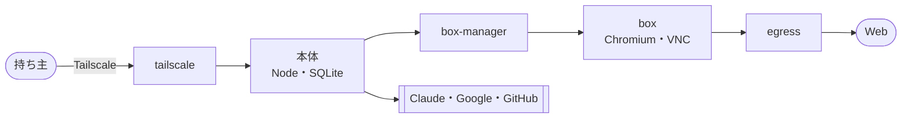

# 11. 技術仕様書
- プロジェクト：Agent-Team-Open ／ 版数：v0.5（2026-10-24） ／ インプット：[01](01_requirements.md)〜[10](10_diagrams.md)

> **3行で**
> 1. Linux ホスト1台の上で Docker Compose の6種類のコンテナ（Tailscale・本体・box-manager・Docker の中継・egress・VM）を動かし、持ち主1人が PC とスマホから使う。
> 2. 本体は Node＋SQLite に移した Cloudflare 版の中身（DB のアダプターと LLM の会話の形は作り直す）。新しいのは VM（Xvfb＋Chromium＋VNC）、パック（FR-085）と VM のターミナル（FR-086）、コンピューターユース、こわい操作の判定（`judgeBrowserAction`）と確認（`browser_checks`）、交代、歩みの記録。
> 3. 実装の順番・タスクはこの文書の範囲外。

## 🧭 判断してほしいこと
全体の一覧は [README](README.md#-判断してほしいこと全ドキュメントから集約)。この文書だけの論点はなし。

## 全体図

見てほしいところ：持ち主 → 本体 → VM の一方向。VM から本体へは戻れない。

## 要点
- 構成とその理由は [07](07_architecture.md) と ADR-041〜054
- こわい操作の判定は [04 FR-076](04_functional_spec.md#fr-076こわい操作の見分け)
- 新しい表は [08](08_database.md)、新しい API は [09](09_api.md)
- リスクは [§12](#12-リスクと対策)

---

## 詳細

### 1. 概要
- 目的：API・MCP のないページもエージェントに任せる。置き先を選ばない（[01](01_requirements.md)）
- スコープ：REQ-076〜095。Won't は [01 §7](01_requirements.md#7-スコープ外wont)
- 読む人：本体・VM・画面を作る開発者（持ち主）と、OSS として自分の機械に置く開発者
- ライセンス：AGPL-3.0（`AGPL-3.0-only`）。リポジトリ直下の `LICENSE`。依存ライブラリは AGPL と両立するものだけ（[ADR-055](adr/ADR-055-agpl-license.md)）

### 2. システム全体像
- コンテナ図は [07 レベル2](07_architecture.md#レベル2コンテナ図)、本体の部品は [07 レベル3](07_architecture.md#レベル3本体のコンポーネント図)
- 技術：Node 24・Hono・`better-sqlite3`・React＋Vite・Claude（computer use。`@anthropic-ai/sdk`、接続先に応じて `@anthropic-ai/bedrock-sdk`・`@anthropic-ai/vertex-sdk`）・Docker Compose・Tailscale・Xvfb・Chromium・x11vnc・noVNC

### 3. 機能概要
| 区分 | FR |
|---|---|
| 新しい | FR-073・074・075・076・077・078・079・082・083・084・085・086、FR-087（Should） |
| 引き継ぎ（差分あり） | FR-013・016・018・061・063・072・080・081。どこから移すかは [04 移植元](04_functional_spec.md#移植元) |
| 次の版 | FR-017（通知。D-179） |

### 4. データモデル
- [08 の ER図](08_database.md#全体図)。新しい表は TBL-032〜034・036〜039、変える表は TBL-031・035・040。`tasks.paused_ms`（確認待ち・交代待ちの時間の合計。D-174）を足す

### 5. インターフェース
- 画面向け：[09 エンドポイント一覧](09_api.md#エンドポイント一覧)。パックは API-114〜116
- 内部：box-manager の API-101〜109・113、VM のコマンド（API-117）とファイルの出し入れ（API-118）
- 外部：Claude Messages API（computer use ツール。接続先は Anthropic 直・Bedrock・Vertex：FR-087）、Google カレンダー API、GitHub API、Tailscale

### 6. 画面構成
- [06 の画面遷移図](06_ux_design.md#全体図)。新しい画面は SCR-022（VM の画面）・SCR-023（設定）・SCR-024（パック）

### 7. 非機能要件への対応方針
| NFR | 実現手段 |
|---|---|
| NFR-061・062 | VM の同時数は `workspace.max_boxes`（既定 1）。VM の資源の上限は box-manager が固定で付ける |
| NFR-063 | Xvfb を 1280×800 で起こす。computer use のツールへの画面の大きさの渡し方は、実装するときの既定モデルのツールの版の仕様に従う |
| NFR-064 | ホストのポートは出さない。入口は `tailscale serve` だけ |
| NFR-065 | Hono のミドルウェアで Origin と `X-Makase-Request` を確かめる |
| NFR-066 | VM ごとに `internal: true` のネットワーク、権限なし、egress でグローバルでないアドレスを断り、つなぐ先を固定する（ADR-045） |
| NFR-067・068 | VM のイメージを小さくし、起動のときに Chromium を先に立ち上げておく。スクショは PNG を縮めずに渡す |
| NFR-070・071 | タイマーで `VACUUM INTO`。歩みの記録で再開 |
| NFR-080 | box-agent がコマンドごとに 120 秒で打ち切り、出力を 64KB で切る。1 タスクの回数は `terminal.max_commands` で数える |
| NFR-076 | edge の上限（費用・回数・時間）を歩みごとに確かめる。LLM を呼ぶ前に見積もりの費用を予約し、並んだタスクで日次を超えない（TBL-038）。会話に残すスクショは直近 3 枚だけ（D-161） |

### 8. セキュリティ設計
| 観点 | 設計 |
|---|---|
| 認証 | Tailscale の身元＋`OWNER_LOGIN`（ADR-046） |
| 認可 | 持ち主1人。ロールなし |
| 入力の検証 | 今の Worker の検証（`edge/validate.ts`・`schema-check.ts`）を引き継ぎ、道具の結果の画像と computer use の操作の形を足す。VM の操作の引数は computer use の形と `open_url` だけ受ける。`open_url` は `http`・`https` だけ（D-158） |
| VM の隔離 | ADR-043・044・045、NFR-066。ターミナルの外向きは許可リスト（`terminal.allow_hosts`） |
| こわい操作 | ADR-047・052。Kernel の決定論の判定。先が分からない操作も確認。承認は中身のハッシュに結びつき、1回だけ実行。VM の中のコマンドは判定しない（ADR-054） |
| 汚染 | VM で読んだものは汚染（BR-06）。汚染のあとの API の書き込みは確認に回る |
| 外へのアドレス | `web_fetch` にも egress と同じ判定をかける。名前を引いて返った全アドレスがグローバルであること、つなぐ先の固定、リダイレクト先の再判定（D-164） |
| 秘密 | `.env`（600）。カレンダーの refresh token は暗号化して SQLite。ログでマスク |
| 個人の情報 | スクショは Claude（Anthropic の API）に送る。ホストに残すスクショは DB の外のファイルで、7日で消す（バックアップに入らない）。秘密の欄の領域は、保存するスクショと Claude に送るスクショの両方で塗り、サイトがマスクしないカード番号も画像に残さない（D-162）。プロフィールはホストの中だけ。秘密の欄に打った文字は、DB のどの表にも平文で残さない（Claude との会話には残る：Claude が出した文字のため） |

### 9. エラーハンドリング・ログ・監視
- API のエラーは共通の形（[09 共通仕様](09_api.md#共通仕様)）。RPC 越しの値の返し方（WriteResult・EdgeOutcome）は、同じプロセスになったので普通の例外に戻してよい
- VM の失敗は1回だけ起こし直し、だめなら `failed`（`sandbox_lost`）
- ログは JSON の行（NFR-079）。監視の仕組みは持たず、SCR-023 でホストの状態を見る

### 10. 環境・設定

環境変数（.env）

| 名前 | 必須 | 中身 |
|---|---|---|
| `LLM_PROVIDER` | いいえ | `anthropic`（既定）・`bedrock`・`vertex`（FR-087） |
| `ANTHROPIC_API_KEY` | `anthropic` のとき | Claude の API キー |
| `AWS_REGION` | `bedrock` のとき | Bedrock のリージョン。資格情報は AWS の標準の順（`AWS_ACCESS_KEY_ID`・`AWS_SECRET_ACCESS_KEY`、または `AWS_PROFILE`）で読む |
| `CLOUD_ML_REGION`・`ANTHROPIC_VERTEX_PROJECT_ID` | `vertex` のとき | Vertex のリージョン（`global` を推奨）と GCP のプロジェクト。資格は ADC（`GOOGLE_APPLICATION_CREDENTIALS` のサービスアカウントの鍵） |
| `CLAUDE_MODEL` | いいえ | 既定 `claude-opus-5-5`。`bedrock` では本体が `anthropic.` を前に付ける |
| `OWNER_LOGIN` | はい | 持ち主の Tailscale のログイン名 |
| `OWNER_LOGIN_REPLACE` | いいえ | `1` のとき、違っていても `workspace.owner_login` を `OWNER_LOGIN` で上書きして起動する（D-170） |
| `TS_AUTHKEY` | はい（初回） | Tailscale の認証キー |
| `TS_HOSTNAME` | いいえ | 既定 `makase` |
| `BOX_MANAGER_TOKEN` | はい | 本体 ↔ box-manager の共有トークン（手順書の作り方で作る） |
| `ENCRYPTION_KEY` | はい | refresh token の暗号化の鍵 |
| `GOOGLE_CLIENT_ID`・`GOOGLE_CLIENT_SECRET` | カレンダーを使うとき | OAuth のクライアント |
| `GITHUB_APP_ID`・`GITHUB_APP_PRIVATE_KEY` | GitHub を使うとき | GitHub App |
| `TZ` | いいえ | 既定 `Asia/Tokyo` |

- 環境の差：開発は本体だけ `pnpm dev` に差し替える上書きの Compose。本番はホストごとに1つ

### 11. テスト方針
| レベル | 観点 |
|---|---|
| 単体 | `judgeBrowserAction` の合図（申告・T-1〜T-6、キーと修飾キー・押すと離す）、中身のハッシュ、`pending → executing` の1回だけ、歩みの記録のなぞり、再開の表（FR-084）のすべての行、費用の予約と精算、`type` の改行の判定（D-157）、`open_url` のスキームと T-2（D-158）、スクショの枚数の制限（D-161）、秘密の欄の塗りつぶし（D-162）、`paused_ms` の計算（D-174）、`clickable` の T-3（D-173）、パックの JSON の検証、接続先ごとの道具の宣言の切り替えとモデル名の形（FR-087） |
| 結合 | 本体＋偽の box-manager で UC-046〜048 を通す。LLM は今の ScriptedLlm。二重の ○、交代と動いている呼び出しの重なり、承認のあとの画面の変化、実行の途中での再起動。UC-052（パックを入れる・外す）・UC-053（VM のターミナルで仕事をする） |
| VM | 実の VM に決まった試験ページ（パスワード欄・購入ボタン・同じ出どころとほかの出どころの iframe・canvas・JS のダイアログ・新しいタブ）を開かせ、確かめた先と実行した先が同じであることを確かめる |
| 隔離 | VM から、ほかの VM・本体・box-manager の口・ホストのブリッジのアドレス・192.168.x・100.64.x・`::1`・IPv4 を入れた IPv6 に届かないこと。名前を引き直す仕掛け（DNS rebinding）で抜けないこと。egress の断りが記録されること。`web_fetch` からも同じアドレスに届かないこと（D-164）。ターミナルから許可リスト外のホスト・LAN に届かないこと |
| 実機 | ラズパイ 5・WSL2・amd64 の Linux で NFR-067〜069 を測る |

### 12. リスクと対策
| # | リスク | 対策 |
|---|---|---|
| R-76 | ページの仕掛けでプロフィールを悪用される | 合図・確認するドメイン・汚染・操作の記録。エージェントを用途で分けてプロフィールを小さく。`div` のボタンも `clickable` で T-3 の対象（D-173） |
| R-77 | ラズパイで遅い | VM1つ・1280×800・実機で測る |
| R-78 | WSL2・ノートが止まる | 歩みの記録で再開。手順書に WSL を止めない設定 |
| R-79 | box-manager がホストを握られる | 決まった操作だけ・中身はコードで固定・口は ctl だけ。中継は API の種類を絞るだけと前提にする |
| R-80 | ヘッダーの偽装 | 本体の画面向けの口は front だけで待ち受け、front には Tailscale と本体だけ |
| R-81 | プロフィールがディスクから漏れる | ディスクの暗号化を勧める・消す操作 |
| R-82 | スクショの画像で費用がかさむ | 1タスク $3・操作 300 回・60分（ポリシーの `max_minutes` は 55：M-59）。会話に残すスクショは直近 3 枚（D-161） |
| R-83 | 自動の操作を禁じるサイトがある | 持ち主の責任。確認するドメインで止められる |
| R-84 | VM の中のコマンドが暴走する | 資源の上限・タイムアウト（NFR-080）・使い捨ての VM |
| R-85 | パックの更新で持ち主の手直しが消える | 更新の前に知らせを出す（SCR-024） |
| R-86 | レビューで評価された「4 人の工程の受け渡し」が、この設計では 1 人のエージェントの手順書 4 本（D-186）になり、工程の見え方が弱くなる | 歩みの記録を工程（設計・制作・点検・仕上げ）ごとに SCR-021 で見せる。手順書を工程ごとに分け、点検の結果を次の手順書に渡す。1 件 1 人（ADR-050）は変えない |
| R-87 | Bedrock・Vertex では費用の見積もりが実際の請求とずれる。Bedrock では Web 検索の道具がない | 設定画面と手順書に「見積もりは目安」と書く。Bedrock では `web_fetch` と VM のブラウザで調べる（FR-087） |

### 13. 未決事項・Claude判断で決めた項目
- 未決：なし（Q-114〜123 は 2026-10-24 に決着。[00 決定事項ログ](00_overview.md#決定事項ログ) の D-172〜D-182。OSS と事業の方針は D-183〜D-189）
- Claude判断：[00 決定事項ログ](00_overview.md#決定事項ログ) の D-136〜D-146・D-151〜D-171・D-187〜D-189

### 14. 参照ドキュメント
- [00](00_overview.md)〜[10](10_diagrams.md)、[adr/](adr/)
- 今の実装：`apps/worker/src`（移す元）、`apps/web/src`
- 置き換える前の設計：[docs/cloudflare-design.md](../cloudflare-design.md)
