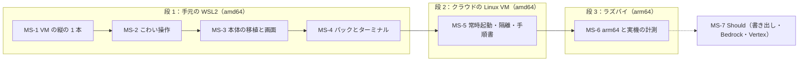

# 12. 実装の順番
- プロジェクト：Agent-Team-Open ／ 版数：v0.6（2026-10-24） ／ インプット：[11](11_tech_spec.md)、置き先の順番（D-190）

> **3行で**
> 1. 置き先は 3 段で進める：**段 1 手元の WSL2 の PC** → **段 2 クラウドの Linux VM（amd64）** → **段 3 ラズパイ（arm64）**。まず動かす場所を 1 つに絞り、不確かなところを早く測る。
> 2. 作る順番は「いちばん分からないものから」。VM と computer use の縦の 1 本（MS-1）→ こわい操作の判定と確認（MS-2）→ 本体の Node＋SQLite への移植と画面（MS-3）→ パックとターミナル（MS-4）。既存の Worker の移植はやり方が分かっているので後ろに置く。
> 3. この文書は「順番と、各段を終える条件」だけを決める。タスクの粒度の分解・チケット化・日程は決めない。

## 🧭 判断してほしいこと
全体の一覧は [README](README.md#-判断してほしいこと全ドキュメントから集約)。この文書だけの論点はなし。順番は D-190 で決めた。

## 全体図

見てほしいところ：段 1 の中で MS-1・MS-2 が先。ここで R-77（amd64 の分）・R-82 の実測と、computer use のツールの版（NFR-063）が決まる。

## 要点
- 段ごとの終わる条件は [§2](#2-段ごとの終わる条件)
- マイルストーンごとに作るもの・確かめることは [§3](#3-マイルストーン)
- 段 3 で詰まらないために段 1 から守ることは [§4](#4-arm64-で詰まらないための約束)
- 設計と食い違いが出たときの扱いは [§5](#5-作りながら設計を直すとき)

---

## 詳細

### 1. 置き先の 3 段（D-190）
| 段 | 置き先 | 何を確かめる段か | 設計での位置づけ |
|---|---|---|---|
| 1 | 持ち主の PC の WSL2（Ubuntu）。Docker は WSL の中の Docker Engine か Docker Desktop のどちらか 1 つに決めて手順書に書く | 機能が通ること。VM・computer use・こわい操作・再開の実物での検証 | [07 配置](07_architecture.md)「開発者の WSL2 で同じ Compose」。REQ-076 の WSL2 |
| 2 | クラウドの Linux VM（amd64、常時起動、Docker と Tailscale を入れる） | 長時間動かしたときの壊れ方。隔離の試験。手順書だけで置けること（NFR-081） | 設計に名前は出ていないが「ふつうの amd64 の Linux」そのもの。Won't の「Cloudflare への配置」「インターネットへの公開」とは別（入口は Tailscale のまま） |
| 3 | ラズパイ 4/5（Raspberry Pi OS 64bit） | arm64 で動くこと。NFR-067・068 の実測（R-77） | REQ-076、NFR-062・075、[07 配置](07_architecture.md) のラズパイの行 |

段 2 を段 3 の前に置く理由：段 1 の WSL2 はノートを閉じると止まる（R-78）。再開（FR-084）以外の長時間の試験は、常時起動の amd64 で先に済ませ、arm64 の問題と切り分けられるようにする。

### 2. 段ごとの終わる条件
| 段 | 終わる条件 |
|---|---|
| 1 | WSL2 の Compose 一式で、UC-042〜048・052・053 が通る。11 §11 の単体と結合（偽の box-manager・ScriptedLlm）が緑。標準パック「告知ページ制作」で告知ページ 1 件を GitHub の PR まで届けられる |
| 2 | 1 週間放置して、毎日のバックアップ（NFR-070）と掃除（NFR-073）が回り、タスクが途中で壊れていない。11 §11 の隔離の試験がすべて通る。開発者でない人 1 人が README だけで 30 分以内に起動できる（NFR-081 の予行） |
| 3 | arm64 のイメージで同じ Compose が起動する。NFR-067（VM の起動 p95 15 秒）・NFR-068（1 歩 p95 600ms）を実機で測り、外れたら画面を小さくする（R-77 の対策）。4GB の機械で VM 1 つが動く（NFR-062） |

### 3. マイルストーン
| MS | 段 | 作るもの | 確かめること | 対応する設計 |
|---|---|---|---|---|
| MS-1 VM の縦の 1 本 | 1 | VM のイメージ（Debian slim・Xvfb 1280×800・Chromium キオスク・x11vnc・noVNC・box-agent）。box-manager の最小（起こす・止める・API-103 の `dryRun` と `expect`・`read_page`）。本体なしで、CLI から computer use のループを回して試験ページを操作する | VM の起動時間と 1 歩の処理時間（amd64 の値）。スクショ 1 枚あたりの費用（R-82 の見積もりの根拠）。computer use のツールの版と画面の大きさの渡し方（NFR-063 の「実装時に決める」を回収）。1 タスクの入力トークンと費用を、`read_page` あり・なしで比べる（Q-124 を決める材料）。Chromium の `SingletonLock`（D-171） | FR-074・075、[07 VM の中身](07_architecture.md#vm-の中身)、API-101〜103、ADR-043・044 |
| MS-2 こわい操作 | 1 | `judgeBrowserAction`（合図 T-1〜T-6、`type` の改行、`open_url` のスキーム、`clickable` の T-3）。eval の土台（`eval:capture` と判定の eval。11 §11、D-199）。`browser_checks`（TBL-039）。承認を中身のハッシュに結びつけて `pending → executing` で 1 回だけ実行。画面が変わったら Claude に決め直させる（D-159） | 11 §11 の単体の観点がすべて緑。実の VM の試験ページ（パスワード欄・購入ボタン・同じ出どころとほかの出どころの iframe・canvas・JS のダイアログ・新しいタブ）で、確かめた先と実行した先が同じ | FR-076・077、ADR-047・052、API-110 |
| MS-3 本体の移植と画面 | 1 | Node 24＋Hono＋`better-sqlite3`。`WsDb` のアダプターの作り直し（08 方針）。drive・runner・edge・kernel・repo の移植。歩みの記録（TBL-038）と再開の表（FR-084）。費用の予約と精算（FR-013）。SSE（API-085）。Tailscale の身元（FR-073）。Compose 一式（tailscale・本体・box-manager・Docker の中継・egress・VM）と開発用の上書き。道具とスキルの渡し方（FR-088）と動いているタスクへのメッセージ（FR-089）。Q-124 が採用なら子の文脈（ADR-057）。画面は SCR-020・021・019・014・010 の差分と、新規の SCR-022・023 | 本体＋偽の box-manager で UC-046〜048 が通る。実行の途中で再起動して続く。動いているタスクへの返事が次の歩みに入る（FR-089）。SSE の合図を落としても画面が追いつく（D-196）。交代と動いている呼び出しの重なり（D-163）。front だけで待ち受けていること（R-80） | [07](07_architecture.md)、[08](08_database.md)、[09](09_api.md)、ADR-042・046・049・051、FR-078・079・083・084 |
| MS-4 パックとターミナル | 1 | パック（FR-085）と SCR-024。標準パック `announcement-page`（手順書 4 本：設計・制作・点検・仕上げ。D-186）。VM のターミナル（FR-086、API-117・118）とターミナルの許可リスト。GitHub の PR で届ける（FR-081、BR-10） | UC-052・053 が通る。告知ページ 1 件を PR まで届けられる。パックの通しの eval（依頼例 3 件）が回る。NFR-080 の打ち切りと出力の切り詰め | ADR-053・054、FR-085・086・081 |
| MS-5 常時起動・隔離・手順書 | 2 | README（置く手順。Docker Engine の入れ方・`.env`・`tailscale serve`）。egress の全アドレスの判定とつなぐ先の固定（ADR-045）。`web_fetch` の同じ判定（D-164）。タイマー（期限・掃除・`VACUUM INTO`）。ログの JSON 行 | 11 §11 の隔離の試験（ほかの VM・本体・box-manager・ホストのブリッジ・192.168.x・100.64.x・`::1`・IPv4 入りの IPv6・DNS rebinding）。1 週間の放置。NFR-081 の予行 | NFR-064〜066・070〜073・079・081、R-79・80 |
| MS-6 arm64 と実機の計測 | 3 | arm64 と amd64 の両方のイメージ（07「イメージは arm64・amd64 の両方」）。ラズパイの手順（Raspberry Pi OS 64bit・ディスクの暗号化の勧め：R-81） | NFR-062・067・068 の実測。外れたら画面を小さくする。4GB で本体＋VM 1 つ＋OS が入る | REQ-076、NFR-062・067・068・075、R-77・81 |
| MS-7 Should | 3 のあと（段 1〜2 で手が空けば前倒し可） | 書き出し・取り込み（FR-082）。LLM の接続先 Bedrock・Vertex（FR-087）。接続先ごとの道具の宣言の切り替え | UC-050。接続先ごとのモデル名の形と道具の線引き（11 §11） | FR-082・087、ADR-056、R-87 |

MS-1 と MS-2 を本体より先に置く理由：設計のレビュー（[changes/](changes/)）で指摘が最も集中したのがこの 2 つで、机の上で決められることは出し切った。残りは動かさないと分からない。本体の移植は Cloudflare 版の部品を並べ直す作業（[07 レベル3](07_architecture.md#レベル3本体のコンポーネント図)）で、やり方が分かっている。

### 4. arm64 で詰まらないための約束
段 1・2 は amd64 だけで進めてよいが、段 3 で作り直しにならないよう、次だけは最初から守る。
- ネイティブモジュールは arm64 のビルドがあるものだけ入れる（`better-sqlite3` は可。入れる前に prebuilt の有無を見る）
- VM のイメージの Chromium は Debian のパッケージ（`chromium`）から取る。Google Chrome の deb（amd64 だけ）や Playwright 同梱のブラウザに頼らない
- Dockerfile に `TARGETARCH` 依存のダウンロードを書くときは、arm64 の分岐も同時に書く
- Compose とイメージ名はアーキテクチャで分けない（同じ `compose.yaml` で両方動く）

### 5. 作りながら設計を直すとき
- 設計と違う作りにしたとき、設計が「実装時に決める」としていたことを決めたとき（NFR-063 など）は、[00 決定事項ログ](00_overview.md#決定事項ログ) に D-xxx を 1 行足す。ADR を覆すときは新しい ADR
- 動かして失敗したタスクは、直す前に eval のケースにする（`eval:capture`。11 §11、D-199）。直したら eval で確かめてから main に入れる
- MS-1・MS-6 の実測の値は [05](05_non_functional.md) の NFR-067・068 の横に「実測」として書き足す
- 画面や API を足したときは [06](06_ux_design.md)・[09](09_api.md) の表に行を足し、[00 トレーサビリティ表](00_overview.md#トレーサビリティ表) をつなぐ

### 6. この文書で決めないこと
- タスクの粒度の分解、チケット、日程、担当。これらは実装の進め方であって設計ではない
- 各 MS の中の作る順番（MS の中は自由）

### 7. 参照ドキュメント
- [11_tech_spec](11_tech_spec.md) §11 テスト方針、§12 リスク
- [07_architecture](07_architecture.md) 配置、[05_non_functional](05_non_functional.md) NFR-062・067・068・075・081
- [changes/](changes/) のレビュー記録（MS-1・2 を先に置く根拠）
