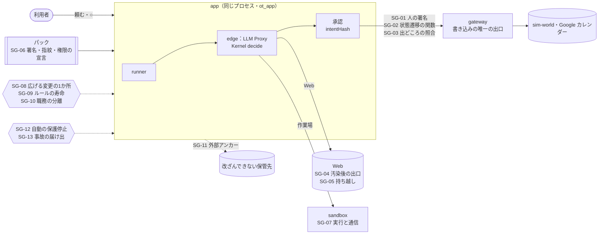

# 17 セキュリティとガバナンス（次の設計の提案）

2026-10-14 起草。**状態：提案**。ただし「提出後すぐ」の5つ（SG-03・04・05・07・09）は 2026-10-15 に実装した（[§実装の状況](#実装の状況2026-10-15)）。🧭 の論点が決まったら、決定を [decisions.md](decisions.md) に D-117 から記録し、要るものは ADR にする。
コードの根拠は 2026-10-14 の `ccr-2ba96bb5-w58oqd` で確かめた（パスと行はそのときのもの）。

## 3行で

> 1. いまの Makase は「LLM は提案するだけ、決めるのは決定論の Kernel」「任せる前にリハーサル」が効いている。ただし守りが **1つのプロセス（app）と1つの DB ロール（`ot_app`）を信じている** ので、app が破られると承認も合格証も作れてしまう。
> 2. 次の設計は **「信頼を、指紋と出どころに結ぶ」**：人の承認・パック・合格証・監査ログを、あとから誰でも検証できる形で残し、権限を広げる変更は1か所だけを通す。
> 3. 13 の守り（SG-01〜13）を6つの柱に分け、**提出後すぐ（小さく効く）→ フェーズ1 → フェーズ2** の順に入れる。BR-39（汚染で MCP の書き込みの判定を変えない）は変えず、汚染は **出口（Web・作業場・持ち越し）** で効かせる。

## 🧭 判断してほしいこと

| # | 種類 | 論点 | 選択肢 | おすすめ（理由） | 決まらないと止まるもの |
|---|---|---|---|---|---|
| 1 | 未決 | 人の承認を **パスキーで署名** させるか（SG-01） | A 署名しない（いま） / B 書き込みの危ないもの（payment・widen・初めての宛先）だけ署名 / C 書き込みすべて | **B**（app が破られても人の承認は偽れない。毎回の ○ を重くしない） | SG-01 のフェーズ2の実装 |
| 2 | 未決 | 汚染された後の Web の出口（SG-04）。D-30 は決定済みだが未実装 | A D-30 をそのまま実装 / B A に加えて、汚染後は `allow_domains:["*"]` を使えなくする | **A を先に、B はフェーズ1**（D-30 で R-11 の大半が塞がる。B は調べものの体験を狭める） | SG-04 |
| 3 | 未決 | パックの信頼モデル（SG-06） | A 運営のパックだけ（いま） / B 署名つきの第三者パックを許す / C 誰でも | **A のまま、B の器（マニフェスト・指紋・署名の検証）だけ先に作る**（第三者を入れた瞬間に注入とコード実行が同時に入る） | パックの公開・更新 |
| 4 | 🟡未決 | 「以後も許可」のルールに寿命を付けるか（SG-09） | A 付けない（いま） / B 既定 30 日・使われないと 14 日で失効 / C 毎回の見直しを必須 | **B**（ルールは widen。広げた権限が静かに残り続けるのを止める） | ルールの一覧画面（Q-57） |
| 5 | 未決 | 職務の分離（SG-10）。01 で four-eyes は Won't | A Won't のまま / B フェーズ1でポリシーの選択肢として入れる（既定は off） | **B**（複数人のワークスペースが来たときに必要。単一ユーザーでは off で影響なし） | FR-020（メンバー）の設計 |
| 6 | 未決 | 自動の保護停止（SG-12） | A 人が押す Kill Switch だけ（いま） / B 異常の兆し（deny の急増・費用の燃え方・tool_hash の変化）で、そのワークスペースだけ自動で止める | **B**（止めるのは締める方向。誤って止めても失うのは時間だけ） | NFR-012・013 の試験 |
| 7 | リスク | SG-02（DB の状態遷移を関数に閉じる）はマイグレーションが大きい | 一度に / 表ごとに段階的に | **段階的に**（`action_intents`・`approvals` から。業務の表は後） | — |

## 全体図

いまの守り（灰）と、この文書で足す守り（太字の SG）。矢印は書き込みが外へ出るまでの流れ。

## 要点

### 足す設計の原則

いまの5つ（[00_overview](00_overview.md) 50〜58行目）に、次の4つを足す。

1. **信頼は指紋と出どころに結ぶ。** 「DB に approved と書いてある」ではなく、「誰が・何を見て・どの規則で決めたか」を、あとから検証できる形で残す。
2. **権限を広げる変更は1か所だけを通る。** ポリシー・付与・ルール・パック・コネクタ、どの経路でも同じ関数を通り、同じ確認と同じ記録と合格証の失効が起きる。
3. **汚染は判定でなく出口で効かせる。** MCP の書き込みの判定は BR-39・D-58 のまま変えない。外へ出る口（Web の URL・作業場の通信・次のタスクへの持ち越し）を、汚染に応じて狭める。
4. **止める方向は自動、広げる方向は人。** 自動でしてよいのは締める・止める変更だけ。広げる・再開するのは owner の直接の操作。

### 6つの柱と 13 の守り

| 柱 | ID | 守り | いま（根拠） | 段階 |
|---|---|---|---|---|
| 判定の完全性 | SG-01 | 人の承認をパスキーで署名し、gateway が検証する | 承認は DB の行だけ。gateway は `status='approved'` と同じ行からの再計算しか見ない（`apps/gateway/src/execute.ts:92-110,155`） | フェーズ2 |
| | SG-02 | 承認・Intent の状態遷移を DB の関数に閉じ、`ot_app` から列の直接更新を外す | `ot_app` は全表に UPDATE を持つ（`packages/db/migrations/roles.sql:41`） | フェーズ1 |
| | SG-03 | gateway が承認の出どころ（承認の行・決めた人・Kernel の判定の行）を照合する | 照合なし（同上） | **提出後すぐ** |
| 情報の流れ | SG-04 | 汚染後の Web は、検索結果と取得済みページのリンクだけ（D-30 の実装） | D-30 は決定済みだが、`packages/edge/src/web.ts` に該当の処理がない | **提出後すぐ** |
| | SG-05 | 汚染を持ち越す：作業場の控え・パックのスキルに出どころの印 | 控えに汚染の列がない。`load_skill` は `<untrusted>` で包まない（`packages/edge/src/sandbox.ts:208-217`） | **提出後すぐ** |
| 供給網 | SG-06 | パックにマニフェスト（要る権限）・中身の指紋・署名。入れる操作を widen として確認する | `pack_installs` は id と版の数だけ（`0012_sandbox_skills_packs.sql:90-`）。入れても確認カードなし | フェーズ1（器は先に） |
| | SG-07 | 作業場：汚染後のコマンドと決まった形でないコマンドは自動にしない。通信はレジストリの読み取りだけ | `run_command` は `run_tests`（auto）に写る（`packages/kernel/src/operations.ts:31`、`policy.ts:118`）。網は 443 と DNS を開ける（`infra/sandbox-setup.sh:74-76`） | **提出後すぐ**（判定）／フェーズ1（網） |
| 権限の変更 | SG-08 | 広げる変更の1か所（`applyGovernedChange`）。BR-51 の確認カードを配線する | `requiresConfirmationCard`（`packages/kernel/src/taint.ts:238`）は使い先0件。ワークスペースのポリシーの上限検証は未設計（`policy.ts` の Q-30） | フェーズ1 |
| | SG-09 | 「以後も許可」のルールに寿命・最後に使った時刻・取り消し | 期限も取り消しの API もない。汚染されたタスクからも作れる（`packages/kernel/src/remember.ts:39`） | **提出後すぐ**（記録）／フェーズ1（寿命） |
| | SG-10 | 職務の分離：依頼者は自分の危ない書き込みを承認できない／N 人の承認 | 依頼者を承認者に入れ、1人で成立（`packages/kernel/src/approvals.ts:66`） | フェーズ1 |
| 証跡 | SG-11 | 監査ログの外部アンカーと定期の検証。入口・セッションも記録 | `checkpointMatched` は常に null（`apps/app/src/routes/audit.ts:111`）。入口は構造化ログだけ | フェーズ1 |
| 自動の守り | SG-12 | 異常の兆しで、そのワークスペースを自動で保護停止。費用は予約してから使う | Kill Switch は人が押すだけ。回数の上限はインスタンスのメモリ（`packages/edge/src/rate-limit.ts:2`） | フェーズ1 |
| | SG-13 | 合格証の期限と、本物のコネクタの事故の届け出 | 合格証は policy_hash を比べず期限もない（`packages/edge/src/inputs.ts:207-221`）。本物のコネクタの停止は `no_snapshot` で試験にならない（`apps/app/src/rehearsal/incident-hook.ts:126`） | フェーズ1 |

---

## 詳細

### SG-01 人の承認をパスキーで署名する（フェーズ2）

**脅威。** app（と `ot_app`）が乗っ取られると、承認の行を書くだけで任意の書き込みが gateway を通る。いまの「人の ○」は、app を信じる前提の上にある。

**設計。**
- 利用者はパスキー（WebAuthn）を1つ登録する。公開鍵は `user_passkeys`（gateway が読める表）に置く。
- 危ない書き込み（論点1の B：`payment`・widen・初めての宛先・ガード超過）は、○ のときにブラウザが **チャレンジ＝ intentHash ‖ approvalId ‖ 期限** に署名する。
- gateway は実行の前に、署名・公開鍵・チャレンジの一致を検証する。app はこの署名を作れない。
- 署名は `approvals.attestation` に保存し、監査ログにはそのハッシュを入れる。
- 5秒の取り消し（D-43）は今のまま。署名はその5秒が過ぎてから送る。

**変えないもの。** ADR-005 の intentHash の結びつけ。署名はその上に乗る。

**検証。** app のロールで `action_intents.status='approved'` に書き換えた Intent を gateway が拒否する E2E。

### SG-02 状態遷移を DB の関数に閉じる（フェーズ1）

**設計。**
- `action_intents.status`・`approvals.status / decided_by / decided_at` の UPDATE を `ot_app` から外す（REVOKE）。
- 遷移は `SECURITY DEFINER` の関数だけで行う：`ot_approve_intent(approval_id, decided_by, intent_hash)` など。
- 関数の中で、状態機械（pending → approved / rejected / expired）、承認者の集合、intentHash の一致、監査ログへの追記を、1つのトランザクションで強制する。
- `workspace_policies`・`agent_snapshots` は UPDATE 禁止がすでにある（`roles.sql:49`）。同じ考えを状態の列に広げる。

**効き目。** 「列を1つ書き換える」攻撃が、「関数の検査を通る正しい手順を踏む」攻撃に変わる。SG-01 がない間の主な壁になる。

### SG-03 gateway が承認の出どころを照合する（提出後すぐ）

**設計。** gateway の `prepare`（`apps/gateway/src/execute.ts:148-`）に、次の照合を足す。どれかが欠けたら `deny`（`approval_provenance`）にし、監査ログに残す。

1. Intent の判定が Kernel の行で裏付けられる：同じ Intent の `policy_decisions` に `decision` が allow（ルール）か approve がある。
2. approve なら、`approvals` の行が `approved` で、`decided_by` が `approver_ids` に入っていて、`decided_at` が期限の前。
3. allow（ルール）なら、その時点の合格証が有効だった記録がある（`matchedRule` と `certificate` の行）。

**なぜ先に。** 小さい変更で、SG-02・SG-01 が入るまでの「1列の書き換え」を塞ぐ。gateway は decide を呼ばない（`execute.ts:10`）という分担は変えない。照合するのは「判定が行われた証拠」だけ。

### SG-04 汚染後の Web の出口（提出後すぐ：D-30 の実装）

**設計。**
- タスクが汚染されたあとの `web_fetch` は、**そのタスクで見た URL の集合**（検索結果のリンク、取得済みページの中のリンク）にある URL だけを許す。LLM が組み立てた・書き換えた URL（クエリの変更を含む）は deny（`tainted_unknown_url`）。
- 見た URL の集合はタスクのカウンタと同じ所に持つ（`policy_decisions.counters` に `seen_urls` のハッシュ集合）。
- `web_search` の検索語は、汚染後は長さと文字種を絞る（読んだ本文の断片を検索語に載せて外へ出す経路を細くする）。
- 論点2の B（フェーズ1）：汚染後は `allow_domains:["*"]`（オーナーの既定：`packages/kernel/src/policy.ts:518`）を、汚染の前に見たドメインに縮める。

**BR-39 との関係。** 変えるのは Web の読み取りの出口だけ。MCP の書き込みの判定は変えない。

**検証。** リハーサルの悪い日に「読んだページの指示で、秘密を載せた URL を取りに行く」状況（障害カタログに F-18 として追加）を足し、O-03 と同じく止まることを確かめる。

### SG-05 汚染を持ち越す（提出後すぐ）

**設計。**
- `agent_workspace_snapshots` に `taint_sources`（出どころの配列）を足す。汚染されたタスクが残した控えを次のタスクが受け取ったら、受け取ったタスクも汚染する（`taintFromInputs` と同じ扱い）。
- パックのスキルは、運営の署名で検証できたもの（SG-06）だけを信頼された手順書として渡す。それ以外は `wrapUntrusted("skill:<名前>", 本文)` で包み、`load_skill` したタスクを `skill` を出どころとして汚染する。
- いまの運営の3パックは、署名の器ができるまで「信頼」のまま（挙動は変えない）。

### SG-06 パックの信頼モデル（器は先に、第三者はフェーズ1以降）

**設計。**
- **マニフェスト**：パックは、要る権限を宣言する。担当のテンプレート、Web のドメイン、作業場を使うか、スクリプトの一覧、コネクタ（いまは常になし）。
- **指紋**：中身（マニフェスト・スキル本文・スクリプトの tar）を正規形にして SHA-256。`pack_installs.digest` に保存し、監査ログ `pack.installed` に入れる。
- **署名**：発行者の Ed25519 鍵で指紋に署名する。信頼する鍵の一覧（いまは運営の鍵1つ）で検証する。合わなければ入れない。
- **入れる操作は widen**：宣言された権限を確認カードに出し、owner の ○ で入れる（BR-47）。入れた担当は合格証なしから始まる（ルールの auto は使えない）。
- **更新と外す**：更新で宣言が広がるなら、もう一度確認し、関係する合格証を切る。外すと担当を止め、スキルと控えを消す。
- **スクリプト**：パックのスクリプトは SG-07 の「決まったコマンド」に入らない限り approve。

### SG-07 作業場の実行と通信（判定は提出後すぐ、網はフェーズ1）

**前提（起草のあとに直した点）。** 最初の案は「決まった形のテストのコマンドだけ auto」だった。しかしテストの中身（`package.json` の scripts・`conftest.py`・テストのファイル）は担当が `edit_code` で書けるので、形の許可リストは **コード実行の境界にならない**。本当の境界は網（下の後半）。判定の層では、次の2つだけを効かせる。

**設計（判定）。**
- `run_command` の写し先を2つに分ける（純粋関数 `operationOfCommand(command, tainted)` を kernel に置き、edge が判定の入力を作るときに呼ぶ）。
  - **`run_tests`（auto のまま）**：汚染されていないタスクで、許可リスト（Q-25 の `commands.allow`）の argv の形に完全一致するもの。例：`npm test`・`npm run <名前>`・`pytest`・`node <作業場の中の相対パス>`。
  - **`run_shell`（新しい操作。auto にはできない）**：それ以外のすべて。
    - (a) **汚染されたあと**のコマンドは、形にかかわらず run_shell。プロンプト注入で書かされたコードを、人の確認なしに動かす経路を閉じる（原則3：汚染は出口で効かせる）。
    - (b) 許可リストにない形（パイプ・リダイレクト・`curl`・`npm publish` などシェルの構文や外へ出るコマンド）。
- 汚染は「どの操作として判定するか」を決めるときだけ使い、decide の手順の条件には入れない（decide の不変条件と BR-39 を保つ）。
- R-10（前方一致のすり抜け）は、許可リストを完全一致と引数の型で書くことで閉じる。

**設計（網。フェーズ1）。**
- 通信は「レジストリの読み取りだけ」にする：レジストリへは作業場から直接でなく、取得専用の中継（GET だけ、`npm publish`・PyPI へのアップロードを拒否）を通す。DNS は中継の名前だけ引けるようにする。

**検証。** 判定は kernel・edge の単体試験（すり抜けの例 `npm testx`・`npm test; curl x`・`node ../x.js` を含む）。網は、作業場から `curl https://example.com` と `npm publish` が失敗することを CI の試験にする（`infra/sandbox-setup.sh` の「要検証」を試験に置き換える）。

### SG-08 広げる変更の1か所（フェーズ1）

**設計。**
- `applyGovernedChange(change)` を1つだけ作り、権限に触るすべての経路をここに通す：ワークスペースのポリシー、担当の付与、ルール、パック、コネクタの有効化、プランナーが既存の担当に仕事を足すとき（いまは classify を通らない：`apps/app/src/asks/create.ts:228-245`）。
- 中でやること：`classify`（narrow / neutral / widen）→ widen なら owner の確認（BR-47）→ Ceiling を超える値の拒否（Q-30 を閉じる）→ 汚染されたタスク由来なら確認カード（BR-51：`requiresConfirmationCard` を配線）→ 記録（`agent_config_changes`）→ 監査ログ → 合格証の失効。
- dependency-cruiser に規則を足す：`agent_config_changes`・`workspace_policies` へ書く repo 関数は、`applyGovernedChange` のモジュールからしか import できない。
- 合格証の確認（`isCertificateValid`）は policy_hash を比べない（M-49）。その前提「広げる経路は必ず失効を呼ぶ」を、この1か所が保証する。

### SG-09 「以後も許可」のルールの寿命（記録は提出後すぐ、寿命はフェーズ1）

**設計。**
- ルールに `created_at`・`created_by`・`created_from_intent`・`created_while_tainted`・`last_matched_at`・`expires_at` を持たせる（いまは `rules.items[i]` の中身だけ）。
- 寿命（論点4の B）：既定 30 日。14 日使われなければ失効。失効は締める方向なので自動で行い、チェックの画面に「切れたルール」として知らせる。
- 汚染されたタスクの Intent から作るときは、確認カードに「外部の内容を読んだ後の書き込みです」と出し、寿命を短く（既定 7 日）する。BR-57（承認カードからだけ作れる）は変えない。
- 一覧と取り消し（Q-57）：担当ごとにルールを並べ、取り消しは narrow として即時に効かせる。

### SG-10 職務の分離（フェーズ1。既定は off）

**設計。** ワークスペースのポリシーに `separation_of_duties` を足す。

- `self_approval: "allow" | "deny_risky"`：`deny_risky` なら、依頼者は自分の依頼の危ない書き込み（payment・widen・ガード超過）を承認できない。ほかに承認者がいなければ handoff に回す。
- `quorum: { payment: 2, widen: 1 }`：操作ごとに必要な承認の人数。`approvals` に `required_count` と承認者ごとの記録（`approval_votes`）を足す。
- 01 の「four-eyes は Won't」を「Could（フェーズ1、ポリシーで選ぶ）」に改める必要がある（論点5）。

### SG-11 監査ログの外部アンカーと定期の検証（フェーズ1）

**設計。**
- 1時間ごとに、ワークスペースごとのチェーンの先頭（`audit_seq`・`audit_last_hash`）を、**消せない保管先**に書く（Cloud Storage の保持ロックつきバケット。KMS の署名はハッカソン版で Won't なので、署名はフェーズ1で足す）。
- 同じ時刻に検証（EP-44）を Cloud Scheduler から走らせ、`checkpointMatched` に結果を入れる。合わなければ、そのワークスペースを SG-12 で保護停止する。
- 記録する事象を足す：入口（成功・失敗）、セッションの開始と失効、Kill Switch の解除の試み、ロールの変更。
- 保持（NFR-035）：オーナーの監査ログを書き出す手段（FR-016）を作ってから、1年の保持を効かせる。

### SG-12 自動の保護停止と、費用の予約（フェーズ1）

**設計。**
- **保護停止**：ワークスペースの Kill Switch を、次の兆しで自動で入れる（原則4：止める方向は自動）。
  - 10 分の deny が閾値を超える、Breaker がタスクをまたいで続けて落ちる
  - 費用の燃え方が1日の上限の速さの数倍
  - 付与したツールの tool_hash が短い間に続けて変わる
  - 監査ログの検証が合わない（SG-11）
- 理由は `killswitch.engaged` の `reason` に機械の文で残し、解除は owner の直接の操作だけ（いまと同じ）。
- **費用の予約**：LLM を呼ぶ前に、見積もりの額を DB で予約し（行ロックで原子的に）、終わったら実額で確定する。いまの「読んでから決める」（`packages/edge/src/spend.ts`）の同時実行のすき間を閉じる。
- **回数の上限**：インスタンスのメモリ（`rate-limit.ts`）を DB か Memorystore に移し、インスタンスをまたいで数える。

### SG-13 合格証の期限と、事故の届け出（フェーズ1）

**設計。**
- **合格証の期限**：既定 30 日。切れたら自動で再リハーサル（いまの失効の後と同じ流れ。D-107 の費用の扱いもそのまま）。
- **合格証とポリシーの関係**：policy_hash は比べない（M-49）のまま。ただし発行時のポリシーを保存し、使うときに `classify(発行時, いま)` が narrow / neutral であることを確かめる。SG-08 が漏れたときの二重の網になる。
- **本物のコネクタの事故**：Google カレンダーなど sim のスナップショットがない書き込みで止まった・却下したものは、**実データを保存せず**（Q-113 のおすすめ B）、状況の型（操作・宛先の種類・汚染の出どころ・止めた理由）だけを「悪い日の種」として残し、次のリハーサルで Gemini が模擬の世界に作り直す。
- **あとからの届け出**：実行されてしまった書き込みを「これはまずかった」と届け出る操作を足す。届け出は `user_reject` と同じく試験になり、合格証を切る。

---

## 実装の状況（2026-10-15）

「提出後すぐ」の5つを実装した。それぞれ実装役とは別の監査役が、攻撃する側の目で調べ、見つかった穴を直してから取り込んだ。最後に、5つを合わせた形を別の監査役が通しで調べ、組み合わせで現れた中3件も直した（下の表の最後の3行）。

| ID | 実装したもの | 監査で見つかって直した穴 |
|---|---|---|
| SG-03 | gateway の `apps/gateway/src/provenance.ts`。ot_app が書ける列は「一致」だけを見て、「すでに起きたこと・起きた順番」は追記だけの `audit_logs` の seq で確かめる（`action.started`・`action.presend_retry` を新しく記録） | 実行済みの Intent を approved に戻すだけで再送できた（高）／却下の後に承認を偽れた／時刻の列の書き換えで失効した合格証を通せた／判定の行の書き換えで承認待ちを allow にできた |
| SG-04 | 見た URL の集合（新しい表 `task_web_urls`。URL は正規化して SHA-256 だけ残す）。依頼文・返事の URL と、引き継ぎ元の集合も入れる。汚染後の検索語の長さと形を絞る | MCP を読んだ後に、依頼文の URL まで取れなくなっていた |
| SG-05 | 控えに `taint_sources`、受け取ったタスクを `workspace_snapshot` で汚染。run_command を取った時点で `sandbox_run` で汚染。スキルは運営のカタログと（名前・説明・本文）のハッシュが一致するものだけ信頼し、ほかは包んで汚染し、システムプロンプトに出さない | 時間切れのコマンドの出力を汚染なしで読めた（高）／スキルの説明が照合されずにプロンプトに入った／0013 の移し替えが控えの鎖をたどらなかった |
| SG-07 | `operationOfCommand`（argv の完全一致の許可リスト）。汚染後とほかは `run_shell`。**既定は deny**（下の注） | 汚染されたタスクが書いたコードが、次の汚染なしのタスクで自動で動いた（高）／出どころの上限で外の内容が落ちた／拒否の連続で正しいコマンドまで止まった |
| SG-09 | ルールの `created_while_tainted`、判定の記録の `matched_rule_id`、承認カードの注意。記録は作るとき以外は変えられない | 締める案に記録の書き換えを混ぜると、汚染の印を消せた |
| 組み合わせ | 0013 の移し替えは担当の控えの鎖をたどる（前に外の内容で汚染されたタスクがあれば汚染、なければ作業場の出力だけか汚染なし）。オーナー・メンテナーが担当の作業場を最初に戻せる（`POST /api/v1/agents/{agentId}/workspace/reset`、監査ログ `agent.workspace.reset`、エージェントの画面のボタン） | 汚染の鎖で、担当がずっとテストを自動で動かせなくなり、戻す手段もなかった |
| 組み合わせ | 作業場がコマンドを受け取る時点で、受け取った控えの汚染を足してから判定し直す（run_shell になったら実行しない） | 判定と受け取りの間に、別のタスクが汚染された控えを残すと、そのコードが確認なしで動いた |
| 組み合わせ | 汚染されたタスクが書いた「次の手の提案」から URL を含むものを落とす。提案と同じ返事の URL は「見た URL」に入れない | 提案のボタンを押すと、担当が仕込んだ URL が利用者の文の URL として通った |

**入れるときの注意（運用）。**
- SG-03 を入れる前に、`executing` の Intent が残っていないことを確かめる。入れる前に送信中だった Intent が送る前の失敗で approved に戻ると、`action.presend_retry` だけが残って `action.started` がないので、`execution_replayed` で止まり続ける。
- マイグレーションの番号は欠番（0014・0017）を埋めずに、次の番号（0018〜）を使う。実行器は「流した番号の集合」で判定するので、欠番を後から埋めると、既存の DB と新しい DB で流れる順番が変わる。

**設計からの変更。**
- SG-04 の集合の置き場所は `policy_decisions.counters` ではなく新しい表にした（counters は decide の入力の写しで inputsHash に入るため）。
- SG-07 の `run_shell` は、既定を approve でなく **deny** にした。MCP の書き込み以外には、人の確認に回す経路（Intent と承認の行）がまだないため。承認の経路ができたら approve に戻し、承認カードにコマンドの全文を出す。

### 残る危険（監査で分かり、この段階では塞いでいないもの）

| 危険 | 理由 | 塞ぐ所 |
|---|---|---|
| ot_app は監査ログを追記できるので、「有る」ことの証拠（`decision.made`・`approval.decided`・`action.presend_retry`）は偽れる。止まるのは、順番が合わないときと既存の記録と食い違うときまで | 照合はすべて同じ DB の中 | SG-02（状態遷移の関数）・SG-01（パスキーの署名） |
| 汚染後も、見た URL の中から「どれを選ぶか」で少しずつ情報が漏れうる（オーナーの既定は `allow_domains:["*"]`、取得は1タスク 30 回） | D-30 の文言（見た URL だけ）の範囲内 | 論点2の B（汚染後は付与ドメインを縮める）、汚染後の取得回数の上限 |
| `npm install` の出力（postinstall の表示など）はパッケージの作者が書ける。作業場の出力だけの汚染は「外の内容」として数えないので、受け渡しで別の担当に持ち込める | 数えると「作る → 動かす → 直す」ができなくなる。出力は npm の設定で減らした | SG-07 の網（取得専用の中継） |
| 作業場の実行役は、プロセスグループの外へ逃げた子が stdout を握ると結果を返さない（汚染は取った時点で付くので、今は洗い流しにはならない） | 実行役の作り | `packages/sandbox/src/executor.ts` の TODO |
| 受け取りの時点で断ったコマンドは、判定の記録（`policy_decisions`）では allow のまま。断ったことは `sandbox_commands` の印と LLM への文にだけ残る | 判定は edge が先に済ませている | 断ったことを監査ログにも残す |
| パックの控え（`source='pack'`）は中身を照合せずに汚染なしとして信頼する。ot_app が pack の控えを INSERT すると最新の控えになる | スキルは (名前・説明・本文) のハッシュで照合するが、控えの tar は照合していない | SG-06（パックの指紋と署名）、SG-02 |
| カタログのスキルの本文を直すと、前の版で入れたスキルは一致しなくなり、読むと汚染される（その担当はテストを自動で動かせなくなる） | 信頼の表は今の版の本文だけを持つ | SG-06（版ごとの指紋）。それまでは作業場を最初に戻す操作で戻す |
| Web と作業場で「汚染」の数え方が違う。SG-04 は `tasks.tainted` をそのまま見るので、dev-coder は最初のコマンドの後から、Web を利用者の文の URL と検索結果に限られる | 安全側に倒した | 必要なら SG-04 も「外の内容」の数え方（SG-07 の `taintedByOutsideContent`）に揃える |
| リハーサルのタスクには利用者の文の URL が入らないので、汚染後の Web はリハーサルのほうが本番より厳しい | リハーサルの状況の文は LLM が作ることがある | 状況の文の出どころを分けてから入れる |

## 脅威と守りの対応

[11 §8](11_tech_spec.md) の脅威モデルの行のうち、この文書で強くなるもの。

| 脅威 | いまの守り | 足す守り |
|---|---|---|
| app の乗っ取りによる承認の偽造 | intentHash の再計算 | SG-03 → SG-02 → SG-01 |
| プロンプトインジェクションからの Web での持ち出し（R-11） | 汚染の追跡、`<untrusted>` | SG-04（D-30）、SG-05 |
| 汚染の洗い流し（作業場の控え・スキル経由） | なし | SG-05 |
| 第三者のパックによる注入とコード実行 | 運営のパックだけ | SG-06、SG-07 |
| 作業場からの持ち出し（`npm publish`・DNS） | 網の設定（要検証） | SG-07 |
| 自己設定による権限拡大（BR-47・51・57） | classify・BR-57 | SG-08（1か所）、SG-09（寿命） |
| 1人で危ない書き込みを通す | 承認者の集合 | SG-10 |
| 監査ログの改ざん（同じ DB の中） | ハッシュチェーン・追記だけ | SG-11 |
| 費用を使い切らせる攻撃・暴走 | 上限・Breaker | SG-12 |
| 古くなった合格証で auto が続く | 失効の4つの理由 | SG-13 |

## 段階と順番

| 段階 | 入れるもの | 大きさの目安 | 主な試験 |
|---|---|---|---|
| **提出後すぐ** | SG-03（出どころの照合）、SG-04（D-30）、SG-05（持ち越し）、SG-07 の判定（`run_shell`）、SG-09 の記録 | 各 1〜2 日。DB の列の追加まで | gateway の拒否の単体試験、F-18 の悪い日 |
| **フェーズ1** | SG-02、SG-06、SG-07 の網、SG-08、SG-09 の寿命、SG-10、SG-11、SG-12、SG-13 | マイグレーションと新しい表あり | 状態遷移の性質試験（NFR-056 と同じ形）、作業場の通信の CI 試験 |
| **フェーズ2** | SG-01（パスキーの署名） | gateway・画面・鍵の登録 | 書き換えた承認の E2E |

順番の考え方：まず **gateway の手前で塞ぐ**（SG-03）、次に **汚染の出口を閉じる**（SG-04・05）、それから **広げる経路を1つにまとめる**（SG-08）。SG-08 ができると、SG-06・09・10 はその上の規則として足せる。

## 既存の決定との関係

| 既存 | この提案での扱い |
|---|---|
| BR-39・D-58（汚染で MCP の書き込みの判定を変えない） | **変えない。** 汚染は出口（SG-04・05・07）とルールの作り方（SG-09）で効かせる |
| D-30（汚染後の web_fetch はリンクだけ） | **実装する**（SG-04）。いまは決定だけで未実装 |
| D-116（run_command を run_tests に） | **分ける**（SG-07）。汚染されていない決まった形は run_tests のまま、汚染後とほかは run_shell |
| M-49（合格証は policy_hash を比べない） | **変えない。** SG-08 で前提を保証し、SG-13 で二重の網を足す |
| 01 の Won't：four-eyes | **Could に改める提案**（SG-10。論点5） |
| 15 の Won't：KMS | ハッカソン版では Won't のまま。SG-11 の署名はフェーズ1 |
| BR-57（ルールは承認カードからだけ） | **変えない。** SG-09 は寿命と記録を足すだけ |
| Q-113（本番の実データを試験に保存するか） | おすすめ B（保存しない）に沿って SG-13 を設計した |

## 文書の食い違い（別件で直す）

この提案を書くために読んで見つけたもの。どれも設計の中身ではなく、記録の整合の問題。

- [00_overview](00_overview.md) の旧い決定ログ「D-01〜D-32」が、[decisions.md](decisions.md) の同じ番号と中身が違う。
- [11](11_tech_spec.md) の「Kill Switch はすべての画面のヘッダーに常に表示」が、D-112（ボタンを外した）と食い違う。
- D-116 の `run_command` → `run_tests` が、04 の操作カタログ（`catalogs.md`）に反映されていない。
- コードのコメントにある「MT §」「SO §」「KD §」の参照先の文書が `docs/` にない。
- ADR の一覧（README・07・00）が ADR-040 まで追いついていない。

## このドキュメントで決まったこと

- 「提出後すぐ」の5つ（SG-03・04・05・07・09）を実装する（2026-10-15、プロダクトオーナーの依頼）。SG-07 の既定は deny（§実装の状況）。
- 🧭 の論点1〜7はまだ決まっていない。決まったら、ここに D-117〜 へのリンクを並べる。
