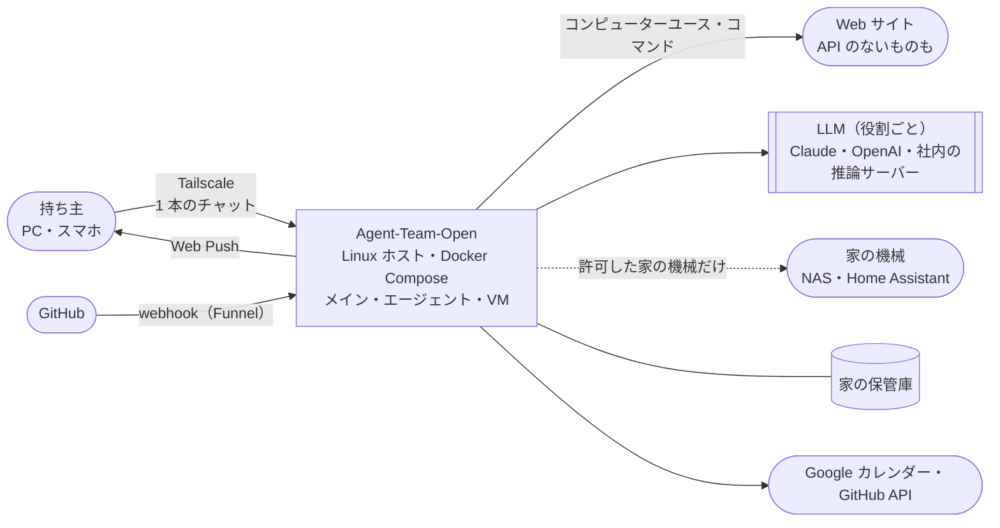

# Agent-Team-Open 設計書（v1.7：家に置く常駐エージェント）
> **3行で**：家に置く常駐エージェント。セットアップ済みのラズパイ（キット）か自分の Linux ホストに置き、スマホや PC から Tailscale 経由で 1 本のチャットでメインと話す。非エンジニアでも、写真の整理・レシートからの家計簿・Home Assistant 経由の家電の自動化を頼める ／ Muse・Dots・Grok Bot はクラウドから家の中に届かない。家の中だけで動かせ（A）、判定を確かめられ（B）、モデルを選べ（C）、仕分けは家の中の判断モデルで 0 円 ／ こわい操作（支払い・送信・削除・鍵や暖房・保管庫のファイルを消す）は Kernel の規則で人に聞く ／ やらない：Cloudflare・複数人（家族は次の版の候補）・Slack やメールの窓口・声・支払いの代行・顔の識別・ストア配布

v1.6 までの 3 行

> **3行で**：持ち主1人が自分の Linux ホストに置いた Agent-Team-Open に、PC やスマホから Tailscale 経由で 1 本のチャットで話しかける。相手は**メイン**のエージェントで、小さな質問に自分で答え、重い仕事は用途に合うエージェントへ裏で振り分ける。チャット・ルーチン・予約した確認・webhook・裏の作業の完了で起き、用がなければ眠り、記憶（2 層）を持ち、伝える価値があるときだけ話しかける（Web Push） ／ 最初の版：常駐の仕組み・振り分け・持ち主に 1 台の VM（ブラウザ＋ターミナル。残り続け、控えから戻せる）・こわい操作の確認（合図 → 人。オートレビューは入れたときだけ）・交代・パック・Web・カレンダー・GitHub ／ **大手（Dots・Grok Bot・Muse）との違い**：A 社内ネットワークの中で動き外に出ない（閉域モード・内部ホスト・外に出た通信の台帳）、B 判定が決定論で確かめられる（規則の版・試験・再実行・監査ログの鎖）、C 役割ごとにモデルを選べる（Claude・OpenAI・OpenAI 互換のローカル LLM） ／ やらない：Cloudflare・複数人（チームで 1 台は提案）・エージェントごとの会話・Slack やメールの窓口・声・支払いの代行・スキルが育つ仕組み・一般向けの配布

## 🧭 判断してほしいこと（全ドキュメントから集約）
**v1.7**：家に置く常駐エージェントにした（D-371〜384）。[変更レポート](changes/2026-10-26-home-agent.md)が今回の読む入口。判断してほしいのは 2 つ：①キットの推奨（ラズパイ 5 の 16GB）と最初に手渡す相手、②判断モデル（Von・Laya・Rizzo Flow）と 4B を実機で測る順番。
**v1.6**：差別化の軸 A・B・C を足した（D-340〜370）。[変更レポート](changes/2026-10-26-differentiation-abc.md)が今回の読む入口。判断してほしいのは 3 つ：①チームで 1 台の案（[ADR-075](adr/ADR-075-team-sharing-proposal.md)、提案）を次の版で採るか、②容量の目安（ラズパイ 5 の 16GB で 4〜5 人・32GB の PC で 10〜15 人）を実機で測る順番、③Claude判断の D-358〜370（子の指摘への答え）でよいか。
v1.5：P1全11件を反映。[変更レポート・受入対応表](changes/2026-10-25-p1-review-fixes.md)。秘密入力・画像遮断・副作用後停止は明示決定、他8件は承認済み改善案に沿う。新しい未決なし。[運用契約](11_operations.md)も参照。
未決はなし（v0.6 の Q-124 は D-201 で決着）。v1.0 で Claude が決めた項目（D-212〜D-240）と、Fable 5.1・Astra のレビューを受けて v1.1 で決めた項目（D-241〜D-274。D-248 だけはユーザー）、v1.1 の直しを読み直して v1.2 で決めた項目（D-275〜D-310。D-310 だけはユーザー）、v1.2 の判断を見直して v1.3 で決めた項目（D-311〜D-314）、過剰な設計を削った v1.4 の項目（D-315〜D-328。D-328 だけ Claude判断で、ほかはユーザーの決定）は[下の一覧](#claude判断で決めたこと見直してほしいもの)で見直してほしい。ほかはリスクだけ。

| # | 種類 | 論点 | おすすめ | 詳細 |
|---|---|---|---|---|
| R-76 | リスク | ページの仕掛けでログイン済みのブラウザを悪用される | 合図・汚染・記録・オートレビューに会話を渡さない | [04](04_functional_spec/README.md#-判断してほしいこと) |
| R-77・78 | リスク | ラズパイで遅い／WSL2・ノートが止まる | VM1つ・実機で測る／歩みの記録で再開 | [05](05_non_functional.md#-判断してほしいこと) |
| R-79・80 | リスク | box-manager がホストを握られる／ヘッダーの偽装 | 決まった操作だけ／口を分ける | [07](07_architecture.md#-判断してほしいこと) |
| R-81 | リスク | VM のホームと控えがディスクから漏れる | ディスクの暗号化を勧める | [08](08_database/README.md#-判断してほしいこと) |
| R-82〜86 | リスク | スクショの費用・自動操作の禁止・コマンドの暴走・パックの更新・工程の見え方 | 上限・振り分け先の文脈・控え・知らせ | [11](11_tech_spec.md#12-リスクと対策) |
| R-88・89 | リスク | 前のタスクの残りに仕掛け／Funnel の公開口への攻撃 | 汚染・控えから戻す／署名・上限・別の口 | [07](07_architecture.md#-判断してほしいこと) |
| R-90・91 | リスク | オートレビューがだまされる／記憶が汚染される | 必ず人の分類・会話を渡さない／材料を限る | [04](04_functional_spec/README.md#-判断してほしいこと) |
| R-92 | リスク | ルーチン・webhook で日次の上限を使い切る | 自動用の別上限 `daily_auto_usd`・15 分以上の間隔・20 本まで・webhook は 1 分 60 件で 429 | [05](05_non_functional.md#-判断してほしいこと) |
| R-93・94 | リスク | キャッシュの外れ／画面の番の待ち | 外れを記録して直す／3 分で返す | [11](11_tech_spec.md#12-リスクと対策) |
| R-97 | リスク | ホームを測るのが重い | 実機で測る | [11](11_tech_spec.md#12-リスクと対策) |
| R-98 | リスク | プロフィールの中の大きなデータでホームが 4GB を超えて VM が止まる | ブラウザのデータを消す・控えに戻す・作り直す | [11](11_tech_spec.md#12-リスクと対策) |
| R-107・110 | リスク | 家電の誤操作で物理的な害／保管庫のファイルを消す・壊す | 機器の区分は必ず人（BR-15）／ゴミ箱・前の版・控え | [ADR-081](adr/ADR-081-home-assistant.md)・[ADR-080](adr/ADR-080-home-vault.md) |
| R-108・109 | リスク | 写真・レシートがクラウドに出る／判断モデルの日本語の精度・ライセンスが分からない | 台帳・見積もり・ローカルへの切り替え／実機で確かめる・自信が低ければ LLM | [ADR-080](adr/ADR-080-home-vault.md)・[ADR-083](adr/ADR-083-classify-and-local-on-pi.md) |
| R-113 | リスク | ChatGPT の枠・利用規約が変わる・無料の枠が小さくて止まる | 自動のきっかけでは使わない・家の中のモデルと API キーの道を残す | [ADR-084](adr/ADR-084-sign-in-with-chatgpt.md) |
| R-111・112 | リスク | 非エンジニアのサポートが重い／ラズパイ 8GB でメモリが足りない | 少数から手渡し・手順書／排他・16GB 推奨 | [ADR-084](adr/ADR-084-sign-in-with-chatgpt.md) | Sign in with ChatGPT を接続先に足し、キットの初回設定で先に出す | 承認（v1.7 への追加） |
| [ADR-079](adr/ADR-079-home-agent-kit.md) |
| R-101・104 | リスク | ローカル LLM の画面操作が下手／接続先ごとの computer use の違いで確かめた先と実行した先がずれる | `generic` は試し扱い・同じ作動の形に直してから確かめる・接続先ごとに試験ページ | [ADR-078](adr/ADR-078-llm-by-role.md) |
| R-102・106 | リスク | 閉域で Web Push が使えない／内部ホストの許可が広すぎる | 画面の中の通知・社内の ntfy／既定は空・既定 `confirm`・固定の除外 | [ADR-079](adr/ADR-079-home-agent-kit.md) | 家に置く常駐エージェント。非エンジニアにはセットアップ済みのラズパイで届ける | 承認（v1.7） |
| [ADR-080](adr/ADR-080-home-vault.md) | 家の保管庫は本体の道具で扱い、消すのはゴミ箱へ | 承認（v1.7） |
| [ADR-081](adr/ADR-081-home-assistant.md) | 家電は Home Assistant 経由。こわい機器は規則で必ず人 | 承認（v1.7） |
| [ADR-082](adr/ADR-082-household-ledger.md) | レシートの写真から家の中だけの家計簿 | 承認（v1.7） |
| [ADR-083](adr/ADR-083-classify-and-local-on-pi.md) | 仕分けは判断モデル、ラズパイでは 4B 級まで | 承認（v1.7） |
| [ADR-074](adr/ADR-074-closed-network.md) |
| R-103 | リスク | ホストの root を取られると規則と監査の鎖を作り直される | 毎日の先頭のハッシュを外に控える・ディスクの暗号化 | [ADR-076](adr/ADR-076-verifiable-decisions.md) |
| R-100 | リスク | Chromium のサンドボックスが使えないホストで、ページの仕掛けにプロフィール（Cookie）まで読まれうる／要約に外から来た指示が残りうる | コンテナの隔離・状態欄に出す・要約の指示で枠の中を写さない・汚染のあとは確認・ブラウザのデータを消す | [11](11_tech_spec.md#12-リスクと対策) |

## 全体図（C4 レベル1：コンテキスト）

## 読む順番
| 目的 | 読むもの | 所要 |
|---|---|---|
| 全体像だけ知りたい | この README → [11](11_tech_spec.md) の要約層 | 5分 |
| 何が変わったか知りたい（v0.6 から） | [変更レポート](changes/2026-10-24-resident-v1.md) → [ADR-058〜070](adr/) | 10分 |
| 何を作るか判断したい | [01](01_requirements.md) → [02](02_user_stories.md) の要約層 | 10分 |
| 常駐の仕組みを知りたい | [04 resident](04_functional_spec/resident.md) → [10 シーケンス図](10_diagrams/sequences.md#uc-054055きっかけからターン振り分け報告まで) | 15分 |
| VM とこわい操作を知りたい | [04 vm](04_functional_spec/vm.md) → [10 シーケンス図](10_diagrams/sequences.md) | 15分 |
| OSS と事業の方針を知りたい | [../oss-and-business.md](../oss-and-business.md) → [ADR-055](adr/ADR-055-agpl-license.md) | 10分 |
| 実装する | [07](07_architecture.md) → [08](08_database/README.md) → [09](09_api/README.md) → [10](10_diagrams/README.md) → [実装手順書](../implementation/README.md)（設計書の外。8 ステップ） | — |

## 主要な設計判断（ADR）
| ADR | 決定 | 状態 |
|---|---|---|
| [ADR-058](adr/ADR-058-resident-agent.md) | 常駐型（ループと状態は本体・きっかけで起き・眠る） | 承認（v1.0） |
| [ADR-059](adr/ADR-059-main-agent-delegates.md) | 1 本のチャットでメインと話し、メインが裏で振り分ける | 承認（v1.0） |
| [ADR-060](adr/ADR-060-one-persistent-vm.md) | VM は持ち主に 1 台・残り続け・画面は順番 | 一部置き換え済み（→ 068） |
| [ADR-061](adr/ADR-061-vm-no-judge-restore.md) | VM の中は判定せず、資格情報を置かず、控えで戻す | 承認（v1.0） |
| [ADR-062](adr/ADR-062-send-to-owner.md) | 持ち主に話す道具は `send_to_owner` 1 つ | 承認（v1.0） |
| [ADR-063](adr/ADR-063-memory-four-layers.md) | 記憶は 4 層。プロフィールとログは共有 | 置き換え済み（→ 070） |
| [ADR-064](adr/ADR-064-auto-review.md) | 合図の後にオートレビュー。外に出す・支払う・消す・秘密は人 | 一部置き換え済み（既定で切る → 077） |
| [ADR-065](adr/ADR-065-webhook-funnel.md) | webhook は Funnel で受け口だけ公開 | 承認（v1.0） |
| [ADR-066](adr/ADR-066-prompt-cache-layout.md) | 文脈はキャッシュの先頭を変えない形に組む | 承認（v1.0） |
| [ADR-067](adr/ADR-067-web-push-first.md) | Web Push を最初の版に | 承認（v1.0） |
| [ADR-068](adr/ADR-068-browser-shell-split.md) | ブラウザとターミナルを別のコンテナにする（VM は 2 コンテナの組） | 承認（v1.4） |
| [ADR-069](adr/ADR-069-daily-auto-budget.md) | 費用は自動のきっかけ用の別上限で守る | 承認（v1.4） |
| [ADR-070](adr/ADR-070-memory-two-layers.md) | 記憶は 2 層（プロフィールと検索） | 承認（v1.4） |
| [ADR-074](adr/ADR-074-closed-network.md) | 閉域モード・内部ホストの許可・外に出た通信の台帳 | 承認（v1.6） |
| [ADR-075](adr/ADR-075-team-sharing-proposal.md) | チームで 1 台の案と容量の目安 | 不採用（v1.7） |
| [ADR-076](adr/ADR-076-verifiable-decisions.md) | 判定の規則の版・試験・再実行・監査ログの鎖 | 承認（v1.6） |
| [ADR-077](adr/ADR-077-auto-review-off-by-default.md) | オートレビューは既定で切る | 承認（v1.6） |
| [ADR-078](adr/ADR-078-llm-by-role.md) | LLM を役割ごとに Claude・OpenAI・OpenAI 互換から選ぶ | 承認（v1.6） |
| [ADR-041](adr/ADR-041-linux-host.md)〜[ADR-047](adr/ADR-047-risky-action-check.md)・[ADR-049](adr/ADR-049-docker-compose.md)・[ADR-051](adr/ADR-051-gateway-in-core.md)〜[ADR-053](adr/ADR-053-pack-by-purpose.md)・[ADR-055](adr/ADR-055-agpl-license.md) | 置き先・本体・VM の作り・egress・Tailscale・こわい操作・Compose・gateway・確認の表・パック・ライセンス | 承認（v0.6 から。043・045 は v1.4 で 068 の追記あり） |
| [ADR-056](adr/ADR-056-llm-provider.md) | LLM の接続先に Bedrock・Vertex を足す | 取り下げ（v1.4） |
| [ADR-048](adr/ADR-048-profile-per-agent.md)・[ADR-050](adr/ADR-050-one-agent-per-ask.md)・[ADR-057](adr/ADR-057-screen-work-in-child-context.md) | プロフィールはエージェントごと・1 件 1 人・子の文脈 | 置き換え済み（→ 060・059） |
| [ADR-054](adr/ADR-054-terminal-in-vm.md) | ターミナルは VM の中 | 一部置き換え済み（→ 061・068） |

## Claude判断で決めたこと（見直してほしいもの）

D-371〜D-390（v1.7。家に置く常駐エージェント、20 件）

| ID | 決めたこと |
|---|---|
| D-371・372 | 対象を家の人（非エンジニアを含む）に。届け方はセットアップ済みのラズパイ（推奨 16GB）。初回は QR・パスキー・API キー（ユーザー） |
| D-373・374・376 | 家の保管庫は本体の道具で扱い、消すのはゴミ箱へ・空にするのは人。写真の並べ替えは LLM なし、中身の分類は見積もってから。チャットに画像を添付 |
| D-375 | レシートの写真から家の中だけの家計簿（ユーザー） |
| D-377・378 | Home Assistant 経由（ユーザー）。鍵・暖房・ガスなどは規則で必ず人 |
| D-379・380 | 仕分けは判断モデル（Kernel には使わない）。ラズパイでは 4B 級まで（ユーザー）。D-357 を置き換え |
| D-381 | A・B・C を家向けの言葉に |
| D-382〜384 | 一般向けの見直し（キットで届ける）・チームで 1 台は不採用・API キーは最初は自分で（ユーザー。D-387 で更新） |
| D-385〜390 | Sign in with ChatGPT（接続先 `openai_chatgpt`）。デバイスコードでサインイン・初回設定で先に出す・上限に達したら止めて知らせる・自動のきっかけでは既定で使わない・画像と computer use は確かめてから（ユーザー：使う） |

D-340〜D-370（v1.6。差別化 A・B・C、31 件）

| ID | 決めたこと |
|---|---|
| D-340〜342 | 閉域モード `network.mode`。入口は Tailscale・Headscale・社内 LAN。`closed` では Funnel・Web Push を使わず、画面の中の通知と社内の ntfy（ユーザー：軸 A） |
| D-343 | 内部ホストの許可（既定は空・既定 `confirm`・固定の除外） |
| D-344 | 外に出た通信の台帳（中身は残さない。行 90 日） |
| D-345・346 | チームで 1 台は提案（v1.7 で不採用：D-383）。容量の目安の表（NFR-092） |
| D-347〜350 | 規則の版と SHA-256・試験が通らないと保存できない・試し当て・再実行で同じ結果（Kernel は純粋な関数）・監査ログのハッシュの鎖と毎日の先頭（ユーザー：軸 B） |
| D-351 | オートレビューは既定で切る（ユーザー） |
| D-352〜355 | LLM は役割ごとに `anthropic`・`openai`・`openai_compatible`（ユーザー：軸 C）。能力と単価の宣言・computer use を同じ作動の形に・キャッシュの組み方は同じ |
| D-356・357 | 完全な閉域は外向き 0。ローカル LLM はラズパイに置かない |
| D-358 | 社内 LAN の直結ではパスキーでログイン（Tailscale・Headscale は今のまま） |
| D-359・360 | egress の記録は box-manager が毎分取りに行く。本体の外向きは窓口 `net`。台帳に書けないとき `closed` は断る |
| D-361〜364 | キーの置き場・役割の既定・要約のしきい値は文脈の長さに合わせる・context editing は Anthropic だけ |
| D-365〜367 | 内部ホストの `confirm`／`auto` はブラウザだけ・`closed` のターミナルの許可・社内 Git のコネクタは次の版 |
| D-368〜370 | `egress_daily` は付属の表・規則の版の本文の範囲・REQ-103 は Should |

D-315〜D-328（v1.4。過剰な設計を削る、14 件）

| ID | 決めたこと |
|---|---|
| D-315 | Bedrock・Vertex の接続先を初版から外す。LLM は Anthropic の API 直だけ（ユーザー。v1.6：D-352 で置き換え） |
| D-316 | 書き出しと取り込みを外す。引っ越しは 2 つのボリュームのコピーを手順書に書く（ユーザー） |
| D-317 | 先温めを外す。API-121 は「画面が見えているか」の心拍だけ（ユーザー） |
| D-318 | webhook は 1 受け口あたり 1 分 60 件を超えたら 429。まとめを外す（ユーザー） |
| D-319 | 掃除のための起動を外す。4GB を超えたら、ブラウザのデータを消す・控えに戻す・作り直すの 3 つ（ユーザー） |
| D-320 | `send_to_owner` の `reaction` を外す（ユーザー） |
| D-321 | Chromium の HTTP キャッシュの置き場を設計書から外す（ユーザー） |
| D-322 | 費用は `daily_usd`（10）と自動用の `daily_auto_usd`（7）の 2 つの上限。区分はターン開始時に決めて変えない（ユーザー） |
| D-323 | 要約は 1 経路（ターンを始める前に履歴が 6 万トークン超なら）。要約の汚染の印は持たない（ユーザー） |
| D-324 | ターン途中の差し込みをやめる。タスクへの言い直しは残す（ユーザー） |
| D-325 | 記憶は 2 層（プロフィールと検索）。ログ・メモ・`write_note` を消す（ユーザー） |
| D-326 | ブラウザとターミナルを別のコンテナ（`box-browser`・`box-shell`）にする。ホスト前提の検査をやめる（ユーザー） |
| D-327 | 本体の再起動では必ず新しい VM の世代で起こし直す（ユーザー） |
| D-328 | Web Push の送り待ち表は残す（Claude判断） |

D-212〜D-240（29 件）

| ID | 決めたこと |
|---|---|
| D-212 | 持ち主に話すのは `send_to_owner` だけ。メインの地の文は出さない |
| D-213 | 先頭は次の要約まで変えない。要約は 10 万トークン超（v1.1 で 6 万：D-270）・ターン後 10 分。`cache_control` 1 時間 |
| D-214・215 | VM は 10 分で眠る。控えは毎日 1 回・3 世代 |
| D-216 | Chrome は利用者 `browser`、コマンドは利用者 `agent` |
| D-217 | 裏のタスク 3 つ・画面の番 1 つ（3 分で返す）・ターミナル 2 本 |
| D-218・219 | 振り分けは 1 段だけ。報告は 2,000 字＋成果物の場所 |
| D-220 | 持ち主のチャットは動いているターンの次の歩みへ。3 秒以内のメッセージはまとめる |
| D-221・222 | ルーチンは持ち主の ○ で作る・15 分以上・20 本。予約はメインだけ・5 分〜30 日・1 日 20 件 |
| D-223 | webhook は 256KB・配達 ID で重複を捨てる。GitHub と汎用の HMAC（件数は v1.2 で 1 分 60 件を超えた分はまとめ、1 時間 600 件で 429：D-284） |
| D-224・225 | 記憶はプロフィール 100 個・4,000 字、ログ 30 件、メモ 60 分。材料は持ち主のメッセージだけ（v1.1：D-246）。検索は FTS5 |
| D-226〜228 | オートレビューは `claude-sonnet-5-5`・20 秒・会話を渡さない。言葉を必ず人とオートレビューに分ける。申告に種類を足す |
| D-229 | Web Push は `send_to_owner`・人の確認・交代の頼みだけ。前に出ているときは送らない |
| D-230・231 | メインの 1 ターンは $1・40 歩・10 分。日次 $10 の残り $1 は持ち主のチャットに取っておく。待機中は LLM を呼ばない |
| D-232 | webhook と汚染したタスクの報告で起きたターンは汚染する |
| D-233・234 | 入力中にキャッシュを温める（Should）。`send_to_owner` でファイルを渡せる（20MB） |
| D-235・236 | 依頼をやめ、チャット・ターン・タスクにする。メインは VM を使わない |
| D-237・238 | 交代の放置では VM を止めない。道具はターンの途中で足し外ししない |
| D-239・240 | 書き出しにプロフィールとルーチンを入れる。最低のディスクは 20GB（v1.2 で 32GB：D-300） |

D-241〜D-274（v1.1。レビューの反映、33 件）

| ID | 決めたこと |
|---|---|
| D-241 | Funnel は 8443 番だけ。443 番（画面と API）は公開しない |
| D-242 | `確定`・`Submit`・POST の送信・決済の iframe・`textarea` の Enter は人に回す |
| D-243・244 | 成果物の HTML はスクリプトを動かさずに配る。報告の時点で `~/work/<taskId>` の下だけを写す |
| D-245・246 | 汚染はタスク・言い直し・予約・ルーチンに引き継ぐ。プロフィールの材料は持ち主のメッセージだけ |
| D-247 | `attached` を足し、ターンを閉じる瞬間のチャットを失わない |
| D-249・250 | 道具の冪等（`tool_call_id`）。取り消したタスクの確認は期限切れ |
| D-251・252・253 | VM の操作は 1 つずつ。CDP はパイプだけ。ホストへの入りを断る |
| D-254 | `tasks` は今の `schema.ts` の状態の値に合わせる |
| D-255・256 | computer use は 1 歩＝操作の列。履歴は追記だけ（古いスクショはサーバー側で消す・要約のあとは履歴を持ち越さない） |
| D-257・258 | `blocked` はタスクの終わり。画面の番は通常の実行中だけ 3 分を数え、番号を分ける |
| D-259・260・261 | 費用の区分（`chat`・`auto`）。件数で捨てるのは webhook だけ。重複の鍵と署名の範囲 |
| D-262〜264 | 履歴は要約まで残す。履歴にも 1 時間のキャッシュ。呼び出しの前に大きさを見る |
| D-265〜268 | ホームは 8GB（v1.2 で 4GB：D-300）。VM の中の 127.0.0.1:8000〜8099 で点検。Web Push の送り待ち。戻すときはタスクを止める |
| D-269〜274 | 見えているかは心拍で。要約は 6 万トークン。本体だけの再起動では VM を引き継ぐ。`apt` は使えない。構造化出力。小さな食い違いの統一 |

D-275〜D-310（v1.2。v1.1 の直しの読み直し、36 件）

| ID | 決めたこと |
|---|---|
| D-275 | メインの書き込みは `policy_decisions` にも `turn_id`。承認の結果と `approval_done` を同じトランザクションで |
| D-276・277 | 履歴の判断。attachedはD-324で廃止。失敗の再受付はD-337で副作用未発生時だけに限定。input原本保存は維持 |
| D-278・310 | 要約も汚染の印を引き継ぐ。印は持ち主が記憶の画面で要約を読んで消す（D-310 はユーザー） |
| D-279・282・289 | 持ち主のチャットが入ったターンは `chat` に上げる。日次の残りが足りなければ 0 時まで始めない。費用はいつも区分の残りで比べる |
| D-280・281 | 歩みの名前は `memory:<n>`・`summary:<n>`。タイマーの要約はターンの外。要約の途中でターンが始まったら要約を捨てる |
| D-283 | 今の `schema.ts` の制約（NOT NULL・CHECK）を変えずに満たす |
| D-284 | webhook は `hook_id`・`body_sha256` を持ち、上限を超えた分はまとめに足す |
| D-285 | メモにも汚染の印。メインのメモは検索でだけ読む |
| D-286 | 本体の知らせは user メッセージの中の枠に入れる（`role: "system"` は使えない） |
| D-287・288 | Intent にも `tool_call_id`。Web Push の送り待ちは端末ごとの行 |
| D-290〜293 | VM の中の隔離を作れる形に：X の抽象ソケットを閉じる・起動役だけが利用者を切り替える・egress は資格のない通信を断る・ホストへの入りを断る規則は手順書で |
| D-294・295・302 | VM の操作の失敗・再起動の道を決める（入れ替えは非同期・壊れたら戻す・作り直すだけ・同じ世代なら使い続ける） |
| D-296・299 | コマンドは交代と関係なく動く。screen_epoch は番を取るときだけ増やし、本体が比べる |
| D-297・298 | Ctrl+Enter の送信と canvas の操作は人に回す。inspect に判定の材料を足す |
| D-300・301・309 | ホームは 4GB・最低のディスクは 32GB・控えは専用のボリューム。容量を超えたら掃除のためだけに起こす |
| D-303〜306 | 点検の経路・Chromium のサンドボックス・Funnel の転送・成果物の tar を、外の製品の挙動に合わせて安全側に（実装で確かめる） |
| D-307・308 | 直前の確かめをすべての実行の前に。戻すときに止めるタスクの範囲 |

D-311〜D-314（v1.3。v1.2 の判断の見直し、4 件）

| ID | 決めたこと |
|---|---|
| D-311 | 汚染の印を消すのは持ち主の記憶の画面のまま。確認のカードとチャットに、印が要約から来ていることと記憶の画面へのリンクを出す |
| D-312 | 日次の上限を設定で変えたら、待っているターンをすぐ評価し直す。待ちの知らせに上げ方と設定へのリンクを入れる |
| D-313 | Chromium の HTTP キャッシュはホームの外の `/tmp`（512MB まで）。ホームの 4GB にも控えにも入らない |
| D-314 | WSL2 は WSL の中の Docker Engine を正とする。Docker が別の VM にある置き先は `isolated` モードが使えるときだけ VM を起こす |

## 最近の変更
- [2026-10-26 家に置く常駐エージェント（v1.7）](changes/2026-10-26-home-agent.md)：Fable 5.1 の助言を受け、Muse・Dots が届かない家の中を便利さの軸にした。非エンジニアにはセットアップ済みのラズパイで届け、家の保管庫・家計簿・Home Assistant 経由の家電・チャットの画像の添付・家の中の判断モデル・Sign in with ChatGPT（API キーなしで始められる）を足した。チームで 1 台は不採用（D-371〜D-390）
- [2026-10-26 差別化 A・B・C（v1.6）](changes/2026-10-26-differentiation-abc.md)：大手の常駐エージェント（Dots・Grok Bot・Muse）と同じ土俵を避け、閉域・社内システム・外に出た通信の台帳（A）、判定の規則の版・試験・再実行・監査ログの鎖とオートレビューを既定で切る（B）、役割ごとのモデル選択（C）を足した。チームで 1 台は提案、容量の目安を表にした（D-340〜D-370）
- [2026-10-24 過剰な設計を削る（v1.4）](changes/2026-10-24-review-v1.4.md)：接続先は Anthropic 直だけ、書き出し／取り込み・先温め・webhook のまとめ・掃除のための起動・リアクション・ターン途中の差し込み・記憶のログとメモを削り、費用は自動用の別上限、要約は 1 経路、VM はブラウザとターミナルを別のコンテナにした（D-315〜D-328）
- [2026-10-24 v1.1 の直しを読み直す（v1.2）](changes/2026-10-24-review-v1.2.md)：v1.1 の直しが一部の文書にしか入っていなかった箇所と、VM の中の隔離が書いたとおりには作れなかった箇所（X の抽象ソケット・利用者の切り替え・egress の資格・ホストの規則）を直した。今の `schema.ts` の制約に合わせ、汚染の印の消し方を決めた（D-275〜D-310）
- [2026-10-24 v1.2 の判断を見直す（v1.3）](changes/2026-10-24-review-v1.3.md)：汚染の印を消す画面への導線、日次の上限を上げたときの再開、Chromium のキャッシュの置き場、WSL2 と Docker Desktop の扱いを決めた（D-311〜D-314）
- [2026-10-24 Fable 5.1 と Astra のレビューを反映（v1.1）](changes/2026-10-24-review-v1.1.md)：Funnel のポート・人に回す操作・成果物の HTML・汚染の引き継ぎ・ターンの境目・メインの書き込みの承認・冪等・VM の操作の直列・CDP の隔離・追記だけの履歴など（D-241〜D-274）
- [2026-10-24 常駐型として作り直す（v1.0）](changes/2026-10-24-resident-v1.md)：参考資料（GrokBot の講義の解説動画）をもとに、メインの振り分け・きっかけと眠り・記憶・`send_to_owner`・オートレビュー・VM 1 台・Web Push・webhook・キャッシュを入れた。04・08・09・10 はディレクトリに分けた。12_implementation_order.md は削除
- [2026-10-24 GrokBot の参考資料から取り入れる（v0.6）](changes/2026-10-24-grokbot-reference.md)：道具は安い順・`read_page`・スキルの本文は要るときだけ・SSE は合図
- それより前（v0.1〜v0.5）は [changes/](changes/) にある。2026-10-23 の v0.1 は [docs/cloudflare-design.md](../cloudflare-design.md) を置き換えた（ADR-041）
