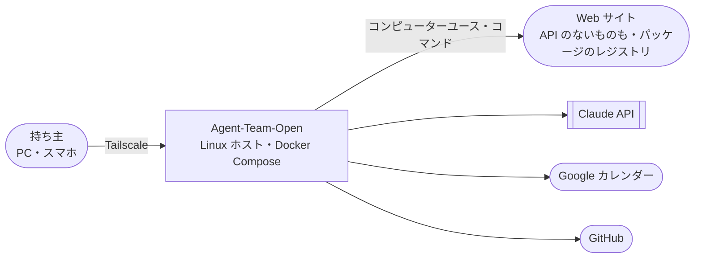

# Agent-Team-Open 設計書
> **3行で**：持ち主1人が、自分の Linux ホスト（ラズパイ・WSL2 の Win ノート・Mac の Linux VM など）に置いた Agent-Team-Open に、PC やスマホから Tailscale 経由で仕事を任せる。エージェントは VM（実体は Docker コンテナ）のブラウザをコンピューターユースで自由に操作し、ターミナルでコードを動かし、こわい操作だけ人が確認する。OSS（AGPL-3.0）で、LLM は Claude だけ（接続先は Anthropic 直・Bedrock・Vertex） ／ 最初の版：チャット・エージェントの作成と削除・用途ごとのパック（標準は「告知ページ制作」）・VM（ブラウザ＋ターミナル）・確認・交代（PC が先）・Web・カレンダー・GitHub ／ やらない：Cloudflare・複数人・同期・編成・育つ仕組み・Web Push 通知・非エンジニアの一般向けの配布

## 🧭 判断してほしいこと（全ドキュメントから集約）
未決は Q-124 の 1 つ（MS-1 の実測のあとに決めればよく、今は何も止めない）。Q-114〜Q-123 は 2026-10-24 にすべて決着し、[00 の決定事項ログ](00_overview.md#決定事項ログ) の D-172〜D-182 に書いた。OSS と事業の方針（D-183〜D-189、ADR-055・056）も同日に決めた。ほかはリスクだけ。

| # | 種類 | 論点 | おすすめ | 決まらないと止まるもの | 詳細 |
|---|---|---|---|---|---|
| Q-124 | 未決 | 画面の操作を子の文脈にし、親には短い報告だけ返すか（ADR-057） | MS-1 で費用を測ってから。$3 に収まらない仕事が多ければ採用 | MS-3 の runner の作り | [ADR-057](adr/ADR-057-screen-work-in-child-context.md) |
| R-76 | リスク | ページの仕掛けでプロフィールを悪用される | 合図・汚染・記録で抑え、残りは受け入れる | — | [04](04_functional_spec.md#-判断してほしいこと) |
| R-77 | リスク | ラズパイで遅い | VM1つ・実機で測る | — | [05](05_non_functional.md#-判断してほしいこと) |
| R-78 | リスク | WSL2・ノートが止まる | 歩みの記録で再開 | — | [05](05_non_functional.md#-判断してほしいこと) |
| R-79 | リスク | box-manager がホストを握られる | 決まった操作だけ・ソケットの中継 | — | [07](07_architecture.md#-判断してほしいこと) |
| R-80 | リスク | Tailscale のヘッダーの偽装 | 本体のポートを出さない | — | [07](07_architecture.md#-判断してほしいこと) |
| R-81 | リスク | プロフィールがディスクから漏れる | ディスクの暗号化を勧める | — | [08](08_database.md#-判断してほしいこと) |
| R-82 | リスク | スクショで費用がかさむ | 回数・時間・費用の上限 | — | [11](11_tech_spec.md#12-リスクと対策) |
| R-83 | リスク | 自動の操作を禁じるサイト | 確認するドメインで止める | — | [11](11_tech_spec.md#12-リスクと対策) |
| R-84 | リスク | VM の中のコマンドが暴走する | 資源の上限・タイムアウト・使い捨て | — | [11](11_tech_spec.md#12-リスクと対策) |
| R-85 | リスク | パックの更新で持ち主の手直しが消える | 更新の前に知らせる | — | [11](11_tech_spec.md#12-リスクと対策) |
| R-86 | リスク | レビューで評価された「4 人の工程の受け渡し」が 1 人の手順書 4 本になり、工程の見え方が弱くなる | 歩みの記録を工程ごとに見せる。1 件 1 人は変えない | — | [11](11_tech_spec.md#12-リスクと対策) |
| R-87 | リスク | Bedrock・Vertex で費用の見積もりがずれる。Bedrock に Web 検索の道具がない | 「見積もりは目安」と書く。`web_fetch` と VM のブラウザで調べる | — | [11](11_tech_spec.md#12-リスクと対策) |

## 全体図（C4 レベル1：コンテキスト）

## 読む順番
| 目的 | 読むもの | 所要 |
|---|---|---|
| 全体像だけ知りたい | この README → [11_tech_spec](11_tech_spec.md) の要約層 | 5分 |
| 何を作るか判断したい | [01](01_requirements.md) → [02](02_user_stories.md) の要約層 | 10分 |
| VM とこわい操作を知りたい | [04 FR-074〜079](04_functional_spec.md#機能詳細) → [10 シーケンス図](10_diagrams.md#シーケンス図) | 15分 |
| パックとターミナルを知りたい | [04 FR-085・086](04_functional_spec.md#機能詳細) → [ADR-053](adr/ADR-053-pack-by-purpose.md)・[ADR-054](adr/ADR-054-terminal-in-vm.md) | 10分 |
| OSS と事業の方針を知りたい | [../oss-and-business.md](../oss-and-business.md) → [ADR-055](adr/ADR-055-agpl-license.md)・[ADR-056](adr/ADR-056-llm-provider.md) | 10分 |
| 実装する | [12](12_implementation_order.md) で順番を見て → [07](07_architecture.md) → [08](08_database.md) → [09](09_api.md) → [10](10_diagrams.md) | — |

## 主要な設計判断（ADR）
| ADR | 決定 | 状態 |
|---|---|---|
| [ADR-041](adr/ADR-041-linux-host.md) | 置き先は Linux ホスト。Cloudflare はいったん外す | 承認 |
| [ADR-042](adr/ADR-042-node-sqlite.md) | 本体は Node＋SQLite、Workflows は歩みの記録に | 承認 |
| [ADR-043](adr/ADR-043-box-container.md) | VM はコンテナ＋仮想画面＋VNC | 承認 |
| [ADR-044](adr/ADR-044-box-manager.md) | VM を起こせるのは box-manager だけ | 承認（2026-10-24） |
| [ADR-045](adr/ADR-045-egress.md) | VM は1つずつ別のネットワーク、外への通信は egress だけ | 承認（2026-10-24） |
| [ADR-046](adr/ADR-046-tailscale-identity.md) | つなぎ方とログインは Tailscale | 承認 |
| [ADR-047](adr/ADR-047-risky-action-check.md) | こわい操作は申告＋合図で確認 | 承認 |
| [ADR-048](adr/ADR-048-profile-per-agent.md) | プロフィールはエージェントごと、VM はタスクごと | 承認 |
| [ADR-049](adr/ADR-049-docker-compose.md) | 配り方は Docker Compose 一式 | 承認 |
| [ADR-050](adr/ADR-050-one-agent-per-ask.md) | 1件の依頼はエージェント1人 | 承認 |
| [ADR-051](adr/ADR-051-gateway-in-core.md) | gateway は本体の中の部品 | 承認（2026-10-24） |
| [ADR-052](adr/ADR-052-browser-checks-table.md) | ブラウザの確認は別の表 `browser_checks` | 承認（2026-10-24） |
| [ADR-053](adr/ADR-053-pack-by-purpose.md) | パックは「用途」の単位。依頼の振り分けに使う | 承認 |
| [ADR-054](adr/ADR-054-terminal-in-vm.md) | ターミナルは VM の中。VM の中のコマンドは判定しない | 承認 |
| [ADR-055](adr/ADR-055-agpl-license.md) | OSS として公開。ライセンスは AGPL-3.0。一般向けの配布はせず、収益化するなら企業導入 | 承認（2026-10-24） |
| [ADR-056](adr/ADR-056-llm-provider.md) | LLM の接続先に Bedrock・Vertex 経由の Claude を足す（Should） | 承認（2026-10-24） |
| [ADR-057](adr/ADR-057-screen-work-in-child-context.md) | 画面の操作は子の文脈で行い、親には短い報告だけ返す | 提案（Q-124） |

## 最近の変更
- [2026-10-24 GrokBot の参考資料から取り入れる（v0.6）](changes/2026-10-24-grokbot-reference.md)：道具は安い順に試す・`read_page` でページの構造を読む・スキルの本文とコネクタの道具の詳細は要るときだけ（FR-088）。動いているタスクへの持ち主のメッセージは次の歩みの頭に（FR-089）。SSE は通し番号つきの合図。知らせの絞り込み、確認カードの出し分け、失敗を eval にする流れ（D-191〜D-199）。画面の操作を子の文脈にする案は ADR-057（Q-124）。ルーチン・記憶は次の版の候補
- 2026-10-24 [12 実装の順番](12_implementation_order.md) を追加：置き先は手元の WSL2 → クラウドの Linux VM → ラズパイの 3 段（D-190）。作る順番は VM の縦の 1 本 → こわい操作 → 本体の移植 → パックとターミナル。各段を終える条件と arm64 で詰まらない約束
- [2026-10-24 OSS の方針と LLM の接続先を反映（v0.5）](changes/2026-10-24-oss-and-provider.md)：AGPL-3.0 で OSS 公開（ADR-055）。一般向けはやらず、企業導入で要る複数人は次の版。LLM の接続先に Bedrock・Vertex（REQ-095・FR-087・ADR-056）。標準パック「告知ページ制作」。成果物を外に出す操作は人が最終承認（BR-10）。第三者が完成できる成功指標と NFR-081
- [2026-10-24 持ち主の決定を反映し、パックと VM のターミナルを足す（v0.4）](changes/2026-10-24-decisions-v0.4.md)：Q-114〜123 をすべて決着（ADR-044・045・051・052 を承認）。呼び名を「VM」など正式名称に。パック（FR-085）・ターミナル（FR-086）を追加。Web Push とスマホの文字入力は次の版
- [2026-10-24 Claude のレビューを反映（v0.3）](changes/2026-10-24-claude-review.md)：`type` の改行と `open_url` も判定、画面が変わったら Claude に決め直させる、操作する人の切り替えに API-113、スクショは直近 3 枚、秘密の欄を塗る、交代で中止した歩みの精算、`web_fetch` のアドレスの判定。新しい未決 Q-121〜123
- [2026-10-24 Astra のレビューを反映（v0.2）](changes/2026-10-24-astra-review.md)：VM ごとのネットワーク、ブラウザの確認を別の表に、合図に T-5・T-6、承認を中身に結びつけて1回だけ実行、交代の排他、再開の表
- 2026-10-23 v0.1 を作成。[docs/cloudflare-design.md](../cloudflare-design.md) の「Cloudflare だけで動かす」を置き換える（ADR-041）
