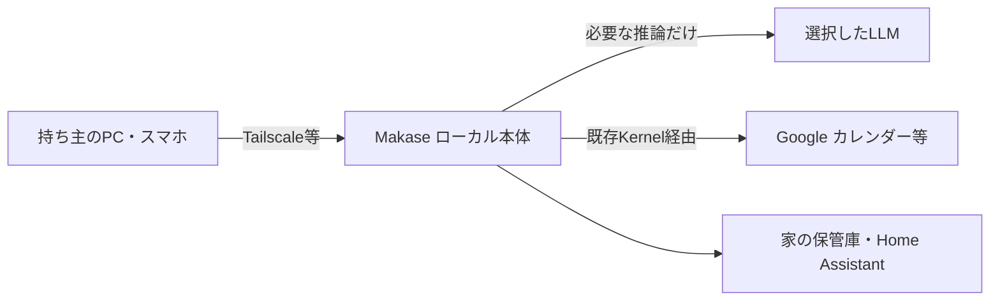

# Makase 設計書 v1.8：使うほど推論が減る
> **3行で**
> 1. 家に置くMakaseが、仕事の経験を成立条件付きのプログラムへ変える。
> 2. 日程調整で検証し、条件を満たす版は自動採用。未知部分だけAIを呼ぶ。
> 3. Linux＋Node＋SQLiteを継承。実行IRと、外部操作を許すKernelは別の役割。

## 🧭 判断してほしいこと（全ドキュメントから集約）
今回の未決事項はなし。既存v1.7のキット・判断モデルの実機評価は継続する。
| # | 種類 | 論点 | 対応・詳細 |
|---|---|---|---|
| R-114 | リスク | 有限試験で汎化を証明できない | [適用範囲・ガード・出力契約](04_functional_spec/learning.md) |
| R-115 | リスク | 学習費が節約分を上回る | [学習費込みの評価](11_learning.md#検証と評価) |
| R-116 | リスク | 外部予定が取得後に変わる | [送信直前の再取得](04_functional_spec/learning.md#fr-120) |
既存の判断事項・リスクR-76〜113は[継続する一覧](README-v1.7.md#-判断してほしいこと全ドキュメントから集約)を参照。今回解決済みとは扱わない。

## 全体図（C4 レベル1：コンテキスト）

見てほしいところ：既知の処理が増えるほど、LLMへ渡す部分が減る。

## 読む順番
| 目的 | 入口 |
|---|---|
| 今回何を決めたか | [変更レポート](changes/2026-10-26-learning-programs.md) |
| 技術の全体像 | [統合技術仕様](11_learning.md) |
| 要件から追う | [概要・決定ログ・追跡表](00_learning.md) → [要件](01_requirements.md#成長機構v18) → [ストーリー](02_user_stories.md#成長機構v18) → [ユースケース](03_learning.md) |
| 振る舞いを確認 | [機能仕様](04_functional_spec/learning.md) → [性能・評価値](05_non_functional.md#成長機構v18) → [画面](06_learning.md) |
| 構造と契約を確認 | [構成](07_architecture.md#成長機構v18) → [DB](08_database/learning.md) → [API](09_api/learning.md) → [図](10_diagrams/learning.md) |
| 既存機能を確認 | [既存設計の索引](README-v1.7.md#読む順番)・[技術仕様全体](11_tech_spec.md) |

## 主要な設計判断（ADR）
- [ADR-085](adr/ADR-085-learning-ir.md)：制限IRと契約付きの穴。
- [ADR-086](adr/ADR-086-learning-activation.md)：独立した検証ゲートによる自動採用。
- [ADR-087](adr/ADR-087-learning-holes.md)：未知部分の推論と障害・拒否を分離。
- [既存ADR一覧](README-v1.7.md#主要な設計判断adr)を継承。

## Claude判断で決めたこと（見直してほしいもの）
スキル指定のラベル。今回の担当による委任判断は[D-396〜401](00_learning.md#決定事項ログ)：IR、採用ゲート、穴の契約、数値、DB/API/UI、運用。実測済みではない。
過去の委任判断は[既存一覧](README-v1.7.md#claude判断で決めたこと見直してほしいもの)に保持。

## 最近の変更
- [v1.8：実行履歴からのプログラム学習](changes/2026-10-26-learning-programs.md)
