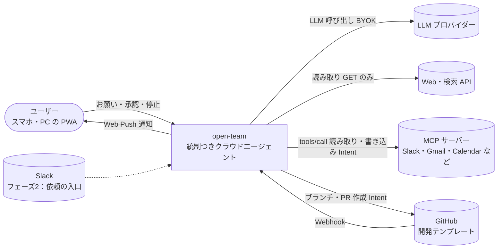

# open-team 設計書：読む入口
- 版数：v0.15（2026-10-02）／ 書き直しの経緯：[changes/2026-10-01-rewrite.md](changes/2026-10-01-rewrite.md)、最新の変更：[changes/2026-10-02-v0.15-rehearsal-strength.md](changes/2026-10-02-v0.15-rehearsal-strength.md)

> **位置づけ（[D-120](decisions.md#d-120)、2026-10-15）**：エンジニアはエージェントを自分で作れるが、一般ユーザーは作れない。open-team（Makase）は依頼から担当を自動で生成し、同じような依頼にはその担当が動き、使うほど確認が減る（引き継がれたルールや権限を絞った設定が、その依頼で安全チェックを通すと効く。承認した宛先や安全チェックの記録は仕事ごとで引き継がれない。学習ではない）。統制と安全チェックは「任せても大丈夫な理由」。
>
> **3行で**
> 1. open-team は、ポリシーを LLM の外にある決定論的なランタイム（Kernel）が強制する **統制つき汎用クラウドエージェント**。入口の「仕事はエージェントに任せて」に頼むだけで、合うエージェントが使い回されるか生成され（必要なら独立した複数に分かれ）、自分で設定する（v0.12）。複数なら担当どうしが連絡板で協調し、依頼1件に回答を1つ返す（v0.14）。
> 2. 外部サービスへは MCP でつなぐ。書き込みはすべて Intent として内容を固定し、承認か「宛先を固定したルール」で通す。Web は読み取りだけ。
> 3. 最初の到達点は課金なし・単一ユーザー・ローカルの **フェーズ0**。ただし、フェーズ0で使う MCP コネクタ周りの画面・API・テーブルがまだ設計されていない（下の T-1）。

## 🧭 判断してほしいこと

確定したものは [decisions.md](decisions.md) に記録する。

**v0.15 で増えた論点**：Q-112 は ✅決定（リハーサルに自分の言葉の悪い日・防いだ損害の金額・本番の停止を試験に・合格証を Must で追加。[D-75〜80](decisions.md#d-75)）。🟡未決は Q-113（フェーズ0で本番の読み取り結果を試験に保存するか。提出後でよい）と仮の値 A-106〜109（[変更レポート](changes/2026-10-02-v0.15-rehearsal-strength.md)）。

**v0.14 で増えた論点**：Q-110 は ✅決定（回答1つは Must、連絡板は Should。[D-73](decisions.md#d-73)）、Q-111 は ✅決定（並列の回答は Kernel が並べる。[D-74](decisions.md#d-74)）。残りは仮の値 A-103〜105（[変更レポート](changes/2026-10-02-v0.14-team-board-and-answer.md)）。

**v0.12〜0.13 で増えた論点**：Q-109 審査員が最初に見る画面は ✅決定（用意した依頼のページ SCR-021。[D-69](decisions.md#d-69)）。残りは仮の値：A-97 編成を見せる時間・A-99 担当の上限・A-100 まとめ役の待ち時間（[変更レポート](changes/2026-10-02-v0.12-ask-generates-agents.md)）。

論点は全部で 112 件（Q 97・R 15）。重なりが多いので、**まず決めてほしいもの**をテーマにまとめた。全件は下の折りたたみ。

| テーマ | 種類 | 論点 | 関係する Q / R | 決まらないと止まるもの |
|---|---|---|---|---|
| T-1 | 方針決定・本設計待ち | （ID 採番・引数の役割・認証情報・リポジトリなしは [D-09〜12](decisions.md) で決定） 13（v0.4）が求めた MCP コネクタ・Web 読み取り・プロフィール・レポート・ワークスペースのポリシーが、FR / SCR / TBL のカラム / API まで設計されていない | Q-19, Q-30, Q-50, Q-65, Q-72, Q-92 | **フェーズ0**の完成条件そのもの |
| T-2 | ✅決定 | フェーズ0の範囲：鍵は `.env`、画面は固定トークン、テーブルは作って1行で使う、NFR-052＋060、`.env` 一覧、開発テンプレートはフェーズ1（[D-03〜08](decisions.md)） | Q-40, Q-43, Q-95, Q-63, Q-91, Q-06, Q-55 | フェーズ0の構成（07）・DB（08） |
| T-3 | ✅決定 | MVP の完成条件は「カタログから Gmail と Calendar をつないで朝のまとめ」に一本化。複数ユーザーはフェーズ1から（[D-01・D-02](decisions.md)） | Q-90, Q-41, Q-36 | — |
| T-4 | ✅決定 | （詳細設定で直接編集・GitOps はフェーズ2・試し実行は変更案に対して・Skill はチャットから。[D-13〜17](decisions.md)） v0.5 で下書き（TBL-021・API-043〜048 ほか）を廃止した波及：Canvas・試し実行・公開・Skill の下書き・KPI「作成完了率」の行き先 | Q-04, Q-08, Q-17, Q-27, Q-35, Q-42, Q-52, Q-53, Q-67, Q-74, Q-81 | 03・04・06・08・09 のエージェント作成まわり |
| T-5 | 方針決定・本設計待ち | （送信前の失敗は approved に戻す・open_pr だけ1件。[D-18・23](decisions.md)） MCP の Intent（1タスク複数・`unknown_outcome`）の UC・API・状態の未整理 | Q-20, Q-33, Q-56, Q-68, Q-76, Q-83, Q-87 | 承認カード（06）・API-013/017/018（09） |
| T-6 | 方針決定・本設計待ち | （実効ポリシーは仕事ごと・idle を状態に足す。[D-19・20](decisions.md)） エージェントと仕事（jobs）の状態：`idle`、仕事の遷移、定義 v2 と API、`compose()` を仕事ごとに計算 | Q-21, Q-31, Q-34, Q-75, Q-82, Q-85 | 10 の状態遷移、09 のエージェント API |
| T-7 | 方針決定・本設計待ち | （列名・API パスまで workspace に改名。[D-21](decisions.md)） organizations → workspaces 改名の範囲（列名・API パス）と、GitHub 前提の入口・UC-001 | Q-18, Q-54, Q-62, Q-66, Q-78 | 08 の外部キー、09 のパス |
| T-8 | ✅決定 | （ワークスペースの owner に限る。[D-22](decisions.md)） 権限を広げる変更を承認できる人（承認者 / owner / ユーザー） | Q-22, Q-28 | BR-33、FR-022 系 |

全件（112 件。Q-80・Q-86 は 08 の Q-62・Q-65 と重複のため欠番）

| # | 種類 | 論点（要約。全文は各ドキュメント） | 場所 | 同じ論点 |
|---|---|---|---|---|
| Q-01 | 未決 | プロダクト名 | [01 要件](01_requirements.md) |  |
| Q-02 | 未決 | 課金モデル・料金体系（将来） | [01 要件](01_requirements.md) |  |
| Q-03 | 未決 | 開発チームの規模とリリース期限 | [01 要件](01_requirements.md) |  |
| Q-04 | ✅決定 | 追加の KPI「作成完了率」（旧 12 §要件） → **「作成完了率」を「最初の結果の到達率」（作ったエージェントのうち7日以内に最初の結果が届いた割合 ≥ 40%）に置き換え**（[D-17](decisions.md#d-17)）| [01 要件](01_requirements.md) |  |
| Q-05 | 未決 | 一般の個人ユーザー向けに、LLM の API キーを用意する手間をどう減らすか（課金を扱わない前提のまま） | [01 要件](01_requirements.md) |  |
| Q-06 | ✅決定 | 開発テンプレートをフェーズ0に含めるか（現状はフェーズ1） → **フェーズ1のまま**（[D-03](decisions.md#d-03)）| [01 要件](01_requirements.md) |  |
| Q-07 | 未決 | MCP カタログの審査の方針（フェーズ1） | [01 要件](01_requirements.md) |  |
| Q-08 | ✅決定 | US-024〜027 の扱い。 → **GitOps モードはフェーズ2以降へ。US-024 廃止、US-025・026 は Could、US-027・UC-019・020・FR-027・NFR-051 はフェーズ2**（[D-14](decisions.md#d-14)）| [02 ストーリー](02_user_stories/README.md) |  |
| Q-09 | 未決 | v0.3 の要件 REQ-033〜038（フェーズ1） | [02 ストーリー](02_user_stories/README.md) |  |
| Q-10 | 未決 | US-035（REQ-030、フェーズ2） | [02 ストーリー](02_user_stories/README.md) |  |
| Q-11 | 未決 | コードを書かない利用者（P-5） | [02 ストーリー](02_user_stories/README.md) | Q-96 |
| Q-12 | 未決 | Slack から承認する場合の再認証の方式と、A-22（通知から直接承認しない） | [02 ストーリー](02_user_stories/README.md) | Q-97 |
| Q-13 | ✅決定 | メンションに対する返信をどうするか（コメント投稿は Won't のため、現在は Web Push だけ） → **Web Push だけ（コメント投稿は Won't のまま）**（[D-33](decisions.md#d-33)）| [02 ストーリー](02_user_stories/README.md) | Q-16, Q-71 |
| Q-14 | 未決 | 却下時にフィードバックを入力して再実行させる機能を、どのフェーズで入れるか（MVP では Won't） | [02 ストーリー](02_user_stories/README.md) |  |
| Q-15 | 未決 | UC-010 E3（PR の検証不一致） | [03 ユースケース](03_use_cases/README.md) |  |
| Q-16 | ✅決定 | メンションへの返信。 → **Web Push だけ（コメント投稿は Won't のまま）**（[D-33](decisions.md#d-33)）| [03 ユースケース](03_use_cases/README.md) | Q-13, Q-71 |
| Q-17 | ✅決定 | v0.3（アプリ内モードが既定・BR-33・ADR-017） → **GitOps モードはフェーズ2以降へ。US-024 廃止、US-025・026 は Could、US-027・UC-019・020・FR-027・NFR-051 はフェーズ2**（[D-14](decisions.md#d-14)）| [03 ユースケース](03_use_cases/README.md) |  |
| Q-18 | 未決 | A-03 の改訂（ワークスペースは GitHub App のインストール単位でない、個人のワークスペースはサインイン時に自動で作る） | [03 ユースケース](03_use_cases/README.md) |  |
| Q-19 | ✅決定 | 13 が 03 に求める「交通・ニュース・MCP 登録のユースケース」は未設計（13 §既存ドキュメントへの影響） → **新しい ID を振る（UC-029〜・FR-041〜・SCR-019〜）。MCP の書き込みは UC-009・010 を拡張せず別 UC。本設計は T-1 の設計作業で書く**（[D-09](decisions.md#d-09)）| [03 ユースケース](03_use_cases/README.md) |  |
| Q-20 | ✅決定 | MCP の書き込みを UC-009・010 の拡張とするか、UC-029・030 として新しく立てるか（15 §既存ドキュメントへの影響… → **新しい ID を振る（UC-029〜・FR-041〜・SCR-019〜）。MCP の書き込みは UC-009・010 を拡張せず別 UC。本設計は T-1 の設計作業で書く**（[D-09](decisions.md#d-09)）| [03 ユースケース](03_use_cases/README.md) |  |
| Q-21 | 未決 | 起動の UC と「仕事（jobs） | [03 ユースケース](03_use_cases/README.md) |  |
| Q-22 | ✅決定 | アプリ内モードで「権限を広げる変更」を承認できる人：承認者（BR-14） → **ワークスペースの owner に限る（Intent の承認は従来どおり承認者 BR-14）**（[D-22](decisions.md#d-22)）| [03 ユースケース](03_use_cases/README.md) | Q-28 |
| Q-23 | ✅決定 | BR-23 は「権限は `autonomy`・`paths`・`commands`・`budget`・`breakers` だけで決まる… → **列挙をやめ「権限は権限の境界だけで決まる」とし、境界の定義を参照する**（[D-24](decisions.md#d-24)）| [03 ユースケース](03_use_cases/README.md) |  |
| Q-24 | 一部決定 | （初回の確認の実行・メモリの移動は [D-27・28](decisions.md) で決定、任せ先の選び方だけ未決）UC-026・027 に関わる 14 の未決：繰り返す仕事の初回に確認の実行を必ず行うか／仕事を移すときメモリも移すか／同じ役割のエージ… | [03 ユースケース](03_use_cases/README.md) | Q-37 |
| Q-25 | 未決 | `commands.allow` の書式（04 §未決事項） | [04 機能仕様](04_functional_spec/README.md) |  |
| Q-26 | 未決 | 承認カードの差分要約をどの言語で出すか（04 §未決事項） | [04 機能仕様](04_functional_spec/README.md) |  |
| Q-27 | ✅決定 | v0.3 のアプリ内モード（既定。 → **詳細設定で定義を直接編集し、下書きを作らず設定変更（TBL-025）として保存。classify() で widen なら確認カード**（[D-13](decisions.md#d-13)）| [04 機能仕様](04_functional_spec/README.md) |  |
| Q-28 | ✅決定 | 権限を広げる変更を承認できる人。 → **ワークスペースの owner に限る**（[D-22](decisions.md#d-22)）| [04 機能仕様](04_functional_spec/README.md) | Q-22 |
| Q-29 | 未決 | v0.3 のフェーズ1機能の FR が未設計：`handoff`（REQ-035・BR-36。 | [04 機能仕様](04_functional_spec/README.md) |  |
| Q-30 | ✅決定 | 13 の MCP コネクタ・Web 読み取り・汚染の追跡・ワークスペースのポリシー・プロフィール（REQ-042〜051） → **新しい ID を振る（UC-029〜・FR-041〜・SCR-019〜）。MCP の書き込みは UC-009・010 を拡張せず別 UC。本設計は T-1 の設計作業で書く**（[D-09](decisions.md#d-09)）| [04 機能仕様](04_functional_spec/README.md) |  |
| Q-31 | ✅決定 | 14 は `compose()` を **仕事ごと**（`ceilings ∧ workspacePolicy ∧ repoPolicy… → **実効ポリシーは仕事（job）ごとに計算・保存し、intentHash の policyHash も仕事のもの。一回きりのお願いは既定の仕事として扱う**（[D-19](decisions.md#d-19)）| [04 機能仕様](04_functional_spec/README.md) |  |
| Q-32 | ✅決定 | `submit_report` の対象。 → **開発以外の全テンプレート（researcher・briefer・watcher・assistant）。開発は deny のまま**（[D-32](decisions.md#d-32)）| [04 機能仕様](04_functional_spec/README.md) |  |
| Q-33 | ✅決定 | 15 で「1タスク1 Intent（A-30） → **open_pr だけ1タスク1件の制限（409 INTENT_ALREADY_SUBMITTED）を残す**（[D-23](decisions.md#d-23)）| [04 機能仕様](04_functional_spec/README.md) |  |
| Q-34 | ✅決定 | 14 の UC-025 が `agents.status = idle` を使うが、状態の定義・遷移がない。 → **idle を状態に足す（遷移は D-20）。仕事の遷移図は T-6 の設計作業で書く**（[D-20](decisions.md#d-20)）| [04 機能仕様](04_functional_spec/README.md) |  |
| Q-35 | ✅決定 | FR-024 を FR-035 に置き換えた後、「タスクから Skill の下書きを作る」（FR-030・UC-024） → **「このやり方を覚える」・チャットの一言で、設定プランナーが Skill の追加を設定変更として提案**（[D-16](decisions.md#d-16)）| [04 機能仕様](04_functional_spec/README.md) |  |
| Q-36 | ✅決定 | フェーズの割り当て。 → **複数ユーザーはフェーズ1から。FR-001・FR-020 はフェーズ1**（[D-02](decisions.md#d-02)）| [04 機能仕様](04_functional_spec/README.md) |  |
| Q-37 | 一部決定 | 自己設定の未決（14 §未決事項）。**①②③⑤は決定（[D-26〜29](decisions.md)）、④任せ先の選び方だけ未決（REQ-057 はフェーズ0で後回し）** | [04 機能仕様](04_functional_spec/README.md) |  |
| Q-38 | ✅決定 | （①は [D-10](decisions.md#d-10)、②〜④は [D-34](decisions.md#d-34)、⑤は [D-31](decisions.md#d-31)） MCP の書き込みの未決（15 §未決事項） | [04 機能仕様](04_functional_spec/README.md) |  |
| Q-39 | 一部決定 | （①は [D-30](decisions.md#d-30)、②は [D-34](decisions.md#d-34)、④は [D-33](decisions.md#d-33)。③汚染の単位はフェーズ0はタスク単位のまま） Web・汚染・連携の未決（13・12 §未決事項） | [04 機能仕様](04_functional_spec/README.md) |  |
| Q-40 | ✅決定 | フェーズ0の NFR が未設計。 → **NFR-052（p95 ≤ 2分）をフェーズ0にも適用し、通しの NFR-060（通知まで10分以内）を追加。「?」の NFR は統制・安全系 0〜、運用・規模系 1〜 で割り当て**（[D-07](decisions.md#d-07)）| [05 非機能](05_non_functional.md) |  |
| Q-41 | ✅決定 | 複数ユーザー（SaaS） → **フェーズ1から**（[D-02](decisions.md#d-02)）| [05 非機能](05_non_functional.md) |  |
| Q-42 | ✅決定 | NFR-055 の前提（API-046 の下書きの検証、SCR-016 の YAML 入力） → **詳細設定の検証（保存前の検証 API）に読み替え**（[D-17](decisions.md#d-17)）| [05 非機能](05_non_functional.md) |  |
| Q-43 | ✅決定 | フェーズ0の鍵の置き場所：13 はフェーズ0の LLM の API キーを `.env` に置くとするが、NFR-022・023 と A… → **.env に置き、NFR-022・023 はフェーズ1から。キーは LLM Proxy と Gateway だけが読む**（[D-04](decisions.md#d-04)）| [05 非機能](05_non_functional.md) |  |
| Q-44 | 未決 | NFR-056 のプロパティベーステストで保証する範囲。 | [05 非機能](05_non_functional.md) |  |
| Q-45 | 未決 | 将来の運用条件：有料化した後の SLA（稼働率の保証と返金の条件） | [05 非機能](05_non_functional.md) |  |
| Q-46 | 未決 | プライベートレジストリへの対応方法（認証情報をサンドボックスに渡さずに実現する方法） | [05 非機能](05_non_functional.md) |  |
| Q-47 | 未決 | NFR-057 のマスクで検出できない秘密情報（独自形式のトークンなど） | [05 非機能](05_non_functional.md) |  |
| Q-48 | 未決 | サービス間の経路の2点。 | [07 アーキ](07_architecture.md) |  |
| Q-49 | 未決 | サンドボックス基盤の比較検証（Cloud Run Jobs / E2B / Fly Machines で、起動時間・隔離の強さ・通信制限… | [07 アーキ](07_architecture.md) |  |
| Q-50 | ✅決定 | 13 の画面（コネクタの一覧・登録・ツールの分類と引数の役割、プロフィール、レポート、スターターから作る導線） → **新しい ID を振る（UC-029〜・FR-041〜・SCR-019〜）。MCP の書き込みは UC-009・010 を拡張せず別 UC。本設計は T-1 の設計作業で書く**（[D-09](decisions.md#d-09)）| [06 画面](06_ux_design/README.md) |  |
| Q-51 | 未決 | v0.3 の画面が未設計：アクティビティビュー（REQ-037、Must） | [06 画面](06_ux_design/README.md) |  |
| Q-52 | ✅決定 | SCR-016 を SCR-017 の「詳細設定」タブに移した後の URL・データ元・操作。 → **詳細設定で直接編集（アプリ内モード）。保存は設定変更（TBL-025）**（[D-13](decisions.md#d-13)）| [06 画面](06_ux_design/README.md) |  |
| Q-53 | 未決 | SCR-017 のタブ（チャット／仕事／変更履歴／詳細設定） | [06 画面](06_ux_design/README.md) |  |
| Q-54 | ✅決定 | SCR-014 の v0.5 化。 → **リポジトリ切り替えを外す。開発エージェントはリポジトリ名を小さく表示**（[D-25](decisions.md#d-25)）| [06 画面](06_ux_design/README.md) |  |
| Q-55 | 未決 | 入口・ホーム・新規タスクが v0.4・v0.5 に未対応。 | [06 画面](06_ux_design/README.md) |  |
| Q-56 | 未決 | v0.6 で増えたタスク・Intent の状態（`completed`（`actions_declined`） | [06 画面](06_ux_design/README.md) |  |
| Q-57 | 未決 | 「以後も許可」のルールの一覧（API-068・069） | [06 画面](06_ux_design/README.md) |  |
| Q-58 | 未決 | ブランドカラーとロゴ | [06 画面](06_ux_design/README.md) |  |
| Q-59 | 未決 | 差分が非常に大きい場合（例：5,000行以上） | [06 画面](06_ux_design/README.md) |  |
| Q-60 | 未決 | 監査ログのパーティション分割（月単位） | [08 DB](08_database/README.md) |  |
| Q-61 | 未決 | ワークスペースの削除（旧：GitHub App のアンインストール） | [08 DB](08_database/README.md) |  |
| Q-62 | ✅決定 | organizations → workspaces 改名の範囲。 → **列名も workspace_id、RLS は app.workspace_id に改名。GitHub 関連列は別テーブル（連携の1つ）へ**（[D-21](decisions.md#d-21)）| [08 DB](08_database/README.md) |  |
| Q-63 | ✅決定 | フェーズ0で使うテーブルの範囲。 → **テーブルは作り、利用者1人・ワークスペース1つの行を初期投入して使う。RLS だけ無効**（[D-05](decisions.md#d-05)）| [08 DB](08_database/README.md) |  |
| Q-64 | ✅決定 | リポジトリのないエージェント・タスク（13 REQ-045・US-039） → **repository_id・base_commit_sha・policy_snapshot_id を NULL 可にし、開発テンプレートでは必須を CHECK で守る。UQ は (workspace_id, slug)**（[D-12](decisions.md#d-12)）| [08 DB](08_database/README.md) |  |
| Q-65 | 未決 | 13 の新テーブルのカラムが未設計（13 §既存ドキュメントへの影響「08」） | [08 DB](08_database/README.md) |  |
| Q-66 | 未決 | 14 の新テーブル・変更の未記述部分：TBL-023〜025 に `organization_id` がない（RLS 方針と不一致） | [08 DB](08_database/README.md) |  |
| Q-67 | ✅決定 | 下書き（TBL-021） → **agent_draft_id 列を削除。試し実行は tasks.is_dry_run＋config_change_id。snapshots.source は in_app / gitops。usage_records に agent_id を足し、task_id か agent_id の一方を必須に。phase design → planner**（[D-17](decisions.md#d-17)）| [08 DB](08_database/README.md) |  |
| Q-68 | 未決 | 15 の値の保存先：Intent の `expired` の理由（`superseded` / `tool_changed`） | [08 DB](08_database/README.md) |  |
| Q-69 | 未決 | 未設計の DB：v0.3（12 §競合機能の採用方針） | [08 DB](08_database/README.md) |  |
| Q-70 | 未決 | 外部向けの公開 API（CLI や CI からタスクを作るための API トークン） | [09 API](09_api/README.md) |  |
| Q-71 | ✅決定 | メンションへの返信（コメント投稿は Won't。 → **Web Push だけ（コメント投稿は Won't のまま）**（[D-33](decisions.md#d-33)）| [09 API](09_api/README.md) | Q-13, Q-16 |
| Q-72 | 未決 | 13 が 09 への反映を求めた API が未設計：コネクタの登録・一覧・`tools/list` の再取得・`needs_review… | [09 API](09_api/README.md) |  |
| Q-73 | 未決 | 12 v0.3 の機能の API が未設計：アプリ内モードの保存・版の履歴・差分・ロールバック・YAML の書き出し・モードの選択、`h… | [09 API](09_api/README.md) |  |
| Q-74 | ✅決定 | 下書きの廃止（14 §API） → **試し実行は詳細設定の変更案（または今の定義）を普通のタスク（isDryRun＋変更案）で走らせる。公開はフェーズ2（D-14）、API-053 はチャット（D-16）**（[D-15](decisions.md#d-15)）| [09 API](09_api/README.md) |  |
| Q-75 | 未決 | 定義 v2（`jobs`・`grants`、`agents.template` の削除、`role`・`name_source`・`ap… | [09 API](09_api/README.md) |  |
| Q-76 | 未決 | 15 の MCP の Intent（1タスク複数、`action_type = mcp_call`） | [09 API](09_api/README.md) |  |
| Q-77 | 未決 | API-056 のレポート：旧 09 は reviewer / triager 以外を 403 にし `title`・`body` だけ… | [09 API](09_api/README.md) |  |
| Q-78 | ✅決定 | ワークスペースへの改名（13 A-78） → **API のパス・フィールドも /workspaces/{workspaceId}・workspaceId に改名**（[D-21](decisions.md#d-21)）| [09 API](09_api/README.md) |  |
| Q-79 | 未決 | API-060 の応答の形と、API-062 の SSE のイベント名・`data` の形（14 §API は「エージェントの発言とカー… | [09 API](09_api/README.md) |  |
| Q-81 | ✅決定 | v0.2 の作り方（下書き → 試し実行 → 公開PR → 有効化） → **GitOps モードはフェーズ2以降へ。US-024 廃止、US-025・026 は Could、US-027・UC-019・020・FR-027・NFR-051 はフェーズ2**（[D-14](decisions.md#d-14)）| [10 図](10_diagrams/README.md) |  |
| Q-82 | ✅決定 | UC-025 はエージェントを `status = idle` で作る（14 §UC-025） → **agents.status に idle を足す。作成直後と、動いている仕事（active / waiting_input）が0件のとき idle、1件以上で active**（[D-20](decisions.md#d-20)）| [10 図](10_diagrams/README.md) |  |
| Q-83 | ✅決定 | MCP の送信前の失敗で、Intent の状態を `approved のまま` とする（15 §Gateway での実行 表） → **送信前の失敗は executing → approved に戻して再試行。executing のまま残ったものだけ unknown_outcome**（[D-18](decisions.md#d-18)）| [10 図](10_diagrams/README.md) |  |
| Q-84 | 未決 | 自律レベル `handoff`（12 §競合機能の採用方針 REQ-035、15 §decide() の拡張 手順8） | [10 図](10_diagrams/README.md) |  |
| Q-85 | 未決 | 仕事（`agent_jobs.status`：`waiting_input` / `active` / `paused` / `done`） | [10 図](10_diagrams/README.md) |  |
| Q-87 | 未決 | タスクの状態遷移（v0.2） | [10 図](10_diagrams/README.md) |  |
| Q-90 | ✅決定 | フェーズ1（MVP） → **旧13の条件（カタログから Gmail と Calendar をつないで「朝のまとめ」を作れる）に置き換え**（[D-01](decisions.md#d-01)）| [11 技術仕様](11_tech_spec.md) |  |
| Q-91 | ✅決定 | フェーズ0・v0.5 以降の環境変数が未設計（13 §フェーズ0「設定は `.env`：LLM・検索 API のキー・VAPID」に名前… → **フェーズ0の .env 一覧を §10 に追加。廃止機能の変数は T-4 で決める**（[D-08](decisions.md#d-08)）| [11 技術仕様](11_tech_spec.md) |  |
| Q-92 | ✅決定 | MCP コネクタの認証情報の保存方式が未設計（13 §登録と分類「Gateway だけが持ち、暗号化して保存」のみ。 → **DB に暗号化して保存。フェーズ0は .env の CONNECTOR_ENC_KEY で AES-256-GCM、フェーズ1は KEK kek-connectors のエンベロープ暗号化。復号は gateway だけ**（[D-11](decisions.md#d-11)）| [11 技術仕様](11_tech_spec.md) |  |
| Q-93 | 未決 | v0.4〜v0.6 のテスト観点が未設計（`classify()` の性質、汚染の追跡、MCP の Intent のライフサイクル、ルー… | [11 技術仕様](11_tech_spec.md) |  |
| Q-94 | ✅決定 | 設計アシスタントの性能・費用の目標（NFR-054、NFR-059 の $0.5、A-35） → **設定プランナーに読み替え（NFR-054 の時間、NFR-059 の /bin/bash.5 は設定変更1件あたり）**（[D-17](decisions.md#d-17)）| [11 技術仕様](11_tech_spec.md) |  |
| Q-95 | ✅決定 | フェーズ0の画面の保護方式：ローカルのパスキーか固定トークンか（13 §フェーズ0「パスキー or 固定トークン」） → **固定トークン（.env）→ Cookie。スマホからはトンネルの閉じた経路のみ**（[D-06](decisions.md#d-06)）| [11 技術仕様](11_tech_spec.md) |  |
| Q-96 | ✅決定 | コードを書かない利用者（P-5） → **ADR-017（アプリ内モード既定）で解決済み**（[D-17](decisions.md#d-17)）| [11 技術仕様](11_tech_spec.md) | Q-11 |
| Q-97 | 未決 | Slack から承認する場合の再認証の方式と、A-22（通知から直接承認しない） | [11 技術仕様](11_tech_spec.md) | Q-12 |
| Q-98 | 未決 | 「操作デモで Skill を教える」機能を持つか。 | [11 技術仕様](11_tech_spec.md) |  |
| Q-99 | 未決 | 競合情報（dots の公式ヘルプ、Grok Bot の監査と支出上限の提供状況） | [11 技術仕様](11_tech_spec.md) | R-01 |
| Q-100 | トレードオフ | Cloud SQL を高可用性構成（HA） | [07 アーキ](07_architecture.md) |  |
| Q-101 | 未決 | YAML のコメントを保持した部分的な書き換え（FR-025。 | [07 アーキ](07_architecture.md) |  |
| R-01 | リスク | 競合の情報は 2026-10-01 時点の Web 検索に基づき、一部は二次情報（A-42） | [01 要件](01_requirements.md) | Q-99 |
| R-02 | リスク | 交通情報の情報源が、利用規約上、自動取得してよいページかどうか未確認（旧 13 §未決事項、A-73） | [01 要件](01_requirements.md) |  |
| R-06 | リスク | MCP の書き込みの検証は既定で `none`。 | [03 ユースケース](03_use_cases/README.md) | R-13 |
| R-07 | リスク | フェーズ0では PC が止まっている間のスケジュールは実行されず、後からも実行しない（A-75） | [03 ユースケース](03_use_cases/README.md) |  |
| R-10 | リスク | `commands.allow` の前方一致はすり抜けうる | [04 機能仕様](04_functional_spec/README.md) |  |
| R-11 | リスク | URL のクエリ文字列に情報を載せて持ち出す経路は残る（ADR-023） | [04 機能仕様](04_functional_spec/README.md) |  |
| R-12 | リスク | 指示文の変更は `neutral` のため、振る舞いが承認なしで変わりうる（ADR-027） | [04 機能仕様](04_functional_spec/README.md) |  |
| R-13 | リスク | MCP には読み戻しの標準がなく、書き込みの検証は既定で `none`（ADR-022） | [04 機能仕様](04_functional_spec/README.md) | R-06 |
| R-14 | リスク | MCP サーバーの自己申告やツールの説明文の書き換えによる誤分類・乗っ取り（12 §未決事項） | [04 機能仕様](04_functional_spec/README.md) |  |
| R-15 | リスク | スケジュール起動が広く使われ、タスク数が A-01 の規模を超える | [05 非機能](05_non_functional.md) |  |
| R-20 | リスク | 承認カードの [以後も許可] は `widen` だが、ユーザーの直接の操作なので確認カードを重ねない（BR-47 ①） | [06 画面](06_ux_design/README.md) |  |
| R-36 | リスク | 実行基盤：Cloud Run Jobs の起動の遅さ・隔離、常時トリガーでも起動に数十秒、ベースブランチの進行、GitHub のレート制… | [11 技術仕様](11_tech_spec.md) |  |
| R-37 | リスク | 統制のすり抜け：判定・合成のバグ、協調的強制の回避、`commands.allow` の前方一致、レジストリ・URL のクエリ文字列での… | [11 技術仕様](11_tech_spec.md) |  |
| R-38 | リスク | 費用：試し実行・設定の LLM 費用、価格表と実請求のずれ、エージェント数と起動回数の増加 | [11 技術仕様](11_tech_spec.md) |  |
| R-39 | リスク | 競合と体験：競合の機能追加の速さ、PR での公開の手間 | [11 技術仕様](11_tech_spec.md) |  |

## 全体図

C4 レベル1（コンテキスト）。中の構成は [07_architecture.md](07_architecture.md)。

見てほしいところ：外への **書き込み**（MCP・GitHub）はすべて Intent で固定してから実行する。Web は読み取りだけ。

## 読む順番

| 目的 | 読むもの |
|---|---|
| ハッカソン版（10/15 締切） | [15_hackathon.md](15_hackathon.md) |
| セキュリティとガバナンスの次の設計（提案） | [17_security_governance.md](17_security_governance.md) |
| 全体をつかむ（10分） | 本書 → [00_overview.md](00_overview.md) の要約層 → [11_tech_spec.md](11_tech_spec.md) の要約層 |
| 何を作るか | [01_requirements.md](01_requirements.md) → [02_user_stories/](02_user_stories/README.md) → [03_use_cases/](03_use_cases/README.md) |
| どう振る舞うか | [04_functional_spec/](04_functional_spec/README.md)（統制・Intent・MCP）→ [05_non_functional.md](05_non_functional.md) → [06_ux_design/](06_ux_design/README.md) |
| どう作るか | [07_architecture.md](07_architecture.md) → [08_database/](08_database/README.md) → [09_api/](09_api/README.md) → [10_diagrams/](10_diagrams/README.md) |
| 用語・仮定・ID のつながり | [用語集](00_overview/glossary.md)・[仮定一覧](00_overview/assumptions.md)・[トレーサビリティ表](00_overview/traceability.md) |

各ドキュメントは冒頭の「3行で → 🧭 判断してほしいこと → 全体図 → 要点」だけ読めば全体が分かる。詳細はその下と、ディレクトリ内の各ファイル。

## 主要な設計判断（ADR）

全37件は [adr/](adr/)。特に効いているもの：

| ADR | 決定 |
|---|---|
| [ADR-001](adr/ADR-001-pure-decision-engine.md) | 判定エンジンを純粋関数にし、状態は DB だけに持つ |
| [ADR-018](adr/ADR-018-model-only-tightens.md) | モデルの判断は「厳しくする方向」にだけ使う |
| [ADR-021](adr/ADR-021-workspace-policy.md) | ポリシーの基本をワークスペース単位にする |
| [ADR-022](adr/ADR-022-mcp-unified-unclassified-is-write.md) | 外部連携は MCP に統一し、未分類のツールは書き込みとして扱う |
| [ADR-024](adr/ADR-024-taint-tracking-against-injection.md) | プロンプトインジェクションは汚染の追跡で抑える |
| [ADR-026](adr/ADR-026-name-and-ask.md) / [ADR-027](adr/ADR-027-classify-widening-changes.md) | 名前を付けて頼むだけ。権限を広げる変更だけ `classify()` で人に戻す |
| [ADR-029](adr/ADR-029-mcp-arg-roles-destination-fixed.md) | MCP の書き込みは引数の役割で宛先を固定し、ルールは宛先の完全一致 |
| [ADR-034](adr/ADR-034-one-screen-ask-and-check.md) | 毎日使う画面は「頼む・チェック」の1枚。承認も同じチェックで、押してから5秒は取り消せる |
| [ADR-036](adr/ADR-036-ask-generates-formation.md) / [ADR-037](adr/ADR-037-entrance-one-sentence.md) | 頼むと編成が生成される（合えば使い回し・ひとり／並列／まとめ／順番、まとめ役は報告だけ）。入口は「仕事はエージェントに任せて」と入力欄だけ |
| [ADR-039](adr/ADR-039-rehearsal-certificate.md) | リハーサルの合格証がない・切れている仕事ではルールの `auto` を使わない。本番で止まったことは次の試験になる |
| [ADR-038](adr/ADR-038-team-board-and-one-answer.md) | 担当どうしは依頼の連絡板で協調し（データとして届き汚染を引き継ぐ・権限は動かない）、依頼1件に回答を1つ返す（窓口が書く） |
| [ADR-035](adr/ADR-035-rule-options-and-guards.md) | ルールの宛先は固定、`option` は「固定」か「変わってよい」。変わってよい値はガードで締め、ガードはルールより先に見る |
| [ADR-032](adr/ADR-032-google-cloud-gemini-where-needed.md) / [ADR-033](adr/ADR-033-rehearsal.md) | Google Cloud と Gemini は必要な所だけに使う。仕事を本番に出す前にリハーサルで試す（ハッカソン版） |

## 最近の変更

| 日付 | 変更 |
|---|---|
| 2026-10-14 | [17 セキュリティとガバナンス（提案）](17_security_governance.md)（13 の守り SG-01〜13 を6つの柱と3段階に。BR-39 は変えず汚染は出口で効かせる。決定は D-117〜 で記録予定） |
| 2026-10-02 | [v0.15 リハーサルを任せたあとも効く仕組みに](changes/2026-10-02-v0.15-rehearsal-strength.md)（自分の言葉の悪い日・防いだ損害の金額・本番の停止を試験に・合格証。15・06・ADR-039 に反映） |
| 2026-10-02 | [v0.14 担当どうしの連絡板と回答1つ](changes/2026-10-02-v0.14-team-board-and-answer.md)（FR-063・064、ADR-038） |
| 2026-10-02 | [v0.13 審査員の入口を用意した依頼のページに](changes/2026-10-02-v0.13-judge-entry.md)（SCR-021 依頼を新設、受信箱係 → 仕入れ係の順番を用意、順番を Must に） |
| 2026-10-02 | [v0.12 頼むとエージェントが生成される](changes/2026-10-02-v0.12-ask-generates-agents.md)（入口 SCR-020、編成の4つの形、まとめ役は報告だけ。01〜04・06・15 に反映、07〜10 は提出後） |
| 2026-10-02 | [v0.11 ガバナンスの詰め](changes/2026-10-02-v0.11-governance.md)（ガードをルールより先に・ルールの `option` を変わってよいに・O-03 の改訂・危ない承認の出し方・影の判定の閉じ方） |
| 2026-10-02 | [v0.10 ハッカソン版の範囲を絞る](changes/2026-10-02-v0.10-hackathon-focus.md)（15 を中心に。3サービス・仕入れ係に集中・先に計測・初日にデプロイ） |
| 2026-10-02 | [v0.9 頼む・チェックの1枚の画面](changes/2026-10-02-v0.9-ask-and-check.md)（06 だけに反映。API・DB は T-1 で） |
| 2026-10-02 | [15 ハッカソン版（フェーズ0-H）とリハーサル](15_hackathon.md)（v0.8。締切 10/15 のため 01〜11 への反映は提出後） |
| 2026-10-01 | [設計書一式の書き直し](changes/2026-10-01-rewrite.md)（12〜15 を 00〜11 に統合、二層構造へ） |
| 2026-10-01 | [v0.6 MCP の書き込み](changes/2026-10-01-v0.6-mcp-write.md) |
| 2026-10-01 | [v0.5 名前を付けて頼むだけ](changes/2026-10-01-v0.5-agent-persona.md) |
| 2026-10-01 | [v0.4 汎用クラウドエージェント](changes/2026-10-01-v0.4-cloud-agent.md) |
| 2026-10-01 | [v0.3 競合機能の採用](changes/2026-10-01-v0.3-competitor-features.md) |
| 2026-10-01 | [v0.2 エージェントビルダー](changes/2026-10-01-v0.2-agent-builder.md) |
