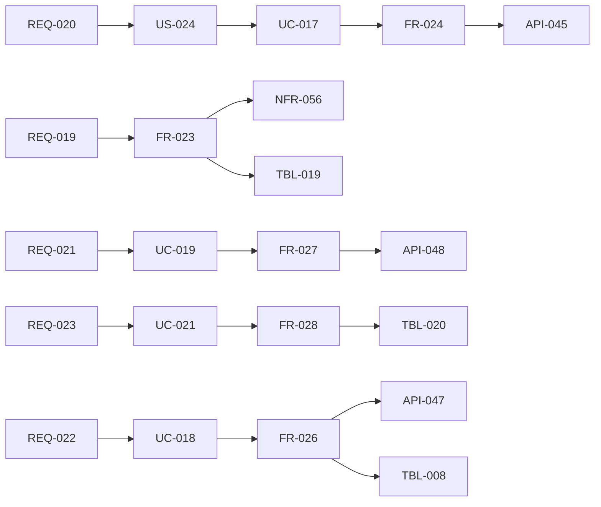

# 変更：ユーザーが自分用のエージェントを作れるようにする（エージェントビルダー）（v0.1 → v0.2、2026-10-01）
> **3行で**：「1リポジトリ＝固定の開発エージェント1つ」を、リポジトリに複数のエージェントを定義し、会話・Harness Canvas・試し実行・PR での公開で作る形に広げた ／ GrokBot / dots に「統制・安全性」「どこからでも頼める」「成果物の質」「開発以外への拡張」で対抗するため ／ いちばん大きい影響は、実効ポリシーの合成 `compose()` が Kernel に加わり、すべての判定が合成後の境界に対して行われること。

元の資料：旧 `12_agent_builder.md`（v0.1 初版 → v0.2 で 02〜11 へ反映、改訂履歴・「既存ドキュメントへの反映」表）、旧 02〜11 の版数欄（すべて v0.2）。

## 🧭 判断してほしいこと
この版で残った論点（現在の番号は [README](../README.md) の判断表）：
- コードを書かない利用者（P-5）向けに、PR のマージを経ずに Web 上で公開する経路を許すか（→ v0.3 のアプリ内モードと関係。11 の Q-96）
- Slack から承認する場合の再認証と A-22 の関係（フェーズ2。11 の Q-97）
- 料金体系（エージェント数・実行時間・機能のどれで課金するか）（→ v0.4 で「課金は当面扱わない」）
- 「操作デモで Skill を教える」機能を持つか（11 の Q-98）
- メンションへの返信（コメント投稿は Won't のため Web Push だけ）、`comment_issue` を外部作用に足すか（09）
- 競合情報の一次情報での確認（11 の Q-99）
- `worker` から `sandbox-edge` の内部関数を呼ぶ経路の実体（D30。07）

## 差分
| ドキュメント | 節 / ID | 種別 | 変更前 → 変更後（1行） |
|---|---|---|---|
| [01](../01_requirements.md) | REQ-018 | 変更 | Harness Canvas：Could → Must（競合に対する中核機能） |
| [01](../01_requirements.md) | REQ-019〜028 | 追加 | 複数エージェント、会話での下書き、PR での公開、試し実行、トリガー、Skill、メモリ、停止とスコアカード、レポート、自己レビュー（フェーズ1） |
| [01](../01_requirements.md) | REQ-029〜032 | 追加 | Slack、GitHub 以外の連携先、コントロールリポジトリ、エージェント間の委任（フェーズ2） |
| [01](../01_requirements.md) | KPI | 追加 | 作成完了率 ≥ 40%、有効なエージェント数の中央値 ≥ 2、clamp による意図しない停止 0件 |
| [02](../02_user_stories/README.md) | P-5、US-024〜035 | 追加 | 開発以外の利用者のペルソナと、作成・試し実行・公開・トリガー・Skill・メモリ・停止・レポート・Slack・連携先のストーリー |
| [03](../03_use_cases/README.md) | UC-017〜024 | 追加 | 下書き作成・試し実行・公開・定義の読み込み・トリガー起動・停止と再開・メモリ管理・Skill の下書き |
| [03](../03_use_cases/README.md) | BR-20〜32 | 追加 | 合成（BR-20）、clamp（BR-21）、HEAD からの読み込み（BR-22）、指示は権限を与えない（BR-23）、試し実行（BR-24）、スケジュールの依頼者（BR-25）、メモリの有効化（BR-26）、停止と再開（BR-27）、Gateway の書き込み範囲（BR-28）、重複判定（BR-29）、設計アシスタント（BR-30）、既定エージェント（BR-31）、秘密情報のマスク（BR-32） |
| [03](../03_use_cases/README.md) | BR-07 | 変更 | 「同じ Issue」の重複判定をエージェント単位に（BR-29） |
| [04](../04_functional_spec/README.md) | FR-022〜033 | 追加 | 定義の読込・検証、`compose()`、設計アシスタント、下書きと Canvas、試し実行、公開、トリガー、テンプレート、Skill、メモリ、停止・スコアカード、レポート |
| [04](../04_functional_spec/README.md) | FR-002〜006・008〜010・012・015・016・021 | 変更 | エージェント・トリガー・試し実行・レポートへの対応 |
| [04](../04_functional_spec/README.md) | FR-004 | 変更 | `decide()` の拡張は `paths.allow`（`path_not_allowed`）と `agent_day_usd` の2点だけ（D3） |
| [04](../04_functional_spec/README.md) | 操作・ツールカタログ | 追加 | `memory_write`、`load_skill`・`remember`・`submit_report` |
| [04](../04_functional_spec/README.md) | ステータス | 追加 | タスクの `completed`（`dry_run` / `report`）、Intent の `simulated`、エージェント4種、下書き4種、メモリ5種、`halt_reason` の `agent_disabled`（D22） |
| [04](../04_functional_spec/README.md) | 権限 | 追加 | 下書き・試し実行・公開・停止は maintainer 以上、再開は組織の owner だけ（BR-27）。定義の `owner` はエージェント担当者でロールとは別（D2） |
| [05](../05_non_functional.md) | NFR-051〜059 | 追加 | 定義の反映、スケジュールの遅れ、エージェント停止、設計アシスタントの応答、下書きの検証、単調性、秘密情報のマスク、Canvas のスマホ対応、試し実行と設計アシスタントの費用 |
| [05](../05_non_functional.md) | NFR-036 | 変更 | 合成の再現に `ceilings_version` を使う |
| [06](../06_ux_design/README.md) | SCR-014〜017 | 追加 | エージェント一覧・作成（会話）・Harness Canvas・エージェント詳細 |
| [06](../06_ux_design/README.md) | SCR-002・003・005・007・009・012 | 変更 | エージェントの表示・選択、試し実行の帯、自己レビュー、clamp の警告、オンボーディングのステップ⑤ |
| [06](../06_ux_design/README.md) | ナビゲーション | 変更 | 下部タブの「リポジトリ」→「エージェント」（D31、A-49） |
| [07](../07_architecture.md) | コンポーネント | 変更 | `kernel`（`compose()`）・`policy-schema`（定義のスキーマ・`ceilings_version`）・`router`（`review` / `report` / `design`）・`harness`（テンプレート）・`gateway`（`/gw/v1/agent-config-prs`、Check Run） |
| [07](../07_architecture.md)、[adr](../adr/) | ADR-011〜016 | 追加 | 定義はリポジトリ、厳しい方の合成、テンプレート固定、サーバー側のメモリ、試し実行は同じ経路、連携先は Gateway のアダプター |
| [08](../08_database/README.md) | TBL-018〜022 | 追加 | agents、agent_snapshots、agent_schedules、agent_drafts、agent_memories |
| [08](../08_database/README.md) | TBL-006・008・011 | 変更 | tasks（`agent_id`・`agent_snapshot_id`・`trigger_type`・`is_dry_run`・`prompt`・`output_type`・`report` ほか、重複防止の部分一意インデックス）、action_intents（`simulated`・`self_review`）、usage_records（`agent_draft_id`、`phase` の追加。D9） |
| [09](../09_api/README.md) | API-041〜059 | 追加 | エージェント・下書き・試し実行・公開・停止・メモリ・Skill・テンプレート・サンドボックス向け（API-055・056） |
| [09](../09_api/README.md) | API-011〜013・018・035・036 | 変更 | `agentId`・`prompt`、絞り込み、プレビューと自己レビュー、Webhook のイベント、タスクのコンテキスト |
| [09](../09_api/README.md) | エラーコード | 追加 | `AGENT_*`、`ASSISTANT_*`、`DAILY_RUN_LIMIT` など（D12）、API-046 の `locked` / `clamped`（D4） |
| [10](../10_diagrams/README.md) | ER・シーケンス・状態遷移 | 追加 | 作成から有効化まで、試し実行の `simulated`、スケジュール・メンションによる起動、エージェント・下書き・メモリの状態 |
| [11](../11_tech_spec.md) | 全体 | 変更 | 全体の統合、GitHub App の権限（`checks: write`、`issue_comment`。A-43）、環境変数の追加 |
| [00](../00_overview.md) | A-33〜43 | 追加 | テンプレート3種、エージェント・Skill の上限、アシスタント $0.5、試し実行 $1、スケジュールの間隔、メモリの上限、レポートの保存先、Slack が最初、メンションの書式、競合情報の時点、App の権限 |

12 v0.2 で反映中に見つけた不整合を解消して決めたもの：タスクの終了状態 `completed`、エージェント担当者と組織の owner の区別、`decide()` の最小限の拡張、`locked` / `clamped`、Check Run の購読と BR-28、BR-31・32、`ceilings_version`、routing のフェーズ、FR-030 の詳細、API-057〜059、エラーコード、重複判定、メモリの出どころ（D20）、試し実行の数え方（D21）、タスクの `instructions` と `prompt` の区別（D19）、下書きのクローズ時の扱い（D25）、`task.report_submitted`（D26）。

## 影響範囲

- 影響を受けるが今回は変更していないもの：なし（v0.2 で 02〜11 すべてに反映済み）。v0.3〜v0.6 でこの版の一部（FR-024・SCR-015・TBL-021・API-043〜048 など）が置き換わる。

## 関連
- ADR：新規 [ADR-011](../adr/ADR-011-agent-definition-in-repo.md)、[ADR-012](../adr/ADR-012-stricter-wins-composition.md)、[ADR-013](../adr/ADR-013-template-fixed-runtime.md)、[ADR-014](../adr/ADR-014-server-side-memory.md)、[ADR-015](../adr/ADR-015-dry-run-same-path.md)、[ADR-016](../adr/ADR-016-integrations-as-gateway-adapters.md)
- 次の版：[v0.3](2026-10-01-v0.3-competitor-features.md)
