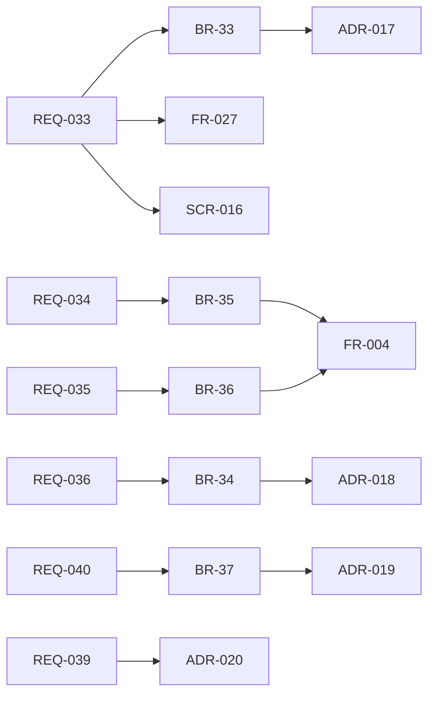

# 変更：dots / Grok Bot の機能を「統制つきで同等に」採用する（v0.2 → v0.3、2026-10-01）
> **3行で**：競合の機能（アプリ内での即時有効化・Always Allow・handoff・Auto Review・Activity View・音声・永続ワークスペース・ブラウザ・MCP・取りまとめ役）を基本的にすべて採用した ／ 体験は競合と同等にし、統制（決定論的な判定・内容を固定した外部作用・超えられない上限）は残すため ／ いちばん大きい影響は、定義の既定の保存場所がリポジトリからアプリ内に変わり、「PR での公開」が GitOps モードの選択肢になったこと。

元の資料：旧 `12_agent_builder.md`（v0.3「競合機能の採用方針」、改訂履歴、未決事項）、旧 00・01 の版数欄（v0.3 の方針）。v0.3 当時、02〜11 には未反映で、2026-10-01 の書き直しで各書に統合した。

## 🧭 判断してほしいこと
この版で残った論点（現在の番号は [README](../README.md) の判断表）：
- v0.2 の「PR での公開」を前提にした US-027・UC-019・FR-027・SCR-016 などの見直し（12 §未決事項。書き直しでは GitOps モードの経路として残した）
- アプリ内モードで「権限を広げる変更」を承認できる人：承認者（BR-14）か組織の owner か（個人開発者は自分で承認することになる）
- ブラウザのサンドボックスの基盤（Cloud Run Jobs で動かせるか、遠隔操作の画面配信の方式）（フェーズ2）
- MCP コネクタの信頼性（登録するサーバーの審査、ツールの説明文によるプロンプトインジェクション）（→ v0.4 で BR-42 などの対策）
- 「操作デモで Skill を教える」を未決として残したまま REQ-041 として採用した矛盾（11 の Q-98）

## 差分
| ドキュメント | 節 / ID | 種別 | 変更前 → 変更後（1行） |
|---|---|---|---|
| [01](../01_requirements.md) | 背景・方針 | 追加 | 競合の機能は基本的にすべて採用し、体験は同等、統制は残す。Web アプリのみ・BYOK のみは維持 |
| [01](../01_requirements.md) | REQ-033〜038 | 追加 | アプリ内での即時有効化と GitOps モード、「以後も許可」のルール、`handoff`、AI事前レビュー、アクティビティビュー、音声入力（フェーズ1） |
| [01](../01_requirements.md) | REQ-039〜043 | 追加 | 永続ワークスペース、統制つきブラウザ、Teach a task、MCP コネクタ、`watch`（フェーズ2） |
| [01](../01_requirements.md) | REQ-032 | 変更 | 取りまとめ役と委任：Could → Should |
| [01](../01_requirements.md) | Won't | 変更 | 「ブラウザ操作による作用」→「統制のないブラウザ操作」「モデルの判断による許可」 |
| [03](../03_use_cases/README.md) | BR-33〜37 | 追加 | 緩める変更の承認（BR-33）、AI事前レビューは厳しくする方向だけ（BR-34）、「以後も許可」のルールの条件（BR-35）、支払い・送金・パスワード変更は `handoff` のみ（BR-36）、ブラウザの通信の制限（BR-37、フェーズ2） |
| [04](../04_functional_spec/README.md) | エージェント定義 | 追加 | `appearance`、`autonomy` の `handoff` / `browser_submit` / `payment`、`rules`、`workspace`、`browser` |
| [04](../04_functional_spec/README.md) | 判定 | 変更 | 「以後も許可」のルールに一致すれば `auto`、自律レベル `handoff` を追加 |
| [07](../07_architecture.md)、[adr](../adr/) | ADR-017〜020 | 追加 | 既定の保存場所はアプリ内、モデルの判断は厳しくする方向だけ、ブラウザは書き込みの通信をプロキシで止める、使い捨ての計算資源＋永続ディスク |
| [adr](../adr/) | ADR-011 | 変更 | 定義はリポジトリ → GitOps モードとして残し、既定はアプリ内（→ ADR-017） |
| [adr](../adr/) | ADR-016 | 変更 | ブラウザ操作は採用しない → 統制つきで採用（→ ADR-019） |
| [00](../00_overview.md) | スコープ・ピッチ | 変更 | アプリ内での即時有効化、「以後も許可」、`handoff`、AI事前レビュー、アクティビティビュー、音声入力を In に |
| [00](../00_overview.md)、[01](../01_requirements.md) | フェーズ計画 | 変更 | フェーズ1にアプリ内モード・ルール・`handoff`・AI事前レビュー・アクティビティビュー・音声入力・見た目、フェーズ2に永続ワークスペース・統制つきブラウザ・MCP・`watch`・取りまとめ役 |

## 影響範囲

- 影響を受けるが v0.3 では変更しなかったもの：02〜11 のすべて（US-027・UC-019・FR-027・SCR-016 など「PR での公開」を前提にした記述、REQ-033〜043 に対応する US・UC・FR・SCR・TBL・API）。REQ-033〜038 の US・UC・FR の詳細は v0.3 では設計されていない（書き直しでは設計を足さず、各書の判断表に Q として挙げる）。
- v0.4 で REQ-042・043 をフェーズ0へ前倒し、v0.6 で BR-35 のルールの形を確定した。

## 関連
- ADR：新規 [ADR-017](../adr/ADR-017-in-app-definition-default.md)、[ADR-018](../adr/ADR-018-model-only-tightens.md)、[ADR-019](../adr/ADR-019-browser-via-write-blocking-proxy.md)、[ADR-020](../adr/ADR-020-ephemeral-compute-persistent-disk.md)。改訂 [ADR-011](../adr/ADR-011-agent-definition-in-repo.md)、[ADR-016](../adr/ADR-016-integrations-as-gateway-adapters.md)
- 前の版：[v0.2](2026-10-01-v0.2-agent-builder.md) ／ 次の版：[v0.4](2026-10-01-v0.4-cloud-agent.md)
