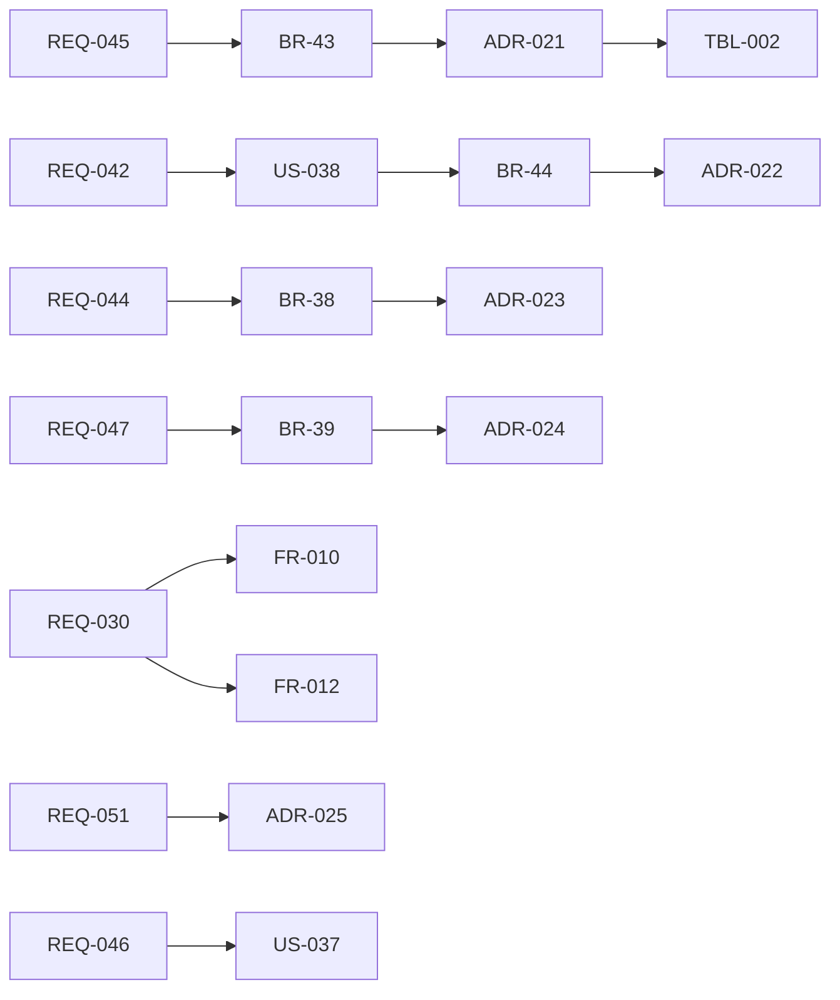

# 変更：開発専用から汎用クラウドエージェントへ位置づけを変える（v0.3 → v0.4、2026-10-01）
> **3行で**：ニュースのリサーチ・毎朝の交通状況・メールの整理・開発を同じ仕組みで動かす汎用クラウドエージェントにし、既存サービスへは MCP、Web の読み取りは組み込みにした ／ プロダクトオーナーとの壁打ち（2026-10-01）で、開発以外の個人の用途を中核にし、まず自分の開発環境で毎日使える状態を目指すと決めたため ／ いちばん大きい影響は、ポリシーの基本がリポジトリからワークスペースに移り（organizations → workspaces）、MCP の書き込みが外部作用に加わったこと。

元の資料：旧 `13_cloud_agent.md`（v0.4。決定事項・フェーズ計画・既存ドキュメントへの影響・改訂履歴）、旧 00・01 の版数欄（v0.4）、旧 12 の改訂履歴（v0.4：フェーズ計画の正本を 13 へ）。v0.4 当時は 00・01・12 にだけ反映し、02〜11 は 2026-10-01 の書き直しで統合した。

## 🧭 判断してほしいこと
この版で残った論点（現在の番号は [README](../README.md) の判断表）：
- Web 取得の URL を使った情報の持ち出しをどこまで防ぐか（汚染後の `web_fetch` を検索結果の URL に限るか）
- MCP の書き込みの検証（Verify）の方法（→ v0.6 で `none` / `readback` に整理、`readback` の設定は未決）
- MCP カタログの審査の方針（フェーズ1）
- 一般の個人ユーザーが LLM の API キーを用意する手間の減らし方（課金なしのまま）
- 開発テンプレートをフェーズ0に含めるか
- 交通情報の情報源の利用規約
- 汚染の単位（タスク全体か、データの流れまでか。フェーズ0はタスク単位）
- 13 の「反映が要る」とだけ書かれた未設計の部分（コネクタ・プロフィール・レポートの画面や API の詳細など）は、各書の判断表に Q として挙げた

## 差分
| ドキュメント | 節 / ID | 種別 | 変更前 → 変更後（1行） |
|---|---|---|---|
| [00](../00_overview.md)、[01](../01_requirements.md) | 位置づけ・目的 | 変更 | 統制つき自律 **開発** エージェント → 統制つき **汎用** クラウドエージェント。開発はテンプレートの1つ |
| [00](../00_overview.md)、[02](../02_user_stories/README.md) | 対象ユーザー | 変更 | 開発者（個人 → チーム → 企業）→ 一般の個人ユーザーも含む（P-6）。最初の利用者はプロダクトオーナー本人 |
| [01](../01_requirements.md) | 制約・Won't | 変更 | 課金の仕組みは作らない（再確認）。セルフホスト版は作らない → フェーズ0の開発・自己利用に限って緩める（ADR-025）。`shell_network` は deny のまま、Web は `web_read` だけ |
| [01](../01_requirements.md) | フェーズ計画 | 変更 | フェーズ0（単一ユーザー・ローカル）を新設。MCP（REQ-042）・`watch`（REQ-043）・連携先への作用（REQ-030）をフェーズ0へ前倒し |
| [01](../01_requirements.md) | REQ-031 | 置換 | コントロールリポジトリ → REQ-045（ワークスペースのポリシー） |
| [01](../01_requirements.md) | REQ-043 | 変更 | Should → Must |
| [01](../01_requirements.md) | REQ-044〜051 | 追加 | Web 読み取り、ワークスペースのポリシー、届け先、汚染の追跡、プロフィール、カタログとワンクリック接続（フェーズ1）、汎用テンプレートとスターター、単一ユーザーのローカル起動 |
| [01](../01_requirements.md) | 完成条件 | 追加 | フェーズ0：「毎朝の交通状況」と「ニュースのリサーチ」を会話で作り、毎朝届く。Slack は初回だけ承認し「以後も許可」で自動（→ v0.5 で改訂）。フェーズ0の KPI はない |
| [02](../02_user_stories/README.md) | P-6、US-036〜039 | 追加 | 交通状況、ニュースのまとめ、MCP サーバーの接続、リポジトリなしでの作成 |
| [03](../03_use_cases/README.md) | BR-38〜46 | 追加 | 汚染の記録（BR-38）、汚染後の書き込み（BR-39。→ v0.6 で改訂）、`watcher` は書き込みなし（BR-40）、プロフィールの公開範囲（BR-41）、ツールの説明の変更で `needs_review`（BR-42）、ワークスペースのポリシーが上限（BR-43）、`read` への分類は owner だけ（BR-44）、出典の URL（BR-45）、変化がなければ通知しない（BR-46） |
| [03](../03_use_cases/README.md)、[00](../00_overview.md) | A-03 | 変更 | 組織 = GitHub App のインストール → GitHub はワークスペースにつなぐ連携の1つ（A-78） |
| [04](../04_functional_spec/README.md) | 操作カタログ | 追加 | `web_read`、`mcp_read`、`mcp_write`（`auto` はルール経由だけ）、`notify`。操作名 `mcp.<connector>.<tool>` |
| [04](../04_functional_spec/README.md) | ツールカタログ | 追加 | `web_search`、`web_fetch`、`mcp_call`、`notify`、`submit_report` を全テンプレートへ（出典必須）、`deliver`（→ v0.6 で廃止） |
| [04](../04_functional_spec/README.md) | テンプレート | 追加 | `researcher`、`briefer`、`watcher`、`assistant` |
| [04](../04_functional_spec/README.md) | `compose()` | 変更 | `compose(ceilings, repoPolicy, agentDef)` → `compose(ceilings, workspacePolicy, repoPolicy?, agentDef)`（BR-20 の改訂） |
| [04](../04_functional_spec/README.md) | ワークスペースのポリシー | 追加 | スキーマ（`autonomy`・`budget`・`web`・`connectors`・`approvers`） |
| [05](../05_non_functional.md) | フェーズ0 | 変更 | マルチテナント系の NFR はフェーズ1以降。フェーズ0の NFR（ローカルの起動時間、スケジュールの遅れ）は「反映が要る」とだけ書かれ未設計 |
| [06](../06_ux_design/README.md) | 画面 | 追加 | コネクタの一覧・登録・分類、プロフィール、レポート、スターターからの作成（詳細は未設計） |
| [07](../07_architecture.md) | 構成 | 追加 | フェーズ0の構成（docker compose、トンネル）、Web 取得プロキシ、Gateway の MCP クライアント |
| [07](../07_architecture.md)、[adr](../adr/) | ADR-021〜025 | 追加 | ワークスペースのポリシー、MCP に統一・未分類は書き込み、Web 読み取りは組み込みのプロキシ、汚染の追跡、フェーズ0 |
| [adr](../adr/) | ADR-016 | 変更 | 連携先は Gateway のアダプター → アダプター方式は GitHub に限る（ADR-022） |
| [08](../08_database/README.md) | TBL-002 | 変更 | organizations → workspaces（改名） |
| [08](../08_database/README.md) | 新規テーブル | 追加 | workspace_policies、connectors、connector_tools、profiles、reports、`tasks.tainted` |
| [09](../09_api/README.md) | API | 追加 | コネクタ・ツールの分類・プロフィール・レポートの API（詳細は未設計） |
| [10](../10_diagrams/README.md) | 図 | 追加 | MCP 呼び出しのシーケンス、汚染の状態 |
| [11](../11_tech_spec.md) | 全体 | 変更 | 目的・スコープ・脅威モデル（外部の内容・Web の持ち出し・ツールの説明の書き換え）を汎用クラウドエージェントに合わせる |
| [00](../00_overview.md) | A-71〜78 | 追加 | リモートの MCP のみ、検索 API、交通の情報源、トンネル、取りこぼしは実行しない、プロフィールの上限、`web_fetch` の上限、組織の改名 |

## 影響範囲

- 影響を受けるが v0.4 では変更しなかったもの：02〜11 のすべて（13 §既存ドキュメントへの影響）。とくに FR-004・FR-010〜012（MCP の Intent）は v0.6 で設計した。
- 12 のフェーズ計画は 13 を正とする注記だけを足した。

## 関連
- ADR：新規 [ADR-021](../adr/ADR-021-workspace-policy.md)、[ADR-022](../adr/ADR-022-mcp-unified-unclassified-is-write.md)、[ADR-023](../adr/ADR-023-builtin-web-read-proxy.md)、[ADR-024](../adr/ADR-024-taint-tracking-against-injection.md)、[ADR-025](../adr/ADR-025-phase0-single-user-local.md)。限定 [ADR-016](../adr/ADR-016-integrations-as-gateway-adapters.md)
- 前の版：[v0.3](2026-10-01-v0.3-competitor-features.md) ／ 次の版：[v0.5](2026-10-01-v0.5-agent-persona.md)
