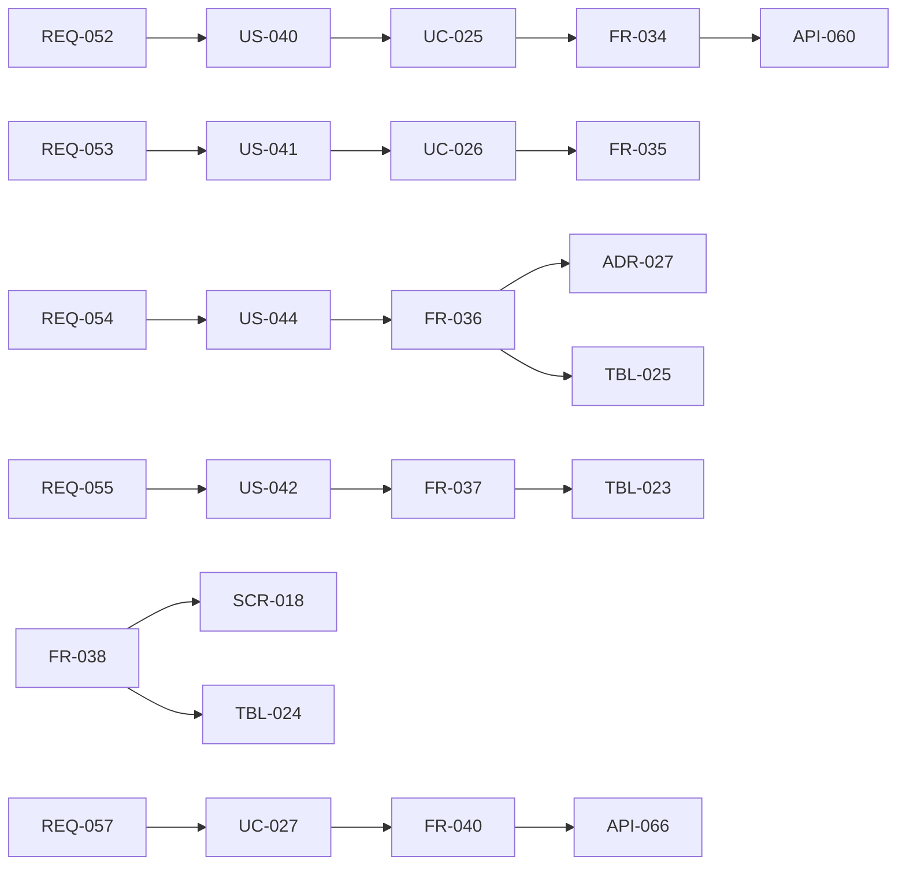

# 変更：エージェントの作り方を「名前を付けて頼むだけ」にする（v0.4 → v0.5、2026-10-01）
> **3行で**：作り方を「名前を付ける → エージェントが話しかける → お願いする → エージェントが自己設定」に変え、トリガー・テンプレート・届け先を「仕事（jobs）」にまとめた ／ 会話で下書き → Canvas → 試し実行 → 公開の手順は一般の個人ユーザーには多すぎたため（プロダクトオーナー、2026-10-01） ／ いちばん大きい影響は、設定の変更を Kernel の `classify()` が分類し、`widen` だけを人に戻す仕組みが加わり、下書き（TBL-021・API-043〜048・SCR-015）が廃止されたこと。

元の資料：旧 `14_agent_persona.md`（v0.5。決定事項・フェーズ0の完成条件・既存ドキュメントへの影響・改訂履歴）、旧 12・13 の v0.5 の注記、旧 00 のドキュメント一覧。v0.5 当時は 00・12・13 に注記だけを足し、01〜10 は 2026-10-01 の書き直しで統合した。

## 🧭 判断してほしいこと
この版で残った論点（現在の番号は [README](../README.md) の判断表）：
- 指示文の変更を `neutral` として自動で反映してよい範囲（宛先・頻度は検出できるが、内容の性質は検出しにくい）
- エージェントの「人格」（口調・一人称）をどこまで持たせるか
- 繰り返す仕事の初回に「確認のための実行」を必ず行うか
- 仕事を移すときにメモリも移すか
- 同じお願いに答えられるエージェントが複数いる場合の任せ先の選び方
- 設計アシスタントの性能・費用の目標（NFR-054・059、A-35）が設定プランナーに読み替わるか（11 の Q-94）

## 差分
| ドキュメント | 節 / ID | 種別 | 変更前 → 変更後（1行） |
|---|---|---|---|
| [01](../01_requirements.md) | REQ-052〜058 | 追加 | 名前だけで作成、お願いで自己設定、`classify()` による分類、複数の仕事、自己調整、任せ先の提案、名前の提案（フェーズ0） |
| [01](../01_requirements.md) | REQ-020 | 置換 | 会話での下書き作成 → REQ-052〜053 |
| [01](../01_requirements.md) | REQ-018・022 | 変更 | Canvas・試し実行：Must → Could（詳細設定の機能） |
| [01](../01_requirements.md) | フェーズ0の完成条件 | 変更 | 会話で作り毎朝届く → 名前だけで「朝の交通係」「ニュースリサーチャー」を作り、一言お願いするだけで翌朝から届く。「もっと短く」で次の朝から短くなる |
| [01](../01_requirements.md) | フェーズ | 変更 | フェーズ0に REQ-052〜055・058 と REQ-056 のうちチャットの一言による調整。👍 / 👎・開封時刻（REQ-056 の残り）と REQ-057 は後回しにできる |
| [02](../02_user_stories/README.md) | US-040〜044 | 追加 | 名前だけで作る、お願いで動き始める、仕事を足す・変える、役割外を任せ先に移す、知らないうちに権限が増えない |
| [03](../03_use_cases/README.md) | UC-025〜028 | 追加 | 名前を付けて作る、お願いから仕事を作る、仕事を移す、自己調整 |
| [03](../03_use_cases/README.md) | BR-47〜55 | 追加 | 定義を変えられる経路（BR-47）、名前・役割は権限に影響しない（BR-48）、質問は1つまで（BR-49）、プロフィールの公開は `neutral`（BR-50）、外部の内容を根拠にした変更は確認（BR-51）、調整は1日1回（BR-52）、変更の記録と元に戻す（BR-53）、戻した調整は14日しない（BR-54）、`agent.config.widened`（BR-55） |
| [04](../04_functional_spec/README.md) | FR-034〜040 | 追加 | 名前のみの作成、設定プランナー、変更の分類、仕事、チャット、自己調整、任せ先の提案 |
| [04](../04_functional_spec/README.md) | FR-024 | 置換 | 設計アシスタント → FR-035 設定プランナー |
| [04](../04_functional_spec/README.md) | 定義スキーマ | 変更 | v1 → v2（`jobs[]`、`grants`）。最初の境界（`web_read`・`notify`・`memory_write`、予算 $0.2 / $1 / 10回） |
| [06](../06_ux_design/README.md) | SCR-018 | 追加 | エージェントのチャット（`/agents/:agentId` の既定のタブ） |
| [06](../06_ux_design/README.md) | SCR-015 | 廃止 | エージェント作成（会話）→ SCR-018 に統合 |
| [06](../06_ux_design/README.md) | SCR-016 | 移動 | Harness Canvas → SCR-017 の「詳細設定」タブ |
| [06](../06_ux_design/README.md) | SCR-014・017 | 変更 | 一覧に仕事の数・次の実行時刻、名前だけのシート。詳細はタブ「チャット／仕事／変更履歴／詳細設定」 |
| [07](../07_architecture.md)、[adr](../adr/) | 設定プランナー、ADR-026〜028 | 追加 | 設定プランナーは `api` の中で LLM Proxy を通す。名前を付けて頼む、`classify()`、仕事を実行の単位に |
| [08](../08_database/README.md) | TBL-023〜025 | 追加 | agent_jobs、agent_messages、agent_config_changes |
| [08](../08_database/README.md) | TBL-018・019・020・006 | 変更 | agents（`role`・`name_source`・`appearance` を追加、`template` を削除）、agent_snapshots（v2・`config_change_id`）、agent_schedules（`job_id`）、tasks（`job_id`） |
| [08](../08_database/README.md) | TBL-021 | 廃止 | agent_drafts → TBL-024・025 |
| [09](../09_api/README.md) | API-060〜067 | 追加 | 作成、会話の取得・送信（SSE）、`widen` の承認・却下、元に戻す、仕事、仕事の移動、反応 |
| [09](../09_api/README.md) | API-043〜048・057・058 | 廃止 | 下書きの API（API-049〜052 はそのまま） |
| [10](../10_diagrams/README.md) | 図 | 追加 | 自己設定のシーケンス、設定の変更の状態遷移 |
| [11](../11_tech_spec.md) | 監査・脅威 | 変更 | 監査イベント（`agent.created` / `renamed` / `config.changed` / `config.widened` / `config.reverted`、`job.created` / `moved` / `paused`）、自己設定による権限の拡大の脅威 |
| [00](../00_overview.md) | A-79〜83 | 追加 | 最初の予算、会話の保存90日、仕事10個・エージェント20体、設定プランナーのモデル、役割5種類 |

## 影響範囲

- 影響を受けるが v0.5 では変更しなかったもの：01〜10 のすべて（14 §既存ドキュメントへの影響）。v0.2 の FR-025〜027・BR-30・NFR-054・055・059・SCR-016 は詳細設定・GitOps モードの経路として残る。
- 12 の作り方の節と 13 のフェーズ0の完成条件には、v0.5 で置き換えた旨の注記だけを足した。

## 関連
- ADR：新規 [ADR-026](../adr/ADR-026-name-and-ask.md)、[ADR-027](../adr/ADR-027-classify-widening-changes.md)、[ADR-028](../adr/ADR-028-jobs-as-unit-of-work.md)
- 前の版：[v0.4](2026-10-01-v0.4-cloud-agent.md) ／ 次の版：[v0.6](2026-10-01-v0.6-mcp-write.md)
