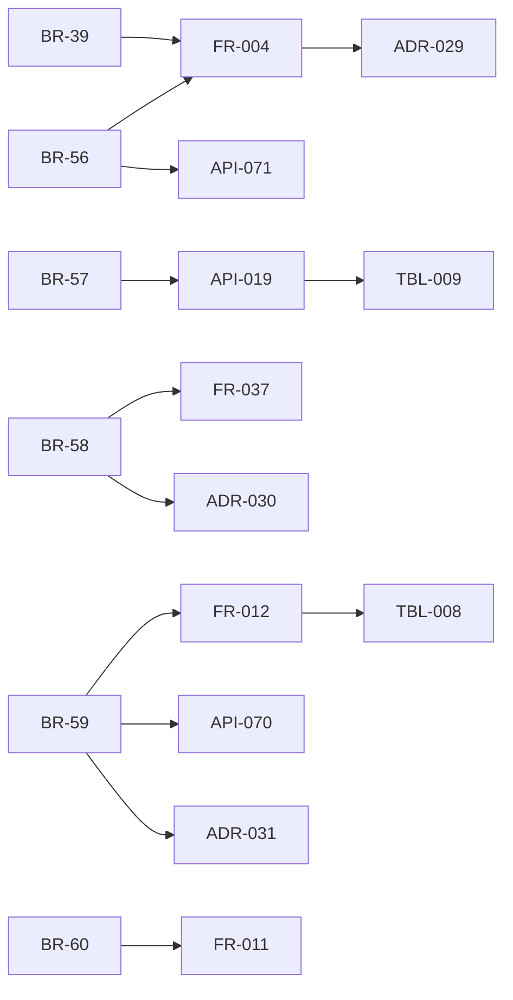

# 変更：MCP の書き込みの宛先を固定し、Intent のライフサイクルを決める（v0.5 → v0.6、2026-10-01）
> **3行で**：書き込みツールの引数に役割（`destination` / `content` / `option`）を付けて「以後も許可」のルールで宛先を固定し、届け先を宣言にして、MCP の Intent のライフサイクル（複数の Intent・`unknown_outcome`・承認待ちと定期実行）を決めた ／ フェーズ0の完成条件「Slack は初回だけ承認し、翌日から自動」が、宛先の引数が分からないことと Intent が PR 専用であることの2点で成り立たなかったため（設計レビュー、プロダクトオーナーが承認） ／ いちばん大きい影響は、`decide()` の評価順にツールの状態・Intent の数・ルールの手順が加わり、Intent とタスクの終わり方が変わったこと。

元の資料：旧 `15_mcp_write.md`（v0.6。決定事項・既存ドキュメントへの影響・改訂履歴）、旧 12・13・14 の v0.6 の修正（ルールの例、ツール `deliver` の廃止、BR-39 の改訂）。v0.6 当時は 12〜14 にだけ反映し、03・04・06・08・09・10 は 2026-10-01 の書き直しで統合した。

## 🧭 判断してほしいこと
この版で残った論点（現在の番号は [README](../README.md) の判断表）：
- 引数の役割の確定が「名前を付けて頼むだけ」の体験に手間を足す：カタログで推奨の役割を配るか、初回の承認カードで確定させるか
- `destination` がネストしているツール（`message.to[]` など）への対応（JSON Pointer で役割を付けるか）
- `assistant` で書き込みの結果を待って次に進みたい場合（タスクを一時停止して承認を待つ形にするか）
- `readback` の検証の設定のしかた
- 宛先の値がユーザーに読めない場合（Slack の DM のチャンネル ID など）の `labels` の付け方

## 差分
| ドキュメント | 節 / ID | 種別 | 変更前 → 変更後（1行） |
|---|---|---|---|
| [03](../03_use_cases/README.md) | BR-39 | 変更 | 汚染時だけ引数のパターンまで一致 → ルールはすべての `destination` 引数を完全一致で固定、汚染の有無にかかわらず同じ |
| [03](../03_use_cases/README.md) | BR-56〜60 | 追加 | 引数の役割はユーザーが確定・未確定は `destination`（BR-56）、ルールは承認カードからだけ（BR-57）、宛先は定義が決める（BR-58）、自動で再試行しない（BR-59）、次の実行で承認待ちは無効（BR-60） |
| [03](../03_use_cases/README.md) | BR-35 | 変更 | 「リポジトリのポリシーと Hard Ceiling が `auto` を許すもの」→「ワークスペースのポリシー（開発ではリポジトリのポリシーも）が `rules.enabled` で、Hard Ceiling が `auto`（ルール経由）を許すもの」 |
| [03](../03_use_cases/README.md) | UC-009〜010 | 追加 | MCP 版（または UC-029〜030 として追加。どちらにするかは 15 で未定） |
| [04](../04_functional_spec/README.md) | FR-004 | 変更 | 入力に `subject.actionType`・`subject.tool`・`subject.origin`・`taint`・`counters.intentsCount`。評価順にツールの状態（`tool_needs_review` / `connector_disabled`）・Intent の数（`intent_limit`）・ルールを挿入。汚染は MCP の書き込みの判定を変えない |
| [04](../04_functional_spec/README.md) | FR-010〜012 | 変更 | MCP 版：intentHash（引数・`toolHash`・実効ポリシーのハッシュ）、Gateway でのロックと `tool_hash` の確認、結果ごとの状態と再試行 |
| [04](../04_functional_spec/README.md) | ステータス | 変更 | Intent に `unknown_outcome` を追加、`executed` は検証 `none` なら終了、`expired` に `superseded` / `tool_changed`。タスクの `succeeded` を「外部作用がすべて実行された」に、`completed`（`actions_declined`）と `failed`（`action_failed`）を追加。メモリの有効化（BR-26）は `actions_declined` でも行う |
| [04](../04_functional_spec/README.md) | A-30 | 廃止 | 1タスク1 Intent → 複数可（既定5件、Hard Ceiling 20件。A-85） |
| [04](../04_functional_spec/README.md) | 届け先・ツール | 変更 | ツール `deliver`（13）を廃止し、仕事の `deliver`（`to`・`args`・`content`）で宣言。`content` に使える変数は `report.title` / `summary` / `body` / `sources_markdown` だけ |
| [04](../04_functional_spec/README.md) | ワークスペースのポリシー | 追加 | `rules.enabled`、`rules.max_per_agent: 20` |
| [04](../04_functional_spec/README.md) | 承認期限 | 変更 | 一律24時間（A-05）→ 定期実行は `min(24時間, 同じ仕事の次の実行の予定時刻)` |
| [06](../06_ux_design/README.md) | 承認カード | 追加 | MCP の承認カード（宛先・中身・その他・汚染・ツールの説明）、[以後も許可] の5条件と固定される値の確認、ルールの一覧、`unknown_outcome` のカード、ツールの分類画面の引数の役割、リスク評価（加点表） |
| [08](../08_database/README.md) | connector_tools | 変更 | `arg_roles`・`scope`・`verify` を追加、`tool_hash` に `arg_roles` を含める |
| [08](../08_database/README.md) | TBL-008 action_intents | 変更 | `task_id` の UQ を外す、`mcp_call`、`payload`・`origin`・`job_id`・`expires_at`・`result` を追加、PR 専用の列は `open_pr` のときだけ NOT NULL |
| [08](../08_database/README.md) | TBL-009 approvals | 変更 | `remember`・`created_rule_id` を追加 |
| [09](../09_api/README.md) | API-019 | 変更 | `remember?: boolean` を追加、作ったルールを返す、422 `RULE_NOT_ALLOWED` |
| [09](../09_api/README.md) | API-068〜071 | 追加 | ルールの一覧・取り消し、`unknown_outcome` の解決、ツールの分類と役割の確定 |
| [10](../10_diagrams/README.md) | 図 | 追加 | MCP の Intent のシーケンスと状態遷移 |
| [11](../11_tech_spec.md) | 脅威・エラー | 変更 | 宛先のすり替え・二重送信の脅威、MCP の書き込みの再試行の方針、入力の上限（60秒・64KB・Intent 数） |
| [00](../00_overview.md) | A-84〜87 | 追加 | 役割は最上位のプロパティ単位、Intent 数、タイムアウトと応答の上限、結果を待たない |
| 旧 12・13・14 | ルールの例 | 変更 | `channel: "@me"` などの別名 → 承認した Intent の実際の値（表示名は `labels`） |

## 影響範囲

- 影響を受けるが v0.6 では変更しなかったもの：03・04・06・08・09・10（15 §既存ドキュメントへの影響）。UC-009〜010 の MCP 版の詳細は未設計。

## 関連
- ADR：新規 [ADR-029](../adr/ADR-029-mcp-arg-roles-destination-fixed.md)、[ADR-030](../adr/ADR-030-declarative-deliver.md)、[ADR-031](../adr/ADR-031-mcp-write-no-auto-retry.md)
- 前の版：[v0.5](2026-10-01-v0.5-agent-persona.md) ／ 全体の書き直し：[2026-10-01-rewrite](2026-10-01-rewrite.md)
