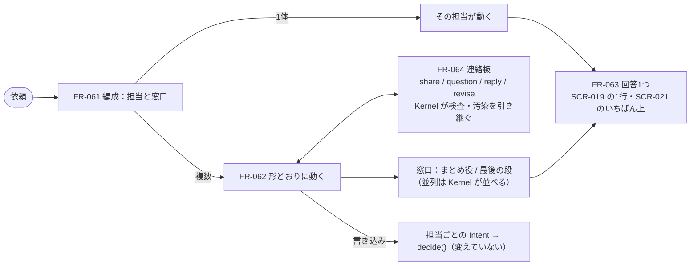

# 変更：担当どうしが協調して、1つの回答を返す（v0.13 → v0.14、2026-10-02）
> **3行で**：頼むと生まれた担当が複数いるとき、依頼ごとの **連絡板** で共有・質問・返事・作り直しの依頼をしながら進め、ユーザーには依頼1件につき **回答を1つ** 返すようにした。1体ならその担当がそのまま答える ／ プロダクトオーナーの要望。v0.12 の編成は結果を一方向に渡すだけで（BR-73 で担当どうしは話せない）、並列では報告がばらばらに届いていた（[ADR-038](../adr/ADR-038-team-board-and-one-answer.md)、[D-72](../decisions.md#d-72)） ／ いちばん大きい影響は、BR-73 を「同じ依頼の担当への連絡だけはできる」に緩めたこと。その代わりに、連絡でも汚染を引き継ぎ（BR-75）、権限は動かさず（BR-76）、上限を Kernel が守る（BR-77）。

## 🧭 判断してほしいこと
- **Q-110**：✅決定（[D-73](../decisions.md#d-73)）。「回答1つは Must、連絡板は Should」。回答は、ひとり・順番では最後の担当の報告を回答にするだけで済む。連絡板はチェックポイント②（10/10）のあとに、用意した依頼（D-70）へ「仕入れ係 → 受信箱係に数量を質問」の1往復だけ足す（[15](../15_hackathon.md)）。
- **Q-111**：✅決定（[D-74](../decisions.md#d-74)）。並列の回答は Kernel が担当ごとの報告を並べる（LLM なし）。
- 仮に置いた値（実機で決め直す）：A-103 連絡は1依頼20通・同じ2体の質問は3往復、A-104 返事を待つのは5分、A-105 追いのターンは1ターン。

## 全体図

## 差分
| ドキュメント | 節 / ID | 種別 | 変更前 → 変更後（1行） |
|---|---|---|---|
| [01](../01_requirements.md) | REQ-066・067、Won't | 追加・変更 | 回答1つ（Must、0-H も Must）・連絡板での協調（Must、0-H は Should）。Won't の「別の担当を呼ぶ」を「依頼の外の担当」に |
| [02](../02_user_stories/stories-cloud-agent.md) | US-047・048、US-046 | 追加・変更 | 答えは1つで返る／確かめ合ってから答える。並列の報告は担当ごとの行 → 回答1つ |
| [03 agents](../03_use_cases/agents.md) | UC-041、UC-040 の6 | 追加・変更 | 担当どうしで協調して1つの回答を返す |
| [03 business-rules](../03_use_cases/business-rules.md) | BR-73、BR-75〜77 | 改訂・追加 | 同じ依頼の担当への連絡だけは可。連絡はデータで汚染を引き継ぐ・権限は動かない・上限 |
| [04 agents](../04_functional_spec/agents.md) | FR-063・064、FR-061・062、Q-111 | 追加・変更 | 窓口と回答、連絡板（`team_post`・`team_wait`・`validateTeamMessage()`・追いのターン）。`validateFormation()` に「窓口が1つ」「名前が重ならない」を追加 |
| [06 ask-page](../06_ux_design/ask-page.md) | SCR-021 | 変更 | いちばん上に「回答」、担当の段の間に「やり取り」、[この依頼に返事する] |
| [06 ask-and-check](../06_ux_design/ask-and-check.md) | 頼んだ仕事の行 | 変更 | 見てほしいものの報告は依頼1件に1行（回答） |
| [06 entrance](../06_ux_design/entrance.md) | SCR-020 | 変更 | 形の1行に「誰が答えるか」を足した |
| [15](../15_hackathon.md) | Q-110、範囲 | 追加・変更 | 回答1つを Must、連絡板を Should に（D-73） |
| [ADR](../adr/) | ADR-038、ADR-036 の影響 | 追加・変更 | — |
| [決定記録](../decisions.md) | D-72〜74 | 追加 | Q-110・111 を決定 |
| [00](../00_overview/) | 用語集・トレーサビリティ | 追加 | 回答・窓口・連絡板・追いのターン、REQ-066・067 の行 |

## 影響範囲（ID でたどったもの）
- BR-71（受け渡しで汚染を引き継ぐ）：連絡にも広げた（BR-75）。汚染された担当の連絡を受けた担当の書き込みは、BR-70 の2行目に「〇〇からの連絡のあとの送信です」と出る。
- BR-72（まとめ役は書き込まない）：変えていない。まとめ役が `revise` で作り直しを頼んでも、書き込むのはその担当で、その担当の Intent として判定する。
- フェーズ2の委任（REQ-032）：別物のまま。連絡板は「聞く・伝える」だけで、相手に仕事（タスク）を渡せるのは `revise`（同じ依頼・同じ仕事・1回）だけ。
- 用意した依頼（D-70）：D-73 で、チェックポイント②のあとに「仕入れ係 → 受信箱係：20kg は確定？」の1往復を足す。送る前の確認の2行目が「受信箱係からの連絡のあとの送信です」になる。

## 変えていないもの
- Kernel の `decide()`・`classify()`・ガード・ルール。担当ごとの書き込みは従来どおり判定する。
- 編成は依頼の時点で決める（実行中に担当は増えない）。形は4つのまま。
- 1編成の担当の上限（A-99）、まとめ役の待ち時間（A-100）、エージェントの上限（A-81）。
- 05・07〜10 への反映（`ask_messages` の表、API-076・077、`tasks.kind`、連絡板のシーケンス図、NFR の目標）は、ハッカソンの提出後にまとめて行う。実装は 04 FR-063・064 を正とする。
