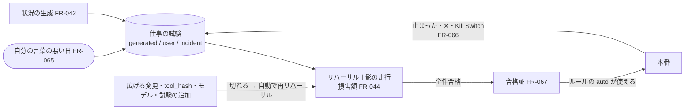

# 変更：リハーサルを、任せたあとも効く仕組みにする（v0.14 → v0.15、2026-10-02）
> **3行で**：リハーサルに4つの機能を Must として足した。自分の言葉で悪い日を足せる（FR-065）・防いだ損害を金額で出す（FR-044 を拡張し、影の判定を Must に）・本番で止まったことが次の試験になる（FR-066）・合格証が切れたら自動で再リハーサルし、それまでルールの自動を使わない（FR-067）。モデルを替えた比較（FR-068）などは Should ／ プロダクトオーナーの方針「量は減らさない。減らす方向ではなく、プロダクトとして強くなる改善を」（[D-75〜80](../decisions.md#d-75)、[ADR-039](../adr/ADR-039-rehearsal-certificate.md)） ／ いちばん大きい影響は、Kernel の `decide()` の手順11に「合格証がなければルールの `auto` を使わない」を足したこと（締める方向だけ）。

## 🧭 判断してほしいこと
- **Q-112**：✅決定（[D-75〜80](../decisions.md#d-75)）。
- **Q-113**：🟡未決。フェーズ0（実のコネクタ）で、本番で止まったタスクの読み取り結果（実のメールの本文など）を回帰の試験として保存してよいか。おすすめは B「保存せず、障害カタログの ID とパラメータだけを残す」。ハッカソン版は `sim-world` だけなので影響しない（提出後でよい）。
- 仮に置いた値（実機で決め直す）：A-106 自分の言葉の悪い日はゲスト1日5件、A-107 回帰の試験は仕事ごとに20件、A-108 Gemma を同じ経路で呼べて比較1回 $1.5 以内、A-109 再リハーサルは5分・$0.5 以内。

## 全体図

## 差分
| ドキュメント | 節 / ID | 種別 | 変更前 → 変更後（1行） |
|---|---|---|---|
| [15](../15_hackathon.md) | 3行で・Q-112・113・審査基準 | 追加・変更 | v0.15 の4機能を前に出す |
| [15](../15_hackathon.md) | §任せたあとも効くリハーサル（新設） | 追加 | FR-065〜071 の中身、`rehearsal_cases`・`rehearsal_certificates` |
| [15](../15_hackathon.md) | §影の判定 | 変更 | 損害額の式（BR-79）と「防いだ損害」の見せ方。Should → Must |
| [15](../15_hackathon.md) | オラクル・業務ルール | 追加 | O-08、BR-78〜81 |
| [15](../15_hackathon.md) | FR・REQ の表 | 追加・変更 | FR-065〜071、REQ-068〜075。REQ-060 を Must に |
| [15](../15_hackathon.md) | §最初に入っているもの | 変更 | 合格証なしで始まり、[適用] → 再試験で合格証が出る。モデルの比較（作れた場合） |
| [15](../15_hackathon.md) | §デモの筋書き | 変更 | 損害の金額・合格証・自分の言葉の悪い日・本番 → 次の試験・モデルの比較を入れた |
| [15](../15_hackathon.md) | §範囲・§日程・切る順番 | 変更 | 4機能を Must（切る順番に入れない）、FR-068〜071 は Should。10/4 に損害の式、10/8〜10 に合格証、10/11 に FR-065・066 |
| [15](../15_hackathon.md) | §リスク・§仮定 | 追加 | R-72〜75、A-106〜109 |
| [06 ask-page](../06_ux_design/ask-page.md) | SCR-021 リハーサルの区画 | 変更 | 合格証の状態・防いだ損害・「こんな日も試す」の入力欄 |
| [ADR](../adr/) | ADR-039 | 追加 | 合格証がないとルールの自動を使わない・本番の停止を試験に |
| [決定記録](../decisions.md) | D-75〜80、D-40 | 追加・注記 | Q-112 を決定。D-40 に「D-76 で Must に変更」 |

## 影響範囲（ID でたどったもの）
- Kernel の `decide()`（D-57 の手順）：手順11でルールを当てる前に合格証を確かめる。手順9・10、汚染（BR-38〜42）、宛先の固定（BR-39・56）は変えない。`approve` を増やす方向だけなので、BR-39 と両立する。
- ADR-022（`tool_hash` の固定）：説明が変わったときの既存の扱いに加えて、合格証が切れて再リハーサルが走る。リハーサルの障害 F-08 と同じ事象を本番でも拾う形になる。
- 用意した依頼（D-70）：合格証なしで始まる。用意した送る前の確認（豆 20kg）はもともとルールのない承認なので、審査員の体験は変わらない。
- SCR-019：本番から試験に入ったときの1行（「止まった発注を、次のリハーサルの試験に入れました」）を報告に出す。06 ask-and-check への反映は提出後（15 を正とする）。
- 費用（BR-62）：自分の言葉の悪い日・再リハーサルも1回 $0.5・ゲスト1日 $1 の中に入れる。

## 変えていないもの
- 障害カタログ（F-01〜13）とオラクル O-01〜07。自分の言葉の悪い日はカタログに当てはめるだけで、カタログは増やさない。
- 締める変更の提案（FR-045）と `classify()`。締める変更では合格証は切れない。
- 01〜05・07〜11 への反映（REQ・BR・FR の本体、`rehearsal_cases` などの表、API、`decide()` のシーケンス図）は、ハッカソンの提出後にまとめて行う。実装は 15 と ADR-039 を正とする。
