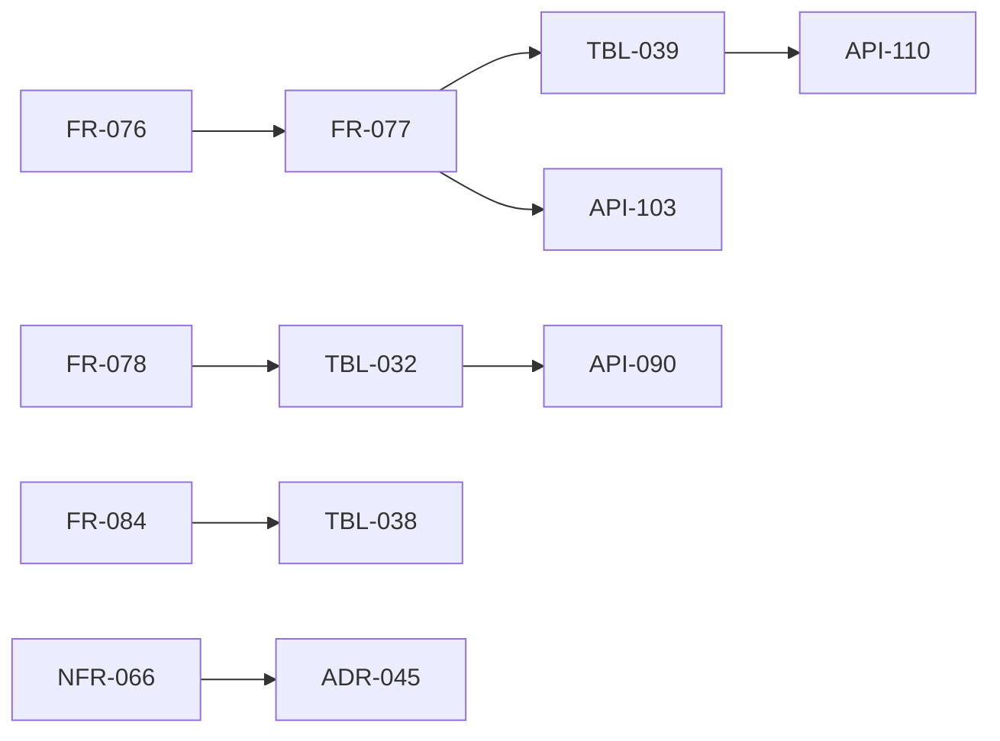

# 変更：Codex（gpt-6-astra）のレビュー 25件を反映（v0.1 → v0.2、2026-10-24）
> **3行で**：VM の隔離・身元のヘッダー・こわい操作のすり抜け・承認の1回性・交代の重なり・再開の漏れ・今のコードとの食い違いを直した ／ レビューの指摘は 25件（高 10・中 11・低 4）で、すべて直した ／ いちばん大きい影響はブラウザの確認を `action_intents` から別の表 `browser_checks`（TBL-039）に移したこと

## 🧭 判断してほしいこと
| # | 種類 | 論点 | おすすめ | 決まらないと止まるもの |
|---|---|---|---|---|
| Q-120 | 未決 | 提案の ADR に ADR-052（確認を別の表に）を足した。ADR-044・045 も中身を直した | 承認 | TBL-039、07 |

操作の先が分からないときの扱いは、ユーザーが「確認に回す」に決めた（D-150）。

## 差分
| ドキュメント | 節 / ID | 種別 | 変更前 → 変更後（1行） | 指摘 |
|---|---|---|---|---|
| 07・ADR-045・NFR-066 | ネットワーク | 変更 | VM は共有の box ネットワーク → VM ごとのネットワーク。egress は全アドレスを確かめ、つなぐ先を固定。IPv6・特別用途の範囲を足す | #1, #17 |
| 07・FR-073・R-80 | 本体の待ち受け | 変更 | 本体に box-manager・egress も届く → 画面向けの口は front だけ、front には Tailscale と本体だけ | #2 |
| FR-076 | 合図 | 変更 | T-1〜T-4 → T-1〜T-6（キーでの作動・修飾キー・先が分からない）。押すと離す・ドラッグを定義 | #3 |
| FR-077・TBL-039・API-110・ADR-052 | 確認 | 変更 | `action_intents` に `browser_action` → 別の表 `browser_checks`。中身のハッシュに結びつけ、`pending → executing` の条件つきの更新で1回だけ。操作 ID で VM の側も重複を断る。`unknown_outcome` を足す | #4, #5, #7 |
| FR-078・TBL-032・API-090 | 交代 | 変更 | `boxes.status = taken_over` → `boxes.control`（agent・handing_over・human）と `control_epoch`。動いている呼び出しを中止し、操作が終わってから人に渡す。`control` の画面は1本だけ | #6 |
| FR-084・10 | 再開 | 変更 | running・awaiting_approval だけ → 終わっていないすべての状態の戻し方の表。VM は必ず新しい世代で起こし、古いスクショは使わない | #8, #9 |
| 07・11 | LLM の会話の形 | 追加 | 「そのまま移す」→ 道具の結果の画像・computer use の専用の宣言・画像の費用を作り直す対象にする | #10 |
| FR-081・API-094・095 | つなぐ | 追加 | `state`（10分・1回）・Cookie・PKCE・GitHub のインストールの確かめ | #11 |
| TBL-035 | ポリシー | 変更 | `limits.*_micro_usd` → 今の `budget.per_task_usd` などのキー＋`max_browser_actions`。`max_minutes = 55` | #12 |
| API-096・TBL-035 | 設定の効き目 | 変更 | 「次の歩みから」→「次のタスクから」（今の `edge/inputs.ts` に合わせる） | #13 |
| TBL-038・FR-013 | 費用 | 追加 | LLM を呼ぶ前に見積もりを予約（`reserved_micro_usd`）、終わって精算。VM の空きもトランザクションで確保 | #14 |
| 04 | 移植元 | 追加 | 「Cloudflare 版のまま」→ Cloudflare 版・旧 Node 版・新規を FR ごとに書いた | #15 |
| 07 VM の中身・API-103 | 座標と要素 | 追加 | キオスク・倍率 1・タブ1枚・`open_url`・iframe とダイアログの扱い。確かめ（`dryRun`）と実行（`expect`）を分けてハッシュで結ぶ | #16 |
| 07・ADR-044・R-79 | docker-socket-proxy | 変更 | 「読み取りの制限つき」→ 使う API の種類を絞るだけ。中身は box-manager のコードで固定。box-manager を sock に入れる | #18 |
| 11 §8・08 | スクショと秘密 | 変更 | 「スクショはホストの中だけ」→ Claude に送る旨を書いた。秘密の文字はどの表にも平文で残さない。スクショはバックアップに入らない | #19 |
| TBL-033 | 操作の記録 | 変更 | `verdict` に結果も混ぜる → 判定（`verdict`）と結果（`outcome`）に分け、`check_id` を残す | #20 |
| 08 方針・07 | SQLite | 追加 | `WsDb` のアダプターの作り直し、`synchronous=FULL`・`foreign_keys`・`busy_timeout` | #21 |
| 09 共通仕様 | ページング | 変更 | 全部 cursor → 新しい一覧だけ cursor、今の一覧は今の形のまま | #22 |
| API-082・API-111 | 状態 | 追加 | health に状態も → health は ok と版だけ、状態は `GET /api/v1/host` | #23 |
| 00 トレーサビリティ・API-112 | 対応表 | 変更 | REQ-086・087 に API-019、REQ-091 に US-055・UC-048、REQ-089 の表を絞った。スクショの取得に API-112 | #24 |
| FR-082 | 書き出し | 変更 | `format_version` → `formatVersion` | #25 |
| 00 | 決定事項ログ | 追加 | D-150〜D-156 | — |

## 影響範囲

- 影響を受けるが今回は変更していないもの：01・02（要件とストーリーの振る舞いは変わらない）、ADR-041〜043・046・048〜051

## 関連
- ADR：新規 ADR-052。中身を直した ADR-044・045・047（どれも提案か、承認の範囲の中での細部）
