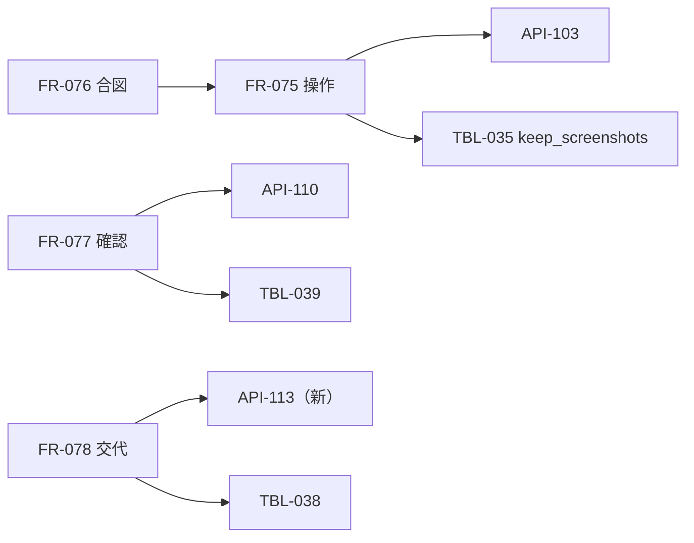

# 変更：Claude（Fable 5.1）のレビューを反映（v0.2 → v0.3、2026-10-24）
> **3行で**：こわい操作の判定のすり抜け2つ（`type` の改行・`open_url`）、実装すると詰まる箇所2つ（画面が変わったあとの確認・`control_epoch` の伝え方）、方針の抜け4つ（スクショの枚数・秘密の欄の画像・交代で中止した歩み・`web_fetch` のアドレス）を直した ／ 指摘は高 8・検討 10・表記 7 で、高と表記はすべて直し、検討のうち3つは持ち主の判断（Q-121〜123）にした ／ 新しい ID は D-157〜D-171・Q-121〜Q-123・API-113。表の形（TBL）は変えていない（TBL-035 の `browser` 欄に `keep_screenshots` を足しただけ）

## 🧭 判断してほしいこと
| # | 種類 | 論点 | おすすめ | 決まらないと止まるもの |
|---|---|---|---|---|
| Q-121 | 未決 | `div` に JS を付けただけのボタン（role なし）を T-3 の対象にするか | 対象にする（`cursor: pointer` か click のリスナーがある要素も見る） | FR-076 の T-3 の実装 |
| Q-122 | 未決 | 確認待ち（30 分）・交代待ちの時間を `max_minutes`（55）に含めるか | 含めない（待つ間はタスクの時計を止める） | FR-075 の上限、FR-077 |
| Q-123 | 未決 | TBL-035 の初期値（200 歩・55 分）は Kernel の上端の値で、今のワークスペースの既定（40 歩・15 分）ではない | 設計書の値のまま（VM の仕事は歩数が多い） | TBL-035 |

## 差分
| ドキュメント | 節 / ID | 種別 | 変更前 → 変更後（1行） | 決定 |
|---|---|---|---|---|
| 04 FR-075・076、03 BR-03、ADR-047 | 合図 T-4 | 変更 | `key` の Enter・Space だけ → `type` の文字列の改行（`\n`・`\r`）も Enter と同じ判定。`textarea`・`contenteditable` の中では当たらない | D-157、D-166 |
| 04 FR-075・076、07 VM の中身、09 API-103、11 §8 | `open_url` | 変更 | 見るだけ・判定なし → `http`・`https` だけ受ける。確認するドメインへの `open_url` は T-2 で確認に回す | D-158 |
| 04 FR-076 | 合図 T-3 | 追加 | 「含む」 → ラテン文字は単語の境界、日本語は部分一致。`div` の擬似ボタンは Q-121 | D-165、Q-121 |
| 04 FR-077、03 UC-047 4a・BR-04、06 SCR-019、09 API-110、10 UC-047、08 TBL-039 | 画面が変わった | 変更 | `expired`（`page_changed`）にして新しい確認を作る → 新しい確認は作らず、Claude に新しいスクショで「実行しなかった」と返して決め直させる。`action_id` の UNIQUE と相互参照の挿入順を 08 に明記 | D-159 |
| 04 FR-078、09 API-090・091・113、10 UC-048 | `control_epoch` | 追加 | 本体が増やすだけ → 内部 API-113 `PATCH /internal/v1/boxes/:boxId/control` で box-manager と box-agent に伝える | D-160 |
| 04 FR-075、07 LLM の行、08 TBL-035、11 §7・§12 | スクショの枚数 | 追加 | 毎歩のスクショを会話に残す → 直近 3 枚（`browser.keep_screenshots`）だけ。古いものは文に置き換える | D-161 |
| 04 FR-075、08 保持、11 §8 | 秘密の欄の画像 | 追加 | 表に平文で残さないだけ → 秘密の欄の領域を、保存するスクショと Claude に送るスクショの両方で塗る | D-162 |
| 04 FR-078、09 API-090、10 UC-048、08 TBL-038 | 交代で中止した呼び出し | 追加 | 中止して捨てる → `llm:<n>` の歩みを `done`（`aborted`）で閉じ、予約した費用を精算する | D-163 |
| 07 外部連携、11 §8・§11、ADR-045 | `web_fetch` | 追加 | 汚染のルールだけ → egress と同じアドレスの判定とリダイレクト先の再判定も適用 | D-164 |
| 04 FR-078、03 UC-048 3a、08 TBL-034、10 状態遷移、00 D-143 | 交代の頼みの期限 | 変更 | 15 分 → 頼み（`requested`）は 30 分、交代中（`active`）の放置は 15 分 | D-167 |
| 07・08・ADR-048・00 用語集 | VM の単位 | 表記 | 「依頼ごと」 → 「タスクごと」（`boxes.task_id` に合わせる） | D-168 |
| 06 Q-119・SCR-022 | スマホの文字入力 | 変更 | RFB の KeyEvent（API-089） → box-agent の `type`（API-103 を人の epoch で呼ぶ）。Q-119 は未決のまま | D-169 |
| 08 TBL-031、11 §10 | `owner_login` | 追加 | 違えば止まる → `OWNER_LOGIN_REPLACE=1` のときだけ上書きして起動 | D-170 |
| 04 FR-074、07 VM の中身 | Chromium のロック | 追加 | — → 起動時に `SingletonLock` などを消す | D-171 |
| 04 FR-075、00 D-141、11 R-82 | 時間の上限 | 表記 | 「60 分」と「55」が混在 → 60 分は外側の打ち切り、ポリシーの `max_minutes` は 55（M-59）。待ち時間を含めるかは Q-122 | Q-122 |
| 06 SCR-020 | サムネイル | 変更 | 数秒ごとのスクショ → 最新の操作のスクショを使う（別に撮らない） | — |
| 06 SCR-020、09 | SSE の経路 | 追加 | — → 画面の `/api/v1/workspaces/w1/stream` を API-085 `/api/v1/events` に差し替えることを画面の差分に明記 | — |
| 11 3行で、07 ログ・監視、06・09 API-099、09 共通仕様 | 表記 | 表記 | 5 種類 → 6 種類。API-082 → API-111。「依頼を取り消す」→「タスクを取り消す」。GET で状態を変えるのは API-094・095 | — |
| 00 | 決定事項ログ・ID 体系・トレーサビリティ | 追加 | D-157〜D-171。API-082〜113、Q-114〜123。REQ-083 に API-103・113 | — |

## 影響範囲

- 影響を受けるが今回は変更していないもの：01・02・05（要件・ストーリー・非機能の値は変わらない。02 US-053 の「60 分」は外側の打ち切りの意味のまま）、ADR-041〜044・046・049〜052
- 承認済みの ADR-047・048 は、承認の範囲内の細部（合図の列挙・表記）だけ直した

## 直していないもの（レビューで触れたが、判断を残したもの）
- `div` の擬似ボタンの扱い → Q-121
- 待ち時間を時間の上限に含めるか → Q-122
- TBL-035 の初期値 → Q-123

## 関連
- 前の版：[2026-10-24 Astra のレビューを反映（v0.2）](2026-10-24-astra-review.md)
- ADR：新規なし。中身を直した ADR-045（影響）・ADR-047（合図の列挙）・ADR-048（題名と表記）
