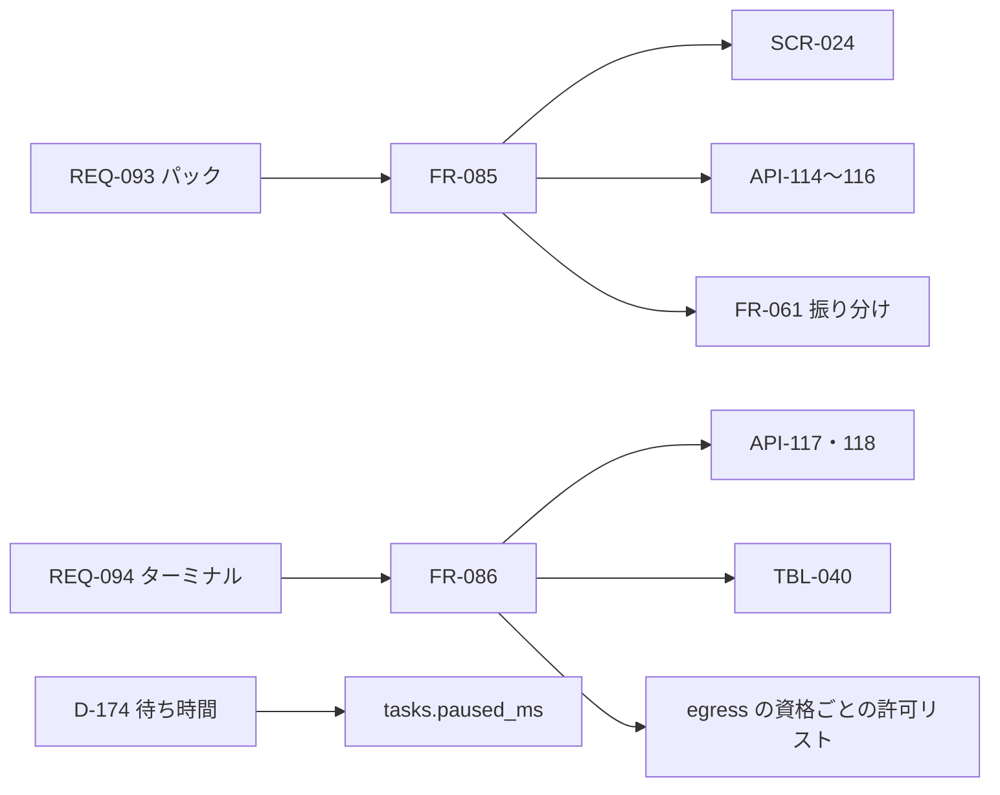

# 変更：持ち主の決定を反映し、パックと VM のターミナルを足す（v0.3 → v0.4、2026-10-24）
> **3行で**：未決だった Q-114〜Q-123 を持ち主がすべて決め（D-172〜D-182）、提案の ADR-044・045・051・052 は承認になった ／ パック（用途ごとのエージェント集。REQ-093・FR-085・ADR-053）と VM のターミナル（REQ-094・FR-086・ADR-054）を最初の版に足し、Web Push 通知とスマホの交代中の文字入力は次の版に回した ／ 呼び名を正式名称にした：箱→VM（実体は Docker コンテナ）、箱の管理役→box-manager、箱の中の操作役→box-agent、出口の見張り→egress

## 🧭 判断してほしいこと
なし。すべて決着した。

## 決着した論点
| Q | 決定 | D |
|---|---|---|
| Q-114 パック | 残す。「用途ごとに最適化されたエージェント集」として設計し直す | D-176 |
| Q-115 手で書いたスキル | 残す（`origin = pack` だけ） | D-177 |
| Q-116 コマンドの作業場 | VM にターミナルを入れる。VM の中は判定しない | D-178 |
| Q-117 Web Push | 入れない（次の版） | D-179 |
| Q-118 決まった言葉 | 「確定」「Confirm」「Submit」を入れる | D-180 |
| Q-119 スマホの文字入力 | PC が先。スマホは見る・タップまで。文字入力は次の版 | D-181 |
| Q-120 提案の ADR | ADR-044・045・051・052 を承認 | D-172 |
| Q-121 擬似ボタン | T-3 の対象にする（`clickable`） | D-173 |
| Q-122 待ち時間 | 時間の上限に含めない（`tasks.paused_ms`） | D-174 |
| Q-123 初期値 | 設計書の値のまま | D-175 |
| （呼び名） | 正式名称にする | D-182 |

## 差分
| ドキュメント | 節 / ID | 種別 | 変更前 → 変更後（1行） | 決定 |
|---|---|---|---|---|
| 全体 | 用語 | 表記 | 箱・箱の管理役・箱の中の操作役・出口の見張り → VM・box-manager・box-agent・egress。コードの名前（`boxes`・`/boxes/:boxId`・`box-<id>`）は変えない | D-182 |
| 01・02・03 | REQ-093、US-060、UC-052、BR-09 | 追加 | パック：用途ごとのエージェント集を入れると、その用途の依頼で使われる | D-176 |
| 01・02・03 | REQ-094、US-061、UC-053、BR-08 | 追加 | VM のターミナル：コマンドは VM の中で自由に実行し、VM の外に効くものだけ確認 | D-178 |
| 01 | REQ-091 | 変更 | Should → Won't（次の版）。US-054・UC-047・UC-048 の「通知」は「画面を開いていれば SSE で知らせる」に | D-179 |
| 01・02・05・06 | REQ-083、US-055、NFR-074、SCR-022 | 変更 | 「スマホでもできる」→ スマホは見る・タップまで。交代中の文字入力は次の版 | D-181 |
| 04 | FR-085 | 追加 | パック：定義は JSON ファイル（`purpose`・`examples`・`agents[]`・`skills[]`・`browser`）、入れる・更新・外す、依頼の振り分け（FR-061 の差分）。エラー `PACK_NOT_FOUND`・`PACK_INVALID`・`PACK_ALREADY_INSTALLED` | D-176、ADR-053 |
| 04 | FR-086 | 追加 | ターミナル：旧 sandbox の 6 つの道具、API-117 で実行、判定なし、egress のターミナル用の資格と `terminal.allow_hosts`、リポジトリは tar で出し入れ（API-118）、上限 NFR-080、記録 TBL-040 | D-178、ADR-054 |
| 04 | FR-017 | 変更 | Should → 次の版。「通知」の表は「知らせ（SSE）」に | D-179 |
| 04 FR-075・077・078、08 `tasks` | `paused_ms` | 追加 | 確認待ち・交代待ちの時間を `tasks.paused_ms` に足し、`max_minutes` と外側の 60 分の判定から引く | D-174 |
| 04 FR-076、09 inspect | T-3 | 変更 | role のある要素だけ → box-agent の `clickable`（`cursor: pointer`・click のリスナー）も対象 | D-173 |
| 04 FR-076、08 TBL-035 | 初期値 | 確定 | 決まった言葉に「確定」「Confirm」「Submit」。`max_steps: 200`・`max_minutes: 55` のまま | D-180、D-175 |
| 05 | NFR-080 | 追加 | ターミナルの上限：1 コマンド 120 秒・出力 64KB・1 タスク 200 回 | D-178 |
| 06 | SCR-024 | 追加 | パックの画面 `/packs`（入っている・入れられる、入れる・外す・更新）。メニューに置く。SCR-014 にパック名のラベル、SCR-021 に「ターミナル」欄、SCR-023 の通知の欄を外す | D-176、D-178、D-179 |
| 07 | VM の中身・egress・移すもの | 変更 | VM にシェル・git・Node・Python。egress は資格ごとに許可リストを分ける。Sandbox SDK の行 → VM のターミナル。パックの行を足す | D-178、D-176 |
| 07・README・ADR | ADR-044・045・051・052 | 変更 | 提案 → 承認 | D-172 |
| 08 | TBL-040 `sandbox_commands` | 変更 | `session_id` → `box_id`。`sandbox_sessions` は使わない。TBL-037 は作らない。`skill_proposals`・`agent_evolution_events` は落とす | D-178、D-179、D-177 |
| 08 TBL-035 | `terminal` 欄 | 追加 | `allow_hosts`・`max_commands: 200`・`command_timeout_sec: 120` | D-178 |
| 09 | API-114〜116 | 追加 | `GET /api/v1/packs`・`POST /api/v1/packs/:packId/install`・`DELETE /api/v1/packs/:packId` | D-176 |
| 09 | API-117・118（内部） | 追加 | `POST /internal/v1/boxes/:boxId/commands`・`PUT/GET /internal/v1/boxes/:boxId/files`（tar） | D-178 |
| 09 | API-031・032 | 変更 | 次の版 | D-179 |
| 10 | UC-053 の図、ER、状態遷移 | 追加 | ターミナルの 1 歩（tar を入れる → `run_command` → 出力は汚染 → tar を取り出し → PR の Intent）。`sandbox_commands.status` | D-178 |
| 11 | §3〜§13、R-84・R-85 | 変更 | 新しい FR・TBL・API・SCR・NFR を反映。R-84（コマンドの暴走）・R-85（パックの更新で手直しが消える）。未決はなし | — |
| 00 | 決定事項ログ・ID 体系・トレーサビリティ・用語集・スコープ | 追加 | D-172〜D-182。REQ-093・094 の行。用語集の VM・box-manager・box-agent・egress を正式名称と実体で書き直した | — |
| ADR | ADR-053・ADR-054 | 新規 | パックは「用途」の単位／ターミナルは VM の中 | D-176、D-178 |

## 影響範囲

- 影響を受けるが今回は変更していないもの：ADR-041〜043・046〜050（承認済み。中身は変わらない）、`browser_checks`・`boxes` の表の形

## 残っている論点
- なし（未決 Q はすべて決着）。Claude判断（おまかせ）の数値は D-139〜D-146・D-161・D-167 と NFR-080。実機で測って直す前提

## 関連
- 前の版：[2026-10-24 Claude のレビューを反映（v0.3）](2026-10-24-claude-review.md)
- ADR：新規 ADR-053・054。状態を変えた ADR-044・045・051・052
