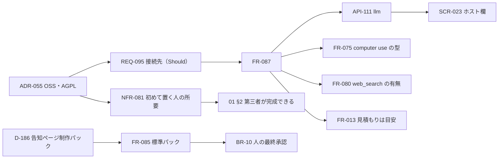

# 変更：OSS の方針と LLM の接続先を反映する（v0.4 → v0.5、2026-10-24）
> **3行で**：BDAA 一次審査のレビューを受けて持ち主が決めた「OSS（AGPL-3.0）・一般向けはやらない・収益化するなら企業導入」を設計書に入れた（ADR-055） ／ 企業導入で最初に要る「AWS・Google Cloud の契約で Claude を使う」を REQ-095・FR-087（Should）として足し、接続先で使えない道具の切り替えを決めた（ADR-056） ／ 最初の標準パックを「告知ページ制作」にし、成果物を外に出す操作は人が最終承認する（BR-10）、第三者が手順書だけで完成できる（成功指標・NFR-081）を加えた。複数人・組織は入れていない

## 🧭 判断してほしいこと
なし（R-86・R-87 はリスク。下の「残っている論点」）。

## 決着した論点
| 論点 | 決定 | D |
|---|---|---|
| OSS にするか | する。AGPL-3.0 | D-183 |
| 誰に配るか | 開発者（自分の機械に置く人）。非エンジニアの一般向けは配らない。企業導入は次の版 | D-184 |
| LLM の接続先 | Anthropic 直・Bedrock・Vertex を `.env` で選ぶ（Should）。他社の LLM は入れない | D-185 |
| 最初の標準パック | 「告知ページ制作パック」。デモの 4 人は 1 人の手順書 4 本 | D-186 |
| 人の最終承認 | 成果物を外に出す操作は必ず人が承認する（BR-10） | D-187 |
| 第三者が完成できるか | 成功指標に足す。3 人中 2 人・総所要時間を記録 | D-188 |
| 初めて置く人の所要 | 30 分以内（NFR-081） | D-189 |

## 差分
| ドキュメント | 節 / ID | 種別 | 変更前 → 変更後（1行） | 決定 |
|---|---|---|---|---|
| 全体 | 版数 | 表記 | v0.4 → v0.5 | — |
| 00 | 3行で・要点・ピッチ・対象ユーザー・スコープ | 変更 | 「個人のための」→「開発者のための。OSS（AGPL-3.0）」。OSS の利用者も P-1。In に接続先と標準パック、Out に他社 LLM と一般向けの配布 | D-183・184 |
| 00 | 決定事項ログ・ID 体系・トレーサビリティ・索引 | 追加 | D-183〜D-189。REQ-095 の行。ADR-041〜056。`../oss-and-business.md` へのリンク | — |
| 01 | §1 背景 | 追加 | レビュー（2026-10-24）の指摘と OSS の決定 | D-183 |
| 01 | §2 成功指標 | 追加 | 「第三者が完成できる」：開発者でない 3 人中 2 人が手順書だけで置き、告知ページ 1 件を完成。総所要時間を記録 | D-188 |
| 01 | §3 ステークホルダー・§4 ロール | 追加 | OSS の利用者（中）、導入先の組織（低・次の版）、審査する人（低）。持ち主のロールに OSS の利用者を含める | D-184 |
| 01 | REQ-095 | 追加 | LLM の接続先を Anthropic 直・Bedrock・Vertex から選べる（Should） | D-185 |
| 01 | §6 制約 | 変更 | 技術（接続先）、予算（AWS・GCP のアカウントでも払える。運営費ほぼゼロ）、体制（OSS）、ライセンス（AGPL-3.0・依存の両立） | D-183・185 |
| 01 | §7 Won't | 変更 | 複数人の理由を「企業導入のとき次の版」に。一般向けの配布、回答へのファイル添付を追加。Claude 以外の LLM に注記 | D-184 |
| 02 | US-062、P-1、ストーリーマップ、全体図 | 追加 | 会社の契約で Claude を使う（Bedrock・Vertex・資格不足・Bedrock では Web 検索なし）。P-1 に OSS の利用者 | D-184・185 |
| 03 | UC-042 | 変更 | 手順 1 に `LLM_PROVIDER` と接続先ごとの資格。〔US-049, US-062〕 | D-185 |
| 03 | BR-10 | 追加 | 成果物を外に出す操作は人が最終承認。点検役の AI は承認の代わりにならない | D-187 |
| 04 | FR-085 | 追加 | 標準パック `announcement-page` の中身（purpose・examples・1 人のエージェント・手順書 4 本・決まった言葉「公開」・PR で届ける・申込フォームは作らない） | D-186 |
| 04 | FR-087 | 追加 | 接続先ごとのクライアント（`@anthropic-ai/sdk`・`bedrock-sdk` の `AnthropicBedrockMantle`・`vertex-sdk` の `AnthropicVertex`）、モデル名の形、道具の宣言の切り替え（computer use の型・`web_search` は Bedrock で出さない・Vertex は基本版）、見積もりは Anthropic 直の単価、起動時の確かめ、`LLM_AUTH_FAILED` | D-185、ADR-056 |
| 04 | 移植元 | 追加 | FR-080 に接続先の注記、FR-087 の行 | — |
| 05 | NFR-081 | 追加 | 初めて置く人の所要：手順書だけで 30 分以内、3 人中 2 人。測り方も | D-188・189 |
| 06 | SCR-023 | 変更 | ホスト欄に LLM の接続先とモデル（表示だけ。Bedrock・Vertex では「見積もりは目安」） | D-185 |
| 07 | 技術選定・外部連携 | 変更 | LLM の行に接続先と SDK。外部連携の Claude API を 3 つの接続先に | D-185 |
| 09 | API-111 | 変更 | 応答に `llm: { provider, model }` | D-185 |
| 11 | §1・§2・§3・§5・§10・§11・§12・§13 | 変更 | ライセンスと読む人。SDK。FR-087。環境変数 `LLM_PROVIDER`・`AWS_REGION`・`CLOUD_ML_REGION`・`ANTHROPIC_VERTEX_PROJECT_ID`。単体試験に道具の切り替え。R-86・R-87 | — |
| README | 3行で・判断・読む順番・ADR・最近の変更 | 変更 | OSS と接続先。R-86・R-87。ADR-055・056。「OSS と事業の方針を知りたい」の行 | — |
| ADR | ADR-055・ADR-056 | 新規 | OSS・AGPL-3.0／LLM の接続先 | D-183・185 |
| リポジトリ | `LICENSE`・`README.md`・`package.json` | 新規・変更 | AGPL-3.0 の原文。README の冒頭にライセンスの 1 行。`"license": "AGPL-3.0-only"` | D-183 |

## 影響範囲

- 影響を受けるが今回は変更していないもの：REQ-078（持ち主1人のまま）、ADR-046（Tailscale の身元。複数人は次の版）、ADR-050（1 件 1 人。パックの 4 工程は 1 人の手順書）、08（表の形は変わらない。`usage_records` の単価は Anthropic 直のまま）

## 残っている論点
- R-86：レビューが評価した「4 人の工程の受け渡し」が、1 人の手順書 4 本になって見えにくくなる。歩みの記録を工程ごとに SCR-021 で見せる案。ADR-050 を覆すほどではないと判断した
- R-87：Bedrock・Vertex では費用の見積もりが実際の請求とずれる。Bedrock には Claude の Web 検索ツールがない
- Claude判断（おまかせ）：D-187（BR-10 の明文化）、D-188（3 人中 2 人・総所要時間）、D-189（30 分以内）。数値は第三者テストで直す前提

## 関連
- 前の版：[2026-10-24 持ち主の決定を反映し、パックと VM のターミナルを足す（v0.4）](2026-10-24-decisions-v0.4.md)
- 元の整理：[../../oss-and-business.md](../../oss-and-business.md)（レビューの要点と WORK 1〜6 の仕分け）
- ADR：新規 ADR-055・056
