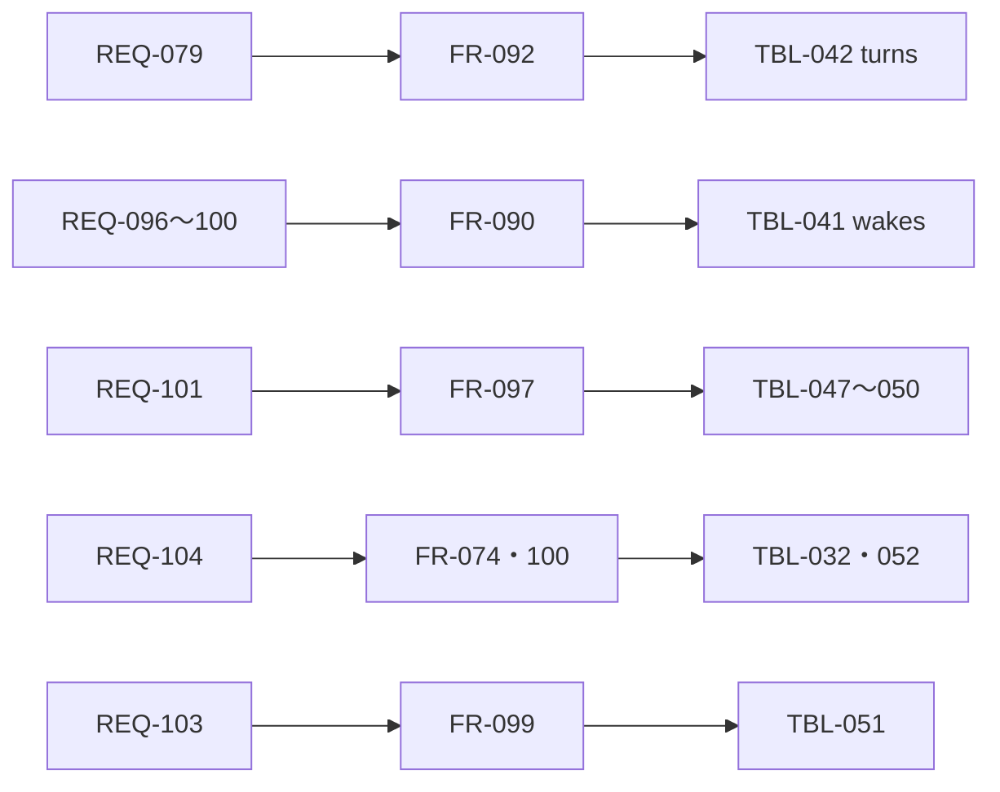

# 変更：常駐型として作り直す（v0.6 → v1.0、2026-10-24）
> **3行で**：参考資料（[GrokBot の講義の解説動画のノート](../../../参考資料/2026-10-17_GrokBotの仕組み_常駐型エージェントのアーキテクチャ.md)）の「ループ＋サーバー＋コンピュータ＋記憶」をもとに、頼まれたときだけ動く形から常駐型に作り直した ／ 持ち主は 1 本のチャットでメインと話し、メインが用途に合うエージェントへ裏で振り分ける。きっかけで起き、用がなければ眠り、記憶を持ち、伝える価値があるときだけ話しかける ／ いちばん大きい影響は、依頼（`asks`）中心の画面・API・表がチャット・ターン・タスクに置き換わることと、VM がタスクごとの使い捨てから持ち主に 1 台の残り続けるものになること

## 🧭 判断してほしいこと
未決はなし。Claude判断の D-212〜D-240 は [README](../README.md#claude判断で決めたこと見直してほしいもの) に一覧した。新しいリスクは R-88〜R-94（[11 §12](../11_tech_spec.md#12-リスクと対策)）。

## 持ち主の決定（ヒアリング 2026-10-24）
| 論点 | 決定 | ID |
|---|---|---|
| 作り直しの深さ | 常駐型として作り直す | D-200 |
| エージェントの形 | 1 本のチャットでメインと話し、メインが用途に合うエージェントへ裏で振り分ける | D-201 |
| VM | 持ち主に 1 台 | D-202 |
| きっかけ | ルーチン・予約した確認・webhook・裏の作業の完了（＋持ち主のチャット） | D-203 |
| 記憶 | 4 層すべて | D-204 |
| VM の分け方 | 全部共有・画面は順番 | D-205 |
| オートレビュー | 合図の後に挟む | D-206 |
| 知らせ | Web Push を最初の版に | D-207 |
| webhook | Funnel で受け口だけ公開 | D-208 |
| VM の守り | 判定せず戻せるように | D-209 |
| 記憶の持ち主 | プロフィールは共有 | D-210 |
| 12 の扱い | 消す | D-211 |

## 参考資料との突き合わせ
v0.6（[changes/2026-10-24-grokbot-reference.md](2026-10-24-grokbot-reference.md)）はスクリーンショット 14 枚だけを見た。今回は動画全体のノートの論点を、v0.6 で取り入れなかったものも含めて見直した。

| 参考資料の論点 | v0.6 | v1.0 | 入れた先 |
|---|---|---|---|
| ループと状態をサーバーに置く・眠る／起きる | なし（頼んだときだけ） | 取り入れた | ADR-058、FR-090・091 |
| 起こす 7 種類のきっかけ・ルーター・重複を捨てる | なし | 5 種類（Slack・電話と会議・ほかのエージェントは除く） | FR-090、TBL-041 |
| ユーザー 1 人に 1 台の VM・ファイルとログインが残る | 取り入れない（使い捨て） | 取り入れた（メモリのスナップショットは除く） | ADR-060・061、FR-074・100 |
| メインとサブエージェント・短い報告だけ戻る | ADR-057 の提案（Q-124） | 取り入れた（1 本のチャットのまま） | ADR-059、FR-092 |
| `SendToUser` 1 本・伝える価値がなければ黙る | 知らせの絞り込みだけ（D-197） | 取り入れた | ADR-062、FR-093 |
| ツールごとに画面を出し分ける（下書き・選択肢・リアクション） | 確認カードだけ（D-198） | `choices`・`file`・`reaction` を足した | FR-093、SCR-020 |
| オートレビュー | なし | 取り入れた（外に出す・支払う・消す・秘密は人のまま） | ADR-064、FR-099 |
| プロンプトインジェクションへの備え（外の文に「信用しない」の印、記憶は情報） | 汚染（BR-06） | webhook・報告にも広げ、記憶にも適用 | BR-11・12、FR-090・097 |
| ツールの約束事（途中で足し外ししない・4,000 字・エラーに次の手） | なし | 取り入れた | D-238、FR-088 |
| プロンプトキャッシュを外さない・外れはバグ | なし | 取り入れた | ADR-066、FR-098 |
| 10 万トークン・10 分後の要約 | なし | 取り入れた | FR-098、UC-060 |
| 入力を始めたらキャッシュを温める | なし | Should で取り入れた | D-233、API-121 |
| 記憶の 4 層 | 次の版の候補 | 取り入れた（共有） | ADR-063、FR-097 |
| ルーチン（`routines/`） | 次の版の候補 | 取り入れた（作るのは持ち主の ○） | FR-094 |
| 新しいメッセージの扱い（1 対 1 は割り込み・まとめて 1 ターン） | 動いているタスクだけ（D-195） | きっかけ全般に広げた | D-220、FR-089・090 |
| 推論の設定を役で分ける | なし | オートレビューを軽いモデルに | D-226 |
| 失敗を eval に戻す | 取り入れた（D-199） | 振り分け・黙る・オートレビューの eval を足した | 11 §11 |
| 製品を消せ（作り込みを少なく） | — | 方針として、判定以外の振る舞いは指示に書き、Kernel で強制しない（D-191 と同じ） | FR-088 |
| Slack・メール・電話・会議・声の窓口、1Password、支払い、デスクトップ全体 | 取り入れない | 取り入れない（01 §7） | — |
| 人のやり方を見てスキルにする | 取り入れない | 取り入れない（記憶まで） | 01 §7 |

## 差分
| ドキュメント | 節 / ID | 種別 | 変更前 → 変更後（1行） |
|---|---|---|---|
| 00 | 全体 | 書き直し | 用語集（依頼 → チャット・ターン・タスク・メイン・きっかけほか 36 語）、D-200〜D-240、ID 体系、トレーサビリティ |
| 00 | D-127・128・131・133・139・143・168・176・178・179・186・190・195・197 | 印 | 置き換え・覆した・読み替えの印を付けた（行は残した） |
| 01 | REQ-077・079・084・088〜092 | 変更 | 公開の例外・メインの振り分け・ログインは共通・ターンの上限・Web Push を Must に |
| 01 | REQ-096〜105 | 追加 | 起きる・眠る／ルーチン／予約／webhook／裏の作業の完了／記憶／黙る／オートレビュー／VM が残る／安く速く |
| 01 | §2・§7 | 変更 | 成功指標に「留守の間に終わる」「外のきっかけ」「覚えている」「待機中は安い」。Won't から Web Push・ルーチン・記憶・ファイルの添付を外し、エージェントごとの会話・振り分けの多段・メモリのスナップショットを足した |
| 02 | US-051〜061 | 変更 | メインに頼む形・VM 1 台・ログインは共通 |
| 02 | US-063〜072 | 追加 | 留守の間に進む・ルーチン・予約・webhook・記憶・言い直し・確認が減る・スマホの知らせ・VM を戻す・長く話しても安い |
| 03 | UC-042〜053 | 変更 | 振り分け先の文脈・画面の番・オートレビューの分岐 |
| 03 | UC-054〜061 | 追加 | きっかけとターン・振り分けと報告・ルーチンと予約・webhook・記憶・オートレビュー・要約・VM の眠りと控え |
| 03 | BR-02・03・04・07〜10 | 変更 | VM 1 台・承認にオートレビューを含める・ログインの消え方・VM の守り |
| 03 | BR-11〜14 | 追加 | 汚染するきっかけ・記憶の書き方・ルーチンの作り手・行き先の決め方 |
| 04 | 全体 | 分割 | `04_functional_spec.md` → `04_functional_spec/`（README・resident・vm・tools） |
| 04 | FR-090〜100 | 追加 | 受付とルーター・ターン・振り分け・`send_to_owner`・ルーチン・予約・webhook・記憶・文脈・オートレビュー・控え |
| 04 | FR-017 | 変更 | 次の版 → Must（Web Push） |
| 04 | FR-061・072〜079・082〜089 | 変更 | 振り分け先の選び方・メインは消せない・webhook の口・VM の眠りと画面の番・行き先の表・交代の放置で VM を止めない・ブラウザのデータは VM 単位・書き出しにプロフィールとルーチン・再開の表に常駐の行・パックは振り分け先・オートレビューのモデル・道具の約束事・言い直し |
| 04 | FR-063 | 統合 | → FR-093 |
| 05 | NFR-061・062・064・066・067・071・072・074・076・077 | 変更 | VM 1 台・ディスク 20GB・Funnel・利用者の分離・起き上がり・VAPID |
| 05 | NFR-082〜088 | 追加 | 待機中の費用・キャッシュ・控え・webhook の口・知らせの遅れ・記憶の大きさ・同時数 |
| 06 | SCR-020・021・022 | 変更 | メインとのチャット・タスクの帯／依頼のページ → タスクのページ `/tasks/:taskId`／`/boxes/:boxId` → `/vm` |
| 06 | SCR-025・026 | 追加 | 記憶・きっかけ |
| 06 | SCR-014・019・010・023 | 変更 | メインの行・ルーチンの提案のカード・きっかけとオートレビューの記録・通知と VM の欄 |
| 07 | 全体 | 書き直し | VM 1 台・box ネットワーク 1 本・webhook の口 :8081・本体の部品に受付・ターン・context・memory・push・timer |
| 08 | 全体 | 分割 | `08_database.md` → `08_database/`（README・resident・vm） |
| 08 | TBL-041〜054 | 追加 | `wakes`・`turns`・`chat_messages`・`routines`・`scheduled_wakes`・`webhooks`・`memory_facts`・`memory_log`・`memory_notes`・`memory_search`・`auto_reviews`・`vm_snapshots`・`context_snapshots`・`routine_proposals` |
| 08 | TBL-031〜035・037〜039、`tasks`・`agents`・`usage_records`・`audit_logs` | 変更 | `max_tasks`・VM の世代と画面の番・オートレビューの参照・言葉の分け方とターンの上限・Web Push を作る・`owner_kind = 'turn'` |
| 08 | TBL-036、`asks` まわり | 使わない | プロフィールは VM に 1 つ／依頼はチャット・ターン・タスクに |
| 09 | 全体 | 分割 | `09_api.md` → `09_api/`（README・resident・vm） |
| 09 | API-119〜144 | 追加 | チャット・合図・タスク・ルーチン・予約・受け口・webhook の口・記憶・VM の控え・ブラウザのデータ・VAPID・内部の控え |
| 09 | API-088〜091・099・101・102・108・109 | 変更 | `/boxes/:boxId` → `/vm`、ホームを残す・入れ替える |
| 09 | API-031・032 | 変更 | 次の版 → Must |
| 09 | API-072・API-073・API-075・API-076・API-077・API-084・API-086・API-092 | 使わない | 依頼の API・VM の一覧・エージェントのプロフィール |
| 10 | 全体 | 分割 | `10_diagrams.md` → `10_diagrams/`（README・sequences・states）。シーケンス図 6 本と状態遷移図 5 つを足した |
| 11 | 全体 | 書き直し | 常駐型の統合。リスク R-88〜R-94 を足した |
| 12 | 12_implementation_order.md | 削除 | D-211 |
| adr | ADR-058〜067 | 追加 | 常駐型・振り分け・VM 1 台・VM の守り・`send_to_owner`・記憶・オートレビュー・Funnel・キャッシュ・Web Push |
| adr | ADR-048・050・057 | 置き換え済み | → ADR-060・059 |
| adr | ADR-054・053 | 一部置き換え・読み替え | → ADR-061・059 |

## 影響範囲

- 図に入れていない主な線：REQ-079・096 → API-119〜124、REQ-091 → FR-017 → TBL-037・API-031・032・137（[00 トレーサビリティ表](../00_overview.md#トレーサビリティ表)）
- 影響を受けるが今回は変更していないもの：ADR-041〜047・049・051・052・055・056（置き先・本体・VM の作り・egress・Tailscale・こわい操作・Compose・gateway・確認の表・ライセンス・接続先）。docs/oss-and-business.md（方針は変わらない）。`apps/web` と `apps/worker` の実装（依頼の画面と API はこれから作り直す）

## 書き直しの点検（rewrite.md R5 の扱い）
| 点検 | 結果 |
|---|---|
| ID の欠落 | v0.6 の ID 291 個のうち、消えたのは API-073・API-075・API-076・API-084 の 4 つ（依頼の API。上の差分で「使わない」と記録） |
| 決定事項・Won't | D-121〜D-199 は全部残し、置き換えたものに印を付けた。Won't は 4 つ外し（入れたため）、4 つ足した |
| 未決 | Q-124 を決着。新しい未決はなし |
| リンク | 相対リンクと見出しへのリンクを機械で確かめ、切れていない |
| 400 行 | いちばん長いのは 03（338 行）。04・08・09・10 は分けた |

## 元に戻す方法
- ブランチ `docs/design-v1-resident` の作業。`git diff main -- docs/design` で差分を見られ、`git switch main` で v0.6 に戻る

## 関連
- ADR：新規 ADR-058〜067。置き換え ADR-048・050・057。一部置き換え ADR-054。読み替え ADR-053
