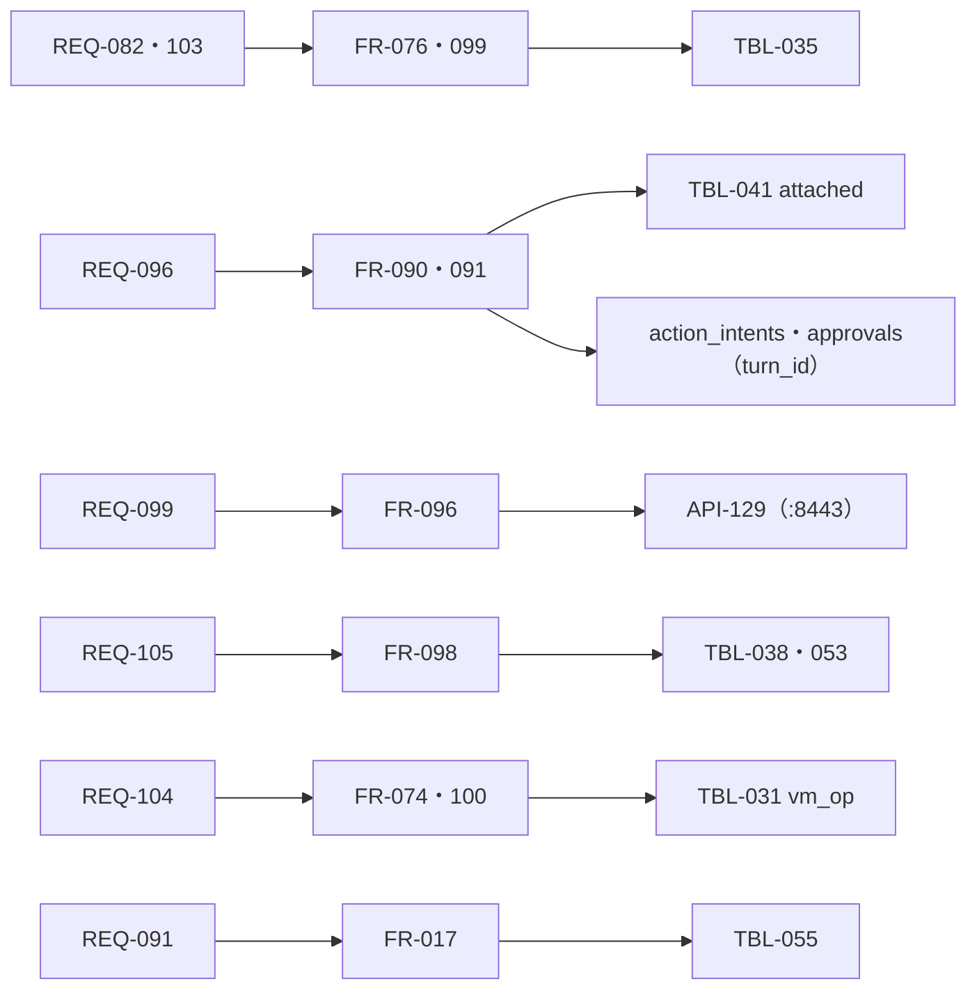

# 変更：Fable 5.1 と Astra のレビューを反映（v1.0 → v1.1、2026-10-24）
> **3行で**：Claude Fable 5.1（39 件）と Codex の gpt-6-astra（26 件）が v1.0 をレビューし、重なりを除いた約 50 件をすべて反映した ／ いちばん重かったのは「人が必ず承認する」「公開は受け口だけ」の線が仕組みとして守れていなかったこと（Funnel のポート・`Submit` と決済の iframe・成果物の HTML）と、ターンの境目・取り消し・控えから戻すときの扱い ／ Claude API の仕様（思考のブロックは履歴を書き換えると無効）に合わせ、文脈は追記だけにした

## 🧭 判断してほしいこと
未決はなし。持ち主が決めたのは D-248（メインの書き込みは承認の結果で起こす）だけで、ほかは Claude判断（D-241〜D-274）。[README](../README.md#claude判断で決めたこと見直してほしいもの) に一覧した。実装するときに確かめるもの：Docker のゲートウェイの `isolated` モードを使える版（D-253）、接続先ごとのサーバー側の context editing（FR-087）。

## 確かめたこと
| 指摘 | 確かめ方 | 結果 |
|---|---|---|
| `tasks` の状態の値・`job_id`（Astra #8） | `apps/worker/src/db/schema.ts` | 正しい。状態は `succeeded`・`completed`・`rejected` などで `done`・`waiting_input` はない。`job_id`・`action_intents.task_id`・`approvals.task_id` は NOT NULL。`report`・`tainted` は今ある列 |
| 履歴の書き換えと思考のブロック（Fable #4） | claude-api の資料 | 正しい。2026-08-31 以降のアカウントでは 400。サーバー側の context editing と要約は書き換えに数えない。「要約のあと直近を残す」も 400 になる形 |
| `max_tokens = 0`・1 時間のキャッシュ・構造化出力・computer toolset（Fable #7・#26・#27） | claude-api の資料 | 正しい。1 時間のキャッシュはどの接続先でも使える。toolset は 1 回の返事に操作を並べ、画面の大きさを渡さない |
| Funnel はポート単位（Astra #1・Fable #3） | 2 人とも同じ指摘（Astra は Tailscale の公式の文書を挙げた） | 8443 番に分けた |

## 差分
| ドキュメント | 節 / ID | 種別 | 変更前 → 変更後（1行） | 指摘 |
|---|---|---|---|---|
| 07・NFR-064・085・FR-073・096・API-128・129・ADR-065 | Funnel | 変更 | 443 番で `/hooks/` だけ → 8443 番だけを Funnel、443 番は tailnet だけ（D-241） | A1・F3 |
| FR-076・BR-14・TBL-035・ADR-064 | 行き先 | 変更 | `Submit`・`確定`・T-4・T-6 はオートレビュー → 人。T-7（POST の送信）を追加。`textarea` の Enter も人（D-242） | A5・F1 |
| FR-099・ADR-064 | オートレビューの入力 | 変更 | 「ページの文は渡さない」→ ページ由来は信用しない材料の枠。構造化出力（D-273） | A5・F13 |
| API-112・FR-093・SCR-020・ADR-062 | 成果物 | 変更 | 同じ出どころで開く → ダウンロードとスクリプトの動かないプレビュー。成果物は報告の時点で写す（D-243・D-244） | A4・F2・F17 |
| FR-089・090・094・095・BR-11 | 汚染 | 変更 | メイン経由の言い直し・ルーチンは汚染しない → ターンの汚染を引き継ぐ（D-245） | A6・F12 |
| FR-097・BR-12・ADR-063 | 記憶の材料 | 変更 | 持ち主のメッセージとメインの文 → 持ち主のメッセージだけ。本体のログは定型文（D-246） | A6・F12 |
| FR-090・091・TBL-041 | ターンの境目 | 追加 | `wakes.status` に `attached`。閉じる処理と残りの確かめを 1 つに。失敗したターンのメッセージを戻す（D-247） | A9・F6・F21 |
| FR-081・090・091・`action_intents`・`approvals` | メインの書き込み | 追加 | 行き止まり → 承認待ちで眠り、`approval_done` で起きる。`turn_id` を持つ（D-248） | A7・F5 |
| FR-084・091・092・TBL-043・045・049・054 | 冪等 | 追加 | `tool_call_id` の UNIQUE。作るのと歩みの確定を同じトランザクションで（D-249） | A10・F14 |
| FR-077・API-110・TBL-039 | 取り消し | 追加 | 取り消しで確認・オートレビュー・Intent を期限切れ。実行の直前の確かめ（D-250） | A11 |
| FR-074・084・100・TBL-031・API-108 | VM の操作 | 追加 | `vm_op` で 1 つずつ。戻しの途中で落ちたらやり直す（D-251） | A12 |
| FR-086・07・NFR-066 | VM の中の隔離 | 追加 | CDP はパイプだけ・X と VNC と box-agent にコマンドから届かない・ホストへの入りを断る（D-252・D-253） | A2・A3 |
| 04 ステータス定義・08 変える表 | `tasks` | 変更 | 設計だけの状態の値 → 今の `schema.ts` の値。`job_id` を NULL 可、`trigger_type` に `delegate`（D-254） | A8 |
| FR-075・087 | computer use | 変更 | 1 歩 1 操作 → 1 歩＝操作の列。toolset の形（D-255） | F7 |
| FR-075・098・TBL-038・ADR-066 | 文脈 | 変更 | 古いスクショを文に置き換え・要約のあと直近 10 往復を残す → 追記だけ・サーバー側の消去・要約だけを持ち越す（D-256） | F4 |
| FR-078・092・UC-048・055 | `blocked` | 変更 | 返事待ちで開いたまま → タスクの終わり（D-257） | A13・F16 |
| FR-074・TBL-032 | 画面の番 | 変更 | 3 分を常に数える・番号は 1 つ → 通常の実行中だけ数える・`screen_epoch` を分ける・ターミナルは交代中も動く（D-258） | A14・F8・F9 |
| FR-013・091・092 | 費用 | 変更 | 「`chat` 以外は始めない」→ 予約ごとの区分。完了の知らせは捨てない（D-259） | A15・F10 |
| FR-090・096・NFR-085 | 件数・重複 | 変更 | 全体で 1 時間 200 件 → webhook だけ。超えた分はまとめる。鍵の名前空間・汎用の署名に時刻と配達 ID（D-260・D-261） | A16・A17・F11・F31 |
| TBL-038・053 | 保持 | 変更 | 7 日で消す → 要約に取り込むまで・参照がある間は残す（D-262） | A18 |
| FR-098・`usage_records` | キャッシュ | 変更 | ⑥は 5 分 → 1 時間。書き込みを TTL ごとに記録（D-263） | A19・F15 |
| FR-090・098 | 大きさ | 追加 | 呼び出しの前に見積もる・1 ターンのきっかけの上限（D-264） | A20 |
| FR-074・100・NFR-062・084 | 容量 | 追加 | ホーム 8GB・空き 3GB で止める・失敗した控えで古いものを消さない（D-265） | A21 |
| FR-075・085・07 | 点検の経路 | 追加 | VM の 127.0.0.1:8000〜8099 だけ egress を通さない（D-266） | A22・F19 |
| FR-017・TBL-055・NFR-086 | Web Push | 追加 | 送ってから記録 → 送り待ちの表と再送（D-267） | A23 |
| FR-100・API-134・135 | 戻す | 変更 | タスクは VM 待ちで続ける → `halted`（`vm_replaced`）（D-268） | F18 |
| API-121・FR-017・098 | 見えているか・先頭 | 変更 | 60 秒だけ覚える → 心拍。冷えたら要約して作り直す（D-269） | A25・F20・F30 |
| FR-098 | 要約の目安 | 変更 | 10 万 → 6 万トークン（D-270） | F39 |
| FR-084 | 本体だけの再起動 | 変更 | VM を止める → 同じ世代なら使い続ける（D-271） | F38 |
| FR-086・07 | VM のルート | 追加 | `apt` は使えない・Chromium のサンドボックス（D-272） | F33 |
| FR-097・098・099 | API の決まり | 変更 | JSON を返させる・`max_tokens = 1` → 構造化出力・`max_tokens = 0`（D-273） | F26・F27 |
| 04・06・08・09 | 小さな食い違い | 変更 | 選択肢の返事・`write_note`・同時数・`propose_routine` の `agentId`・パックの言葉・Push の `tag`・ルーチンの承認・TBL-033 の制約・移植元の文・画面の欄のデータ元（D-274） | F22〜F25・F29・F32・F34〜F37・A24・A26 |
| 10 | 図 | 追加・変更 | メインの書き込みと承認のシーケンス図を追加。webhook・要約・`wakes`・画面の番の図を直した | — |

指摘の番号：A は Astra、F は Fable（`review-astra.md`・`review-fable.md` の番号）。Fable #28（変更レポートの件数の書き方）は、v1.0 の変更レポートの「使わない 8 つ、うちファイルから消えたのは 4 つ」で説明できるので直していない。

## 影響範囲

- 影響を受けるが今回は変更していないもの：01 の要件（REQ-099 の文だけ直した）・ADR-041〜047・049・051〜056（方針は変わらない）

## 関連
- ADR：ADR-062〜066 に v1.1 の直しを書いた（v1.0 は未マージのため、新しい ADR は作らなかった）
- レビューの全文：`/tmp/claude-1000/-mnt-c-Users-1kkim-project-dev-agent-team/b66a437d-8270-4539-9476-1b262191c772/scratchpad/review-astra.md`・`review-fable.md`（作業用。リポジトリには入れていない）
