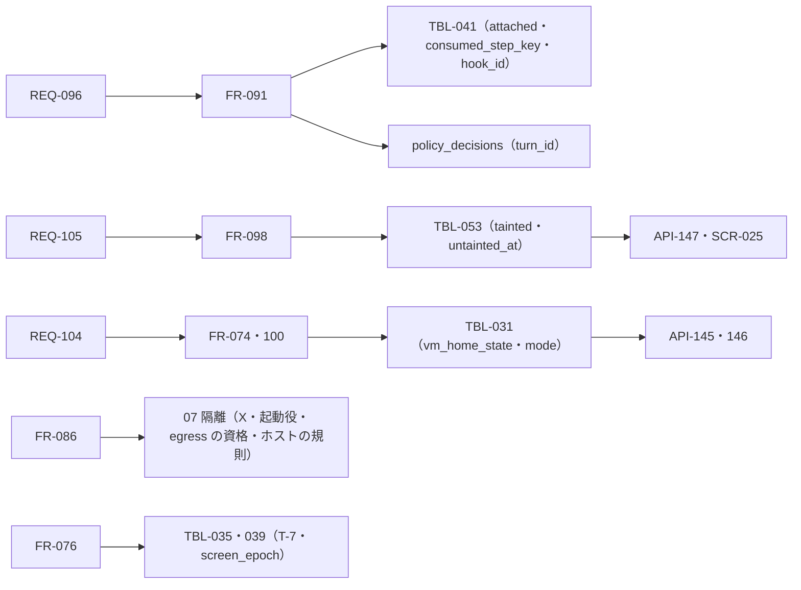

# 変更：v1.1 の直しを読み直す（v1.1 → v1.2、2026-10-24）
> **3行で**：v1.1 の直しを、常駐側と VM 側に分けて 2 人で読み直し、実害のある 46 件（常駐 22・VM 24）をすべて反映した ／ いちばん重かったのは、VM の中の隔離が書いたとおりには作れない・すり抜けられること（X の抽象ソケット・利用者の切り替えと capability・資格のない egress・ホストの規則）と、今の `schema.ts` の制約で保存できない書き込みがあったこと ／ 直しが一部の文書にしか入っていない箇所（図・表定義・API・状態遷移）もそろえ、汚染の印の消し方を持ち主が決めた（D-310）

## 🧭 判断してほしいこと
未決はなし。持ち主が決めたのは D-310（要約に付いた汚染の印は持ち主が消す）だけで、ほかは Claude判断（D-275〜D-309）。[README](../README.md#claude判断で決めたこと見直してほしいもの) に一覧した。外の製品の挙動に頼るものは、断定せず安全側の形にして「実装のときに確かめる」と書いた：Chromium の `--proxy-bypass-list`（D-303）、Docker の seccomp と Ubuntu の AppArmor（D-304）、Tailscale Funnel の転送のパス（D-305）、DOCKER-USER と INPUT の規則（D-293）。新しいリスクは R-95〜R-97（[11 §12](../11_tech_spec.md#12-リスクと対策)）。

## 確かめたこと
| 指摘 | 確かめ方 | 結果 |
|---|---|---|
| `policy_decisions.task_id` が NOT NULL（R1） | `apps/worker/src/db/schema.ts:685` | 正しい。gateway・edge が書くので、メインの書き込みが保存できなかった |
| `tasks` の `requester_id`・`agent_snapshot_id`・`report_kind`、`usage_records` の CHECK（R9・R16） | `schema.ts` | 正しい。制約は変えずに満たす形にした（D-283） |
| `messages` に `role: "system"` を入れる（R13） | Messages API の決まり | 正しい。`messages` は `user`・`assistant` だけ。`user` の中の枠にした（D-286） |
| API-122 の `done`・webhook の古い上限（R10・R18） | grep | 正しい。直した |
| X・capability・egress・DOCKER-USER（V1〜V4） | 07・04 vm.md・ADR の記述の突き合わせ | 正しい。書かれたとおりに作ると守りが抜けるか、作れない |

## 差分
| ドキュメント | 節 / ID | 種別 | 変更前 → 変更後（1行） | 指摘 |
|---|---|---|---|---|
| 08 README・04 resident・tools・09 README | メインの書き込み | 変更 | `policy_decisions` が `task_id` 前提 → `turn_id` と一方だけ。`approval_done` を同じトランザクションで（D-275） | R1 |
| 04 resident・08 resident・03・states | ターンの境目 | 変更 | `attached` は再起動でだけ戻す → 閉じる処理で戻す。失敗したら全種類を戻す（D-276） | R2 |
| 04 resident・08 resident・08 vm・ADR-066 | 組み直し | 追加 | 足した文の記録なし → 歩み `input:<n>` と `wakes.consumed_step_key`（D-277） | R3 |
| 04 resident・08 resident・06・09 resident・ADR-066 | 要約の汚染 | 追加 | 要約で印が消える → `context_snapshots.tainted`。持ち主が要約を読んで消す（API-147・SCR-025）（D-278・D-310） | R4 |
| 04 resident・tools・08 resident | 費用 | 変更 | 区分は始めたときのまま → `chat` が入ったら上げる。残りが足りなければ 0 時まで始めない。いつも区分の残りで比べる（D-279・D-282・D-289） | R5・R8・R22 |
| 04 resident・08 resident・08 vm・03・sequences | 歩みの名前・要約 | 変更 | `memory`・`summary` 固定 → `memory:<n>`・`summary:<n>`。タイマーの要約はターンの外。途中でターンが始まったら捨てる（D-280・D-281） | R6・R7 |
| 08 README・04 resident | `schema.ts` の制約 | 追加 | 書かれていない → `requester_id`・`agent_snapshot_id`・`report_kind`・`phase`・`provider` の埋め方（D-283） | R9・R16 |
| 09 resident | API-122 | 変更 | `active` は `done` 以外 → `finished_at IS NULL` | R10 |
| 04 resident・08 resident・09 README・03・11・05・ADR-065・sequences | webhook | 変更 | 本文のハッシュ・まとめの場所がない、古い上限 → `hook_id`・`body_sha256`・`merged`・まとめの鍵。上限は 1 分 60 件超でまとめ、1 時間 600 件で 429（D-284） | R11・R17・R18・R21 |
| 04 resident・08 resident・ADR-063 | メモ | 追加 | メモに印がない → `memory_notes.tainted`。メインのメモは検索でだけ読む（D-285） | R12 |
| 04 resident・09 resident・ADR-066 | 本体の知らせ | 変更 | `role: "system"` → `user` の中の枠（D-286） | R13 |
| 08 README・04 resident・04 vm | 冪等 | 追加 | Intent に `tool_call_id` なし → UNIQUE で持つ。再起動で探すものを足す（D-287） | R14 |
| 04 resident・08 resident・ADR-067 | Web Push | 変更 | 1 行で全端末 → 通知 × 購読の行・`skipped`（D-288） | R15 |
| 04 README・03・states | 記憶の材料・状態の図 | 変更 | 古い材料の文・図とステータス定義の食い違い → そろえた | R19・R20 |
| 04 vm・07・05・11・ADR-043・061 | X と利用者 | 変更 | ファイルの権限で守る・capability をすべて外す → 抽象ソケットを閉じ `-auth`。起動役だけが利用者を切り替えて手放す。鍵は fd で（D-290・D-291） | V1・V2 |
| 04 vm・07・11・ADR-045・054 | egress | 変更 | Chromium は資格なし → 資格のない通信を断り、Chromium にも資格（D-292） | V3 |
| 07・04 vm・09・ADR-044・045 | ホストの規則 | 変更 | box-manager が DOCKER-USER を入れる → 手順書で入れ、box-manager は確かめるだけ（D-293） | V4 |
| 04 vm・08 vm・08 resident・09 vm・05・06 | VM の操作の失敗・再起動 | 追加 | 落ちたときのやり直しだけ → 入れ替えは非同期・壊れたら戻す・作り直すだけ・値ごとの再開・同じ世代なら使い続ける（D-294・D-295・D-302） | V5・V6・V14・V15 |
| 09 vm・04 vm・ADR-054・sequences | ターミナル | 変更 | `controlEpoch` を確かめる → 世代と actionId だけ（D-296） | V7 |
| 04 vm・09 vm・08 vm・06・11・ADR-047・064 | こわい操作 | 変更 | Ctrl+Enter・canvas がオートレビュー、inspect に材料なし、T-7 が表と画面にない → 人に回す・材料を足す・T-7 は標準の送信だけ（D-297・D-298） | V8・V9・V10 |
| 08 vm・09 vm・07・states | 画面の番 | 変更 | `screen_epoch` を増やす場所と比べる相手がばらばら → 取るときだけ増やし、本体が比べる（D-299） | V11 |
| 05・04 vm・07・ADR-060・061・09・06 | 容量 | 変更 | ホーム 8GB・最低 20GB（足し算が合わない）・画面で消せない → ホーム 4GB・最低 32GB・掃除のための起動（API-145・146）・控えは専用のボリューム（D-300・D-301・D-309） | V12・V13・V24 |
| 07・04 vm・05・11・03・ADR-043・045・065 | 外の製品の挙動 | 変更 | 点検の経路・Chromium のサンドボックス・Funnel の転送 → 安全側の形と「実装で確かめる」（D-303・D-304・D-305） | V17・V18・V19 |
| 04 vm・04 resident・09 vm・ADR-054 | 成果物の tar | 変更 | 作る利用者とリンクの扱いが未定 → 利用者 agent・リンクはたどらない・広げるときに捨てる（D-306） | V20 |
| 04 vm・09 vm・06・ADR-052・064 | 直前の確かめ | 変更 | 人の ○ のときだけ → すべての実行の前。API-110 は `expired` を返す（D-307） | V21 |
| 04 vm・08 vm・04 README | 戻すときに止めるタスク | 変更 | 「この世代で歩んだもの」→ VM の道具を使った・画面の番を持つ、終わっていないタスク。`vm_replaced`（D-308） | V22 |
| 10 | 図 | 追加・変更 | `vm_op`・`vm_home_state` の状態の図、控え・戻すのシーケンス図を追加。UC-046・047・053・057・059・060・061・再開の図と ER 図を直した | V16・V23・R20・R21 |
| 00・README・11 | 決定・ID | 追加 | D-275〜D-310、API-145〜147、R-95〜97。D-223・224・240・253・256・265 に直した先を書いた | — |

指摘の番号：R は常駐側、V は VM 側のレビュー（作業用。リポジトリには入れていない）。

## 影響範囲

- 影響を受けるが今回は変更していないもの：01 要件・02 ユーザーストーリー（要件は変わらない）、ADR-041・042・046・049・051・053・055・056

## 関連
- ADR：ADR-043〜045・047・052・054・060・061・063〜067 に v1.2 の直しを追記した（方針は変わらないので、新しい ADR は作らなかった）
- 前の版：[2026-10-24-review-v1.1.md](2026-10-24-review-v1.1.md)
