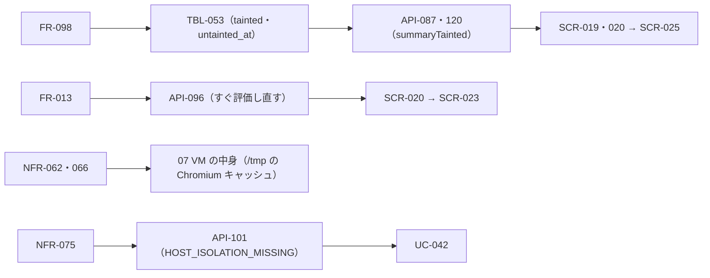

# 変更：v1.2 の判断を見直す（v1.2 → v1.3、2026-10-24）
> **3行で**：v1.2 で Claude が決めた D-275〜D-309 を読み直し、36 件のうち 32 件はそのままでよく、4 件に対策を入れた ／ 汚染の印が付いたままになりやすいのに消す場所への道が見えないこと、日次の上限で止まったチャットの戻し方がないこと、Chromium のキャッシュが VM のホーム 4GB を食うこと、WSL2 の Docker Desktop ではホストの規則が効かないこと ／ 方針は変えず、導線・再評価・置き場・置き先の前提を足した（D-311〜D-314）

## 🧭 判断してほしいこと
未決はなし。D-311〜D-314 はすべて Claude判断で、[README](../README.md#claude判断で決めたこと見直してほしいもの) に一覧した。D-310（印は持ち主が消す）は持ち主の決定なので変えていない。外の製品の挙動に頼るものは「実装のときに確かめる」と書いた：Chromium の `--disk-cache-dir` で code cache なども移るか（D-313）、Docker が別の VM にあるかを `docker info` で見分けられるか（D-314）。新しいリスクは R-98・R-99（[11 §12](../11_tech_spec.md#12-リスクと対策)）。

## 見直しの結果
| 決定 | 判定 | 理由 |
|---|---|---|
| D-275〜277・280・281・283〜292・294〜296・298・299・301〜303・305〜309 | そのまま | 書いたとおりに作ると保存できない・守りが抜ける箇所の直しで、方針は変わっていない |
| D-278・285（＋D-310） | 対策を足す（D-311） | Web で調べたタスクは汚染し、完了報告でメインの要約に印が付く。印がある間は書き込みとタスクが確認に回り続けるが、消す画面への道がなかった |
| D-282 | 対策を足す（D-312） | 日次の上限に届くとチャットも 0 時まで待つ。上限は設定で変えられるが、上げたときにすぐ再開するかが書かれておらず、知らせにも上げ方がなかった |
| D-300 | 対策を足す（D-313） | Chromium のキャッシュの置き場と大きさが決まっていない。D-272 で道具もホームに入るので、キャッシュが育つと 4GB を超えて VM が止まり、控え 3 世代にも写る |
| D-293 | 対策を足す（D-314） | 07 の置き先の表が WSL2 で Docker Desktop を認めていた。Docker Desktop の Docker は別の VM で動くので、WSL の中で入れた規則が効かない。最初の置き先は WSL2 |

## 差分
| ドキュメント | 節 / ID | 種別 | 変更前 → 変更後（1行） |
|---|---|---|---|
| 04 resident・03（UC-060）・06（SCR-019・020・025）・09 README・resident・vm（API-019・087・120） | 汚染の印 | 追加 | 印を消す場所への道がない → 確認のカードとチャットに `summaryTainted` と SCR-025 へのリンク（D-311） |
| 04 tools・resident・03（UC-054）・06（SCR-020・023）・09 README・vm（API-096） | 日次の上限 | 変更 | 0 時まで待つだけ → 上限を変えたらすぐ評価し直す。知らせに上げ方と設定へのリンク（D-312） |
| 07・04 vm・05（NFR-062・066）・ADR-043・060・061 | Chromium のキャッシュ | 追加 | 置き場なし → `/tmp/chromium-cache` に 512MB。`/tmp` は VM 専用の名前なしボリューム。ホームの測りと控えに入らない（D-313） |
| 07（置き先・隔離・ホスト側の手順）・05（NFR-075）・04 vm・03（UC-042）・09 README・vm（API-101）・ADR-044・045 | Docker が別の VM | 変更 | WSL2 は Docker Engine か Docker Desktop → WSL の中の Docker Engine を正とする。別の VM の置き先は `isolated` モードのときだけ（D-314） |
| 00・README・11 | 決定・リスク | 追加 | D-311〜D-314、R-98・R-99。D-278・282・293・300 に直した先を書いた |

## 影響範囲

- 影響を受けるが今回は変更していないもの：01 要件・02 ユーザーストーリー、08 データベース（新しい列は要らない）、10 図（日次の上限の待ちとキャッシュは図に出てこない）

## 関連
- ADR：ADR-043・044・045・060・061 に v1.3 の直しを追記した（方針は変わらないので、新しい ADR は作らなかった）
- 前の版：[2026-10-24-review-v1.2.md](2026-10-24-review-v1.2.md)
