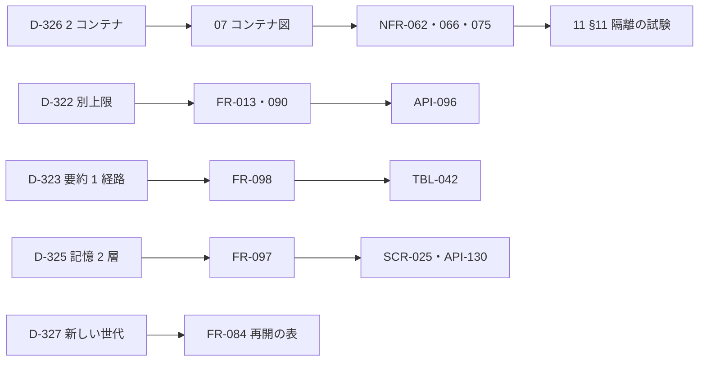

# 変更：v1.4：過剰な設計を削る（v1.3 → v1.4、2026-10-24）
> **3行で**：2026-10-24 のレビューで「持ち主 1 人・ホスト 1 台・VM 1 台の前提に対して、守りと耐久性の仕掛けが重い。R-95〜R-99 は仕掛け自身が生んだ」と指摘され、D-315〜D-328 を決めた ／ 接続先は Anthropic 直だけ・書き出し／取り込み・先温め・webhook のまとめ・掃除のための起動・リアクション・ターン途中の差し込み・記憶のログとメモ・要約の汚染の印を削り、費用は自動用の別上限、要約は 1 経路にした ／ VM はブラウザとターミナルを別のコンテナにして、利用者を分ける仕掛けとホスト前提の検査をやめた。新しいリスクは R-100

## 🧭 判断してほしいこと
未決はなし。D-315〜D-327 はユーザーが決めた。D-328（Web Push の送り待ち表は残す）だけ Claude判断で、[README](../README.md#claude判断で決めたこと見直してほしいもの) に一覧した。外の製品の挙動に頼る点は「実装のときに確かめる」と書いた：Docker の既定の seccomp に `makase-browser-seccomp.json` を足すと Chromium のサンドボックスが動くか、box-manager が egress に 2 つのコンテナのアドレスを伝える方法。新しいリスクは R-100（[11 §12](../11_tech_spec.md#12-リスクと対策)）。

## きっかけ
2026-10-24 のレビューで、v1.2 以降に足した守りと耐久性の仕掛けが前提に対して重いと指摘された。R-95（ホスト前提）・R-96（起動役の capability）・R-97（ホームの測り）・R-98（ホームの大きなデータ）・R-99（Docker が別の VM）は、どれも仕掛け自身が生んだリスクだった。ユーザーは下の決定をすべて承認した。

## 決定の一覧
| ID | 決定 |
|---|---|
| D-315 | Bedrock・Vertex の接続先を初版から外す。LLM は Anthropic の API 直だけ（REQ-095 は Won't、FR-087 は使わない、ADR-056 は取り下げ） |
| D-316 | 書き出し・取り込みを外す（REQ-089 は Won't）。引っ越しは 2 つのボリュームのコピーを手順書に書く |
| D-317 | 先温めを外す。API-121 は残し、用途は「画面が見えているか」だけ |
| D-318 | webhook のまとめを外す。1 受け口あたり 1 分 60 件を超えたら 429。重複は `source_key` の UNIQUE だけで捨てる |
| D-319 | 掃除のための起動を外す。ホームが 4GB を超えたら、ブラウザのデータを消す・控えに戻す・作り直すの 3 つだけ |
| D-320 | `send_to_owner` の `reaction` を外す。`kind` は `text`・`file`・`choices` |
| D-321 | Chromium の HTTP キャッシュの置き場を設計書から外す（実装のときに決める） |
| D-322 | 費用の区分の取っておきをやめ、`daily_usd`（10）と `daily_auto_usd`（7）の 2 つの上限にする（ADR-069） |
| D-323 | 要約を 1 経路（ターンを始める前に履歴が 6 万トークン超なら要約）にする。要約の汚染の印は持たない |
| D-324 | ターン途中の差し込みをやめる。動いている間に届いた `chat` は `queued` のままで、ターンが終わったらすぐ次を始める。タスクへの言い直し（`steer`）は残す |
| D-325 | 記憶を 2 層（プロフィールと検索）にする。ログ・メモ・`write_note` を消す（ADR-070） |
| D-326 | ブラウザとターミナルを別のコンテナ（`box-browser`・`box-shell`）にする（ADR-068） |
| D-327 | 本体の再起動では必ず新しい VM の世代で起こし直す |
| D-328 | Web Push の送り待ち表（`push_outbox`、TBL-055）はそのまま残す（Claude判断） |

## 版と置き換えの表
| 新 | 覆す・置き換える |
|---|---|
| D-315 | D-185、ADR-056、REQ-095、FR-087、R-87 |
| D-316 | REQ-089、FR-082、D-239 |
| D-317 | D-233、D-273 の先温めの部分 |
| D-318 | D-260 の件数、D-284、D-223 の一部 |
| D-319 | D-301、D-294 の `over_quota` |
| D-320 | D-212 のリアクション、ADR-062 の一部 |
| D-321 | D-313 |
| D-322 | D-230 の取っておき、D-259、D-279、D-282、D-289、D-312、R-92 の対策 |
| D-323 | D-264 の要約、D-269、D-270 の条件、D-278、D-280 の要約、D-281、D-310、D-311 |
| D-324 | D-195、D-220 の差し込み、D-247、D-276 の `attached`、D-280 の `closing_at`、REQ-079 の文言 |
| D-325 | D-204、ADR-063、D-224 のログとメモ、D-246 のログ、D-285 |
| D-326 | D-216、D-252、D-253、D-266、D-272、D-290〜D-293、D-303、D-304、D-314、ADR-043・045・054・060・061 の一部、R-95・R-96・R-99 |
| D-327 | D-271、D-302 |
| D-328 | （変更なし。D-267・D-288 のまま） |

## 差分
| ドキュメント | 節 / ID | 種別 | 変更前 → 変更後（1行） |
|---|---|---|---|
| 01・04 tools・09・11 §10 | REQ-095・FR-087・API-111・環境変数 | 削除 | 接続先 3 つ（Bedrock・Vertex）→ Anthropic 直だけ（D-315） |
| 01・04 tools・06・09 | REQ-089・FR-082・API-097・098・SCR-023 | 削除 | 書き出しと取り込み → なし。引っ越しは手順書（D-316） |
| 04 resident・05（NFR-082・085）・09 | FR-098・API-121・webhook | 削除・変更 | 先温め・まとめ・`merged` → なし。1 分 60 件で 429（D-317・D-318） |
| 04 vm・06・08・09 | 掃除のための起動・`boxes.mode` | 削除 | `cleanup` の起動・API-145・146 → ブラウザのデータを消す・控えに戻す・作り直すの 3 つ（D-319） |
| 04 tools・resident・06・09 | `reaction`・`kind` | 削除 | 4 種類 → 3 種類（D-320） |
| 04 resident・05・08・09 | 費用の区分・上限 | 変更 | `reserve_chat_usd` と格上げ → `daily_usd`・`daily_auto_usd`（D-322） |
| 04 resident・08・09 | 要約・`context_snapshots.tainted` | 変更・削除 | 3 つの経路と汚染の印 → ターン開始前の 1 経路。印は持たない（D-323） |
| 04 resident・08 | `attached`・`closing_at` | 削除 | ターン途中の差し込み → 終わってから次のターン（D-324） |
| 04 resident・06・08・09 | 記憶 | 変更・削除 | 4 層 → 2 層。TBL-048・049・API-132・`write_note` を消す（D-325） |
| 04 vm・05・07・08・09・10・11 §11 | VM の構成 | 変更 | 1 コンテナ `box` → `box-browser`・`box-shell`。起動役・資格・ホスト前提の検査を消す（D-326） |
| 04 vm・09 | 再開の表・API-103・117 | 変更・削除 | 同じ世代を使い続ける → 常に新しい世代（D-327） |
| 00・README・11・adr | 決定・リスク・ADR | 追加 | D-315〜D-328、R-100、ADR-068〜070。R-87・95・96・99 を消す |

## 影響範囲

- 影響を受けるが今回は変更していないもの：ADR-044 は末尾の追記だけ。ADR-064・065・067 は変更なし

## 残る危険
- R-100：Chromium のサンドボックスが使えないホストでは、ページの仕掛けで Chromium を取られると `box-browser` の中（プロフィール＝Cookie）まで読まれうる。要約に汚染の印を引き継がないので、外から来た指示が要約に残る危険もある。対策：コンテナの隔離（権限なし・読み取りだけのルート・内部ネットワーク・プロフィール以外に秘密なし）、状態欄に「サンドボックスなし」を出す、要約の指示で枠の中の指示を写さない、汚染のあとの書き込みは確認に回る、ブラウザのデータを消す・控えに戻す操作
- 消したリスク：R-87・R-95・R-96・R-99。R-97・R-98 は対策欄を簡略化して残した

## Claude 判断で決めた細部
- D-328：Web Push の送り待ち表（`push_outbox`）は変えない（再送が要る。削ると通知が落ちる）
- Chromium のサンドボックスが使えないホストは、起動を断らず `--no-sandbox` で起こす（ユーザーの D-326 の範囲で、状態欄に出す）
- 要約に汚染の印は引き継がない（印を消す操作と確認のカードも要らなくなる。R-100 に残す）

## 関連
- ADR：新しく ADR-068・069・070。ADR-056 は取り下げ、ADR-063 は置き換え済み、ADR-060・054 は一部置き換え済み。ADR-043・044・045・061・062・066 に v1.4 の追記を入れた
- 前の版：[2026-10-24-review-v1.3.md](2026-10-24-review-v1.3.md)
