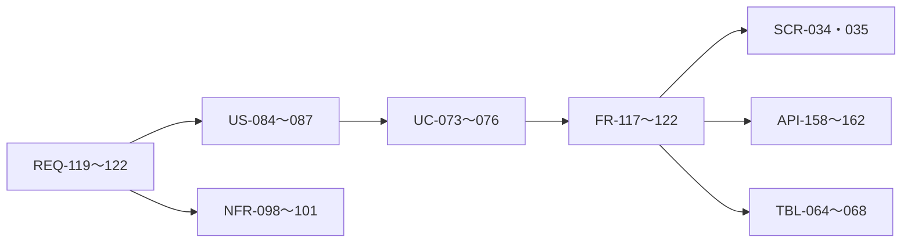

# 変更：推論を実行プログラムへ変える成長機構（v1.7 → v1.8、2026-10-26）
> **3行で**
> 1. 日程調整の実行履歴から、ガードと判断の穴を持つプログラムを学習する。
> 2. 検証条件達成で自動採用し、条件が変わった部分だけAIへ戻す。
> 3. 家に置くローカル構成を基準とし、要件から技術仕様まで既存設計へ追加した。

## 🧭 判断してほしいこと
今回の未決事項なし。技術詳細・数値はユーザーの委任に基づく設計値。
R-114（有限試験の限界）、R-115（学習費の回収）、R-116（外部予定の競合）は[読む入口](../README.md)に集約した。
既存v1.7の実機評価とリスクは継続。今回解決済みとは扱わない。

## 全体図

見てほしいところ：新しい学習機能のIDを上流から下流まで対応づけた。

## 要点
- 制限IRにより、固定できる部分と未知の部分を分けた。
- 採用の承認クリックは不要。検証は候補生成LLMから独立させた。
- 学習費・入力解釈・報告も含めて効果を測る。
- 送信後の結果不明は再実行せず、照合する契約を定義した。

## 詳細
### 差分・影響範囲
| 文書 | ID・節 | 変更 |
|---|---|---|
| 00_overview / 00_learning | D-391〜402、用語、追跡表 | 成長原理・ユーザー回答・委任判断を追加 |
| 01_requirements | REQ-119〜123 | 日程調整の学習をMust、仕事横断合成をWon'tに追加 |
| 02_user_stories | US-084〜087 | 再利用・自動採用・局所推論・停止の受入条件 |
| 03_use_cases / 03_learning | UC-073〜076 | 初回から採用・変化・停止までの正常・例外フロー |
| 04_functional_spec | FR-117〜122 | 型付き履歴・IR・採用ゲート・executor・穴・停止 |
| 05_non_functional | NFR-098〜101 | 成功率・LLM削減・費用・資源・再開・保持の目標 |
| 06_ux_design / 06_learning | SCR-034・035 | 設定とタスク詳細から学習を確認する画面 |
| 07_architecture | 本体の部品 | ローカル本体にcompiler・validator・executor等を追加 |
| 08_database | TBL-064〜068、TBL-035 | 新規5表、設定、CAS・リース・保持削除の契約 |
| 09_api | API-158〜162、API-122 | 閲覧・停止・設定、taskと学習runの関連 |
| 10_diagrams | ER・状態・UC-073〜076 | DB参照、採用状態、主要業務と異常時シーケンス |
| 11_tech_spec / 11_learning | 統合仕様・運用 | 設定値、効果測定、既存実装との差を明記 |
| README | 読む入口 | 47行のv1.8入口へ整理。過去の入口をREADME-v1.7.mdへ保存 |

影響する既存仕様：FR-081（カレンダー接続）、FR-090〜093（受付・メイン・裏タスク・報告）、FR-104〜108（規則・監査・モデル）、API-122（task詳細）、TBL-035（設定）、既存task・Intent・監査の保存。
FR-081・090〜093・104〜108自体の既存契約は継承し、今回の呼び出し方と追加preflightはFR-120・121で定義した。自然言語スキルを育てないD-177は継承し、別概念の実行IRを追加する。

### 委任判断
| 決定 | 内容 |
|---|---|
| D-396 | 32ノード以下の制限DAG、既知の型付き演算、契約付き穴 |
| D-397・399 | 独立した検証、5実績・100反例・5シャドー、自動失効 |
| D-398 | 穴だけの推論、最大4穴・各2試行、拒否や障害を分離 |
| D-400 | 費用日0.50 USD、保持30日、512MiB等の初期設計値 |
| D-401 | DB・API・画面、版停止、再開、冪等性、設定の契約 |

これらは実測済みの性能保証ではない。定義の正本は[決定事項ログ](../00_learning.md#決定事項ログ)。

### 検証の対象と結果
- ID範囲と追跡表、相対リンク、コードフェンス、状態enum、API/DB対応、ERのFK対応を確認した。新規ページからの相対リンク先・見出し79参照で欠落0、追加ID範囲の欠落0、`git diff --check`で問題0。
- 追加した詳細ページは400行以内、ADRは30行以内。READMEを短縮し、今回の詳細を各標準文書の分冊として接続した。
- 既存の00_overview・03_use_cases・06_ux_designなどには、変更前から400行超や長い要約層が残る。今回の追加仕様の分冊化とは別に、既存全体の再構成は未実施。既存全書が読みやすさチェックに合格したとはしない。
- 実装・モデル品質・ラズパイ性能の試験は今回の設計変更では実施しない。コード変更、実装タスク分解、工数見積もりは含めない。

### 関連
- [ADR-085](../adr/ADR-085-learning-ir.md)：表現。
- [ADR-086](../adr/ADR-086-learning-activation.md)：自動採用。
- [ADR-087](../adr/ADR-087-learning-holes.md)：局所推論。

## このドキュメントで決まったこと
ユーザー決定D-391〜395、委任判断D-396〜401、既存規約の継承D-402。
