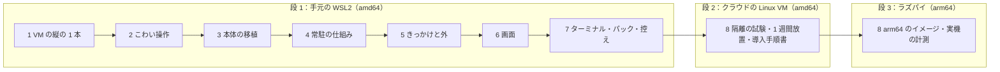

# Agent-Team-Open 実装手順書（設計 v1.4 向け）
- プロジェクト：Agent-Team-Open ／ 手順書の版：v1（2026-10-24） ／ 設計の版：[v1.4](../design/README.md) ／ インプット：[11 技術仕様書](../design/11_tech_spec.md)、置き先の順番（D-190）

> **3行で**
> 1. [設計書 v1.4](../design/README.md) を、**8 つのステップ**で順に実装する手順書。各ステップは「作るもの → 手順 → 終わる条件 → 実装で決めること」の型で書く。設計の中身は写さず、設計書へのリンクで済ませる。
> 2. 順番は「いちばん分からないものから」：VM の縦の 1 本 → こわい操作 → 本体の移植 → 常駐の仕組み → きっかけと外とのつながり → 画面 → ターミナル・パック・控え → 隔離の試験と導入手順書。置き先は 段 1 WSL2 → 段 2 クラウドの Linux VM → 段 3 ラズパイ（D-190）。
> 3. この手順書は設計書の**外**にある（D-211）。設計と食い違ったら設計書の決定事項ログ（D-xxx）に戻し、この手順書は設計に追いつかせる。チケット・日程・担当は決めない。

## 始める前に
### 言葉
| 言葉 | 意味 |
|---|---|
| ステップ | 8 つの作業の単位（1〜8）。順に進める。1 ファイル 1 ステップ |
| 区切り（N.k） | ステップの中の、単独で動かして確かめられる単位。各区切りの終わりに「確かめ」がある |
| 段 | 置き先。段 1 ＝手元の WSL2、段 2 ＝クラウドの amd64 の Linux VM、段 3 ＝ラズパイ（arm64）。ステップ 1〜7 は段 1、ステップ 8 で段 2・3 |
| 終わる条件 | ステップを「済」にするための表。11 §11 のテスト観点と UC の基本フローから、ID つきで拾ってある |
| 実装で決めること | 設計が「実装で決める」とした論点。手順書は「おすすめ」を書くだけで、決めたら設計書の決定事項ログに D-xxx を足す |

### 要るもの
| もの | いつから要るか |
|---|---|
| Node 24・pnpm 10・Docker Engine（WSL の中）・Compose v2・`docker buildx` | ステップ 1 |
| `ANTHROPIC_API_KEY`（**ここから有料**。`LLM_SESSION_BUDGET_MICRO_USD` で上限をかける） | ステップ 1 の 1.6（CLI で computer use）。ステップ 2 のオートレビュー、ステップ 4 の実 API の確かめ、ステップ 7・8 の通し |
| Tailscale のアカウント（tailnet の HTTPS を有効に。`TS_AUTHKEY`） | ステップ 3 |
| GitHub（テスト用のリポジトリ・GitHub App）、Google Cloud（OAuth のクライアント）。使う機能だけ | ステップ 5 |
| Web Push を受ける実機（Android の Chrome、または iOS でホーム画面に追加した PWA）、tailnet の外から `curl` できる場所 | ステップ 5・6 |
| クラウドの amd64 の Linux VM（1 週間以上）、ラズパイ 4/5（4GB 以上）、開発者でない人（予行 1 人＋本番 3 人） | ステップ 8 |

### 進め方
1. ステップのファイルを開き、「前提」を満たしているか確かめる（前のステップの「終わる条件」が済んでいること）
2. 「手順」の区切り N.k を上から 1 つずつ進め、区切りの「確かめ」を実行する。区切りの中の番号は順番の目安で、入れ替えてよい
3. ステップの最後に「終わる条件」の表を上から埋め、`pnpm typecheck / test / lint:deps` を回す
4. 「実装で決めること」で決めたことは、設計書の [00 決定事項ログ](../design/00_overview.md#決定事項ログ) に D-xxx を足す。「設計に戻すこと」も同じときに片づける
5. 済んだら[下のステップ一覧](#ステップ一覧)に「済（日付・コミット）」を書く。コミットは機能ごとに分ける
6. Claude Code などのエージェントに頼むときは「`docs/implementation/0N_*.md` のステップ N の区切り N.k をやって」と、区切りの単位で頼む

## 🧭 判断してほしいこと
| # | 論点 | おすすめ | どこで決まる |
|---|---|---|---|
| J-1 | 本体のパッケージ名と、旧コードを消す時期 | 新規 `apps/makase` に `apps/worker/src` を移す。ステップ 3 の最後で `apps/app`・`apps/worker`・`packages/edge` を消し、`packages/db`・`apps/gateway`・`apps/gcal`・`apps/github`・`packages/gateway-client` はステップ 5 の最後で消す | [ステップ 3](03_core_port.md)・[5](05_triggers.md) |
| J-2 | ステップ 2（こわい操作）を本体より先に置くか | 先に置く。設計レビューで指摘が最も集中した箇所で、VM と CLI のループだけで試せる。本体ができてから表を合流させる | [ステップ 2](02_risky_actions.md) |
| J-3 | 画面（ステップ 6）を常駐（ステップ 4）より後に置くか | 後に置く。ステップ 4・5 は curl・SSE・ScriptedLlm で確かめられる。先に画面を作ると API の形が揺れるたびに作り直しになる | [ステップ 6](06_web.md) |
| J-4 | Google の OAuth の戻り先に ts.net の URL を使えるか、クラウドの VM と第三者テストの費用・被験者 | 持ち主が決める。[実装で決めることの一覧](#実装で決めることの一覧)の太字の行 | [ステップ 5](05_triggers.md)・[8](08_release.md) |

ほかに、各ステップの「実装で決めること」（設計が「実装で決める」とした論点）を[下の一覧](#実装で決めることの一覧)に集めた。手順書を書くときに見つけた設計の直しどころは [design-feedback.md](design-feedback.md) にある。

## 全体図

見てほしいところ：段 1 の中でステップ 1・2 が先。ここで NFR-063（computer use のツールの版と画面の大きさ）・NFR-067・068（速さ）・R-82（スクショの費用）の実測が出て、設計の「実装で決める」が最初に減る。ステップ 3 以降は Cloudflare 版の部品を並べ直す作業で、やり方が分かっている（[07 レベル3](../design/07_architecture.md#レベル3本体のコンポーネント図)）。

## 要点
- ステップごとの「作るもの・終わる条件」は[下の一覧](#ステップ一覧)。中身は各ファイル
- 読む順番：この README の[「始める前に」](#始める前に) → [ステップ 1](01_vm_vertical.md) から順に。設計を知らない人は先に [設計書 README の「読む順番」](../design/README.md#読む順番) で 5 分の層を読む
- 置き場の名前（`apps/makase`・`apps/box-manager`・`apps/egress`・`apps/box-agent`・`apps/shell-agent`・`docker/box-browser`・`docker/box-shell`・`compose.yaml`・`packs/`・`evals/`）は[下の表](#置き場の名前)で統一する
- 段 1 は amd64 だけで進めてよいが、[arm64 で詰まらないための約束](#arm64-で詰まらないための約束)は最初から守る
- 作りながら設計を直すときの約束は[§作りながら設計を直すとき](#作りながら設計を直すとき)

---

## 詳細

### ステップ一覧
| ステップ | 段 | 作るもの | 終わる条件（要約） | 主な設計の参照 |
|---|---|---|---|---|
| [1 VM の縦の 1 本](01_vm_vertical.md) | 1 | `docker/box-browser`・`docker/box-shell` のイメージ、box-agent、shell-agent の最小、egress、box-manager の最小、本体なしの CLI で computer use のループ | CLI から試験ページを操作できる。止めて起こしてもホームが残る。`box-shell` から X・CDP・VNC に届かない。NFR-067・068・スクショの費用の実測が出る | [07](../design/07_architecture.md)、[04 vm](../design/04_functional_spec/vm.md)、[09 vm](../design/09_api/vm.md)、ADR-043〜045・060・068 |
| [2 こわい操作](02_risky_actions.md) | 1 | `judgeBrowserAction` と行き先の表、`browser_checks` の承認とハッシュ、オートレビュー、eval の土台 | 11 §11 の単体の観点が緑。実の VM の試験ページで、確かめた先と実行した先が同じ。eval (1)(3) が回る | [04 vm](../design/04_functional_spec/vm.md) FR-076・077・099、ADR-047・052・064 |
| [3 本体の移植](03_core_port.md) | 1 | `apps/makase`（Node 24・Hono・`better-sqlite3`）、表の骨組み（版 4・5）、Compose 一式（`isolated`）、Tailscale の身元、FR-083 の状態、SSE、監査ログ、`web_fetch` の判定。依頼（asks）と旧コードを消す | `docker compose up -d` で起動し、Tailscale 経由で入れる。LAN からは届かない。`pnpm typecheck / test / lint:deps` が緑 | [07](../design/07_architecture.md) 移すもの、[08 方針](../design/08_database/README.md)、ADR-042・046・049・051 |
| [4 常駐の仕組み](04_resident.md) | 1 | `wakes`・`turns`・`tasks`、受付・ターン・タスク・タイマー、`delegate`・`report`・`send_to_owner`、文脈とキャッシュ、要約、記憶 2 層、VM の窓口（画面の番・交代 API-089〜091・113・確認の一覧 API-087・110）、再開 | チャットで頼むとメインが答えるか振り分け、タスクが VM で仕事をして報告し、メインが伝える。交代して返せる。再起動しても続く。先頭の 9 割以上がキャッシュに当たる | [04 resident](../design/04_functional_spec/resident.md)、[08 resident](../design/08_database/resident.md)、ADR-058・059・062・066・069・070 |
| [5 きっかけと外とのつながり](05_triggers.md) | 1 | ルーチン・予約・webhook（:8081・Funnel）、Web Push の送り手と購読、カレンダー・GitHub の gateway と `approval_done`。旧 gateway・gcal・github・`packages/db` を消す | 時刻と webhook でメインが起き、留守の間の知らせがスマホに届く。カレンダーと PR の書き込みが確認つきで通る | [04 resident](../design/04_functional_spec/resident.md) FR-094〜096・017、[04 tools](../design/04_functional_spec/tools.md) FR-081、ADR-065・067 |
| [6 画面](06_web.md) | 1 | SCR-020〜026、PWA と Service Worker、noVNC の画面、`apps/web` の作り直し | 06 の画面遷移どおりに動き、スマホで頼む・見る・確認する・タップで交代するまでできる | [06](../design/06_ux_design.md)、[09](../design/09_api/README.md) |
| [7 ターミナル・パック・控え](07_terminal_pack_snapshot.md) | 1 | shell-agent のコマンドと tar、パック（`announcement-page`）、VM の控え・戻す・作り直す、ブラウザのデータを消す | UC-052・053・061 が通る。告知ページ 1 件を PR まで届けられる。控えから戻せる | [04 vm](../design/04_functional_spec/vm.md) FR-086・100・079、[04 tools](../design/04_functional_spec/tools.md) FR-085、ADR-053・054・061 |
| [8 隔離の試験・導入手順書・段 2 と 3](08_release.md) | 2・3 | 隔離の試験、実機の計測、導入手順書（README）、1 週間の放置、arm64 のイメージ | 11 §11 の隔離の試験がすべて通る。開発者でない人が README だけで 30 分以内に起動できる（NFR-081）。arm64 で同じ Compose が起動する | [11 §11](../design/11_tech_spec.md#11-テスト方針)、[05](../design/05_non_functional.md)、[07 ホスト側の手順](../design/07_architecture.md#デプロイ構成環境) |

### 段ごとの終わる条件
| 段 | 終わる条件 |
|---|---|
| 1（WSL2） | ステップ 1〜7 の終わる条件がすべて満たされ、WSL2 の Compose 一式で UC-042〜049・051〜061 が通る。11 §11 の単体と結合が緑。標準パック「告知ページ制作」で告知ページ 1 件を GitHub の PR まで届けられる |
| 2（クラウドの amd64） | 1 週間放置して、毎日のバックアップ（NFR-070）・VM の控え（NFR-084）・掃除（NFR-073）が回り、ターンもタスクも途中で壊れていない。11 §11 の隔離の試験がすべて通る。開発者でない人 1 人が README だけで 30 分以内に起動できる（NFR-081 の予行） |
| 3（ラズパイ） | arm64 のイメージで同じ Compose が起動する。NFR-067・068 を実機で測り、外れたら画面を小さくする（R-77）。4GB の機械で本体＋VM（2 コンテナ）＋OS が入る（NFR-062） |

段 2 を段 3 の前に置く理由：WSL2 はノートを閉じると止まる（R-78）。長時間の試験は常時起動の amd64 で先に済ませ、arm64 の問題と切り分ける。

### 置き場の名前
| もの | 置き場 | 備考 |
|---|---|---|
| 本体（コンテナ `makase`） | `apps/makase`（新規） | `apps/worker/src` を移す。移し終えたら `apps/worker`・`apps/app` は消す（ステップ 3） |
| 共有パッケージ | `packages/kernel`・`runner`・`llm`・`platform`・`gcal-core`・`github-core` | そのまま使う。`packages/edge`（旧 Node 版。`web.ts` などは本体に移す）はステップ 3 の最後、`packages/db`（PostgreSQL）・`packages/gateway-client` はステップ 5 の最後、`packages/sandbox`・`apps/sandbox`（shell-agent に移す）はステップ 7 の最後で消す |
| こわい操作の判定（`judgeBrowserAction`） | `packages/kernel/src/browser.ts`（新規。ステップ 2） | LLM・DB・ネットワークを使わない純粋関数 |
| こわい操作の確認と承認（`browser_checks`・オートレビュー） | `packages/browser-guard`（新規。ステップ 2）→ ステップ 3 で `apps/makase/src/guard/` に取り込みパッケージは消す | 試験用の小さな SQLite を持つ。`WsDb` を受ける形で書き、ステップ 3 で本体の DB に合流 |
| box-manager | `apps/box-manager`（新規） | Node。Docker API は docker-socket-proxy 越し |
| egress | `apps/egress`（新規） | Node の小さな CONNECT プロキシ |
| box-agent（`box-browser` の中） | `apps/box-agent`（新規） | xdotool・CDP（`--remote-debugging-pipe`）・スクショ・`read_page` |
| shell-agent（`box-shell` の中） | `apps/shell-agent`（新規） | `apps/sandbox`＋`packages/sandbox` から育てる |
| VM のイメージ | `docker/box-browser/Dockerfile`・`docker/box-shell/Dockerfile`・`docker/makase-browser-seccomp.json` | Chromium は Debian の `chromium` パッケージ |
| Claude のクライアント（computer use・オートレビュー・本体で共用） | `packages/llm/src/claude.ts`（ステップ 1 で `apps/worker/src/llm/claude.ts` から移す） | クライアントの作成は 1 か所（D-315） |
| 試験用の CLI（本体なしで computer use のループを回す） | `apps/box-manager/src/cli/`（ステップ 1。開発用） | 本番の構成には入れない |
| 試験ページ | `evals/pages/`（ステップ 1 で最小、ステップ 2 で増やす） | `box-shell` の `shell:8000` で配る |
| Compose | `compose.yaml`（今の db だけのものを置き換える）＋`compose.dev.yaml`。ステップ 1・2 の間は暫定の `compose.vm.yaml`（3.6 で取り込んで消す） | 開発時は本体だけ `pnpm dev` に差し替える。`box` ネットワークは `isolated` を既定で書く |
| 標準パック | `packs/announcement-page.json`（イメージでは `/opt/makase/packs/`） | 既存の `apps/app/src/packs/library/*.ts` は参考 |
| eval | `evals/cases/<日付>-<短い名前>/`、`pnpm run eval:capture`（設計の `npm run` はこのリポジトリでは `pnpm run`） | 11 §11・D-199 |
| 画面 | `apps/web`（作り直す） | |

名前はおすすめで、実装で変えてよい。変えたらこの表と各ステップを直す。

### 各ステップの型
各ファイルは同じ見出しで書く：**3行で → 前提（入力・機械・鍵とアカウント）→ 作るもの → 手順（4〜9 の区切り。大きい区切りは N.k.a の小見出しに分け、どれにも「確かめ」）→ 終わる条件 → 実装で決めること → 設計に戻すこと → 参照**。「終わる条件」は `S<ステップ>-<連番>`（例 `S4-07`）の ID を持ち、[11 §11 テスト方針](../design/11_tech_spec.md#11-テスト方針) と [03 のユースケース](../design/03_use_cases.md) の基本フローから、そのステップに当たるものを拾う。

### 実装で決めることの一覧
設計が「実装で決める」「実装のときに確かめる」とした論点。全部は各ステップの「実装で決めること」の表にあり（合わせて 100 件強）、ここには**ほかのステップにも効くもの**と**持ち主の判断が要りそうなもの**だけを挙げる。決めたら [00 決定事項ログ](../design/00_overview.md#決定事項ログ) に D-xxx を足す。

| 論点 | 決めるステップ | 効く先 | おすすめ（詳細はステップの表） |
|---|---|---|---|
| computer use のツールの版と画面の大きさの渡し方（NFR-063） | [1](01_vm_vertical.md) | 2・4 | 既定モデルで 1 回試し、座標が合えば渡さない |
| Claude のクライアントの置き場 | [1](01_vm_vertical.md) | 2・3・4 | `packages/llm/src/claude.ts` に移して 1 か所（D-315） |
| egress への送り元アドレスの伝え方・外の名前を引かない設定との両立 | [1](01_vm_vertical.md) | 7・8 | box ネットワークに固定アドレス、`ExtraHosts` で `shell`・`egress` |
| Chromium のサンドボックスの可否の見分け方・キャッシュの置き場 | [1](01_vm_vertical.md) | 8 | 失敗したら 1 回だけ `--no-sandbox`。キャッシュは `/tmp` 512MB を試して実測 |
| `content_hash` を誰が作るか（TBL-039 と API-103 の食い違い） | [2](02_risky_actions.md) | 4 | 正規化を Kernel に置き、box-agent の値をそのまま保存 |
| `packages/browser-guard` を作り、ステップ 3 で本体に取り込む | [2](02_risky_actions.md) → [3](03_core_port.md) | 4 | 作る。3 で `apps/makase/src/guard/` へ |
| RPC の値返し（`WriteResult`・`EdgeOutcome`）を例外に戻す | [3](03_core_port.md) | 4・5 | 戻す |
| 新しい表を版 5 で一度に作る・asks の表はまだ落とさない | [3](03_core_port.md) | 4・5・7 | 一度に作る。落とすのは別の版 |
| `apps/app`・`apps/worker`・`packages/edge` を消す時期と、`packages/db`・`apps/gateway`・`apps/gcal`・`apps/github`・`packages/gateway-client` を消す時期 | [3](03_core_port.md)・[5](05_triggers.md) | 4・5・7 | 前者は 3 の最後（4・5・7 の移す元は git の履歴から）、後者は 5 の最後 |
| ポリシーの `budget` のキー（今の `per_day_usd` → `daily_usd`・`daily_auto_usd`） | [3](03_core_port.md) | 2・4 | `packages/kernel/src/policy.ts` を作り直し（DB は版 4）、`BrowserPolicy` も合流 |
| runner に `runTurn` を足す形・`ChatMessage` に `raw` | [4](04_resident.md) | 5・7 | `packages/runner/src/turn.ts`。`raw` を素通し |
| `cache_control` の付け方・context editing の形・入力の大きさの測り方 | [4](04_resident.md) | — | 実 API で確かめて決める（有料） |
| Funnel の付け外しを誰が動かすか・ts.net の名前の取り方 | [5](05_triggers.md) | 3・8 | 共有ボリュームの印ファイル。`PUBLIC_BASE_URL` で上書き可 |
| Google の OAuth が ts.net の戻り先を受けるか | [5](05_triggers.md) | 8 | 最初に Google Cloud のコンソールで確かめる。通らなければ設計に戻す（**持ち主の確認が要る**） |
| 既存の MCP サーバー（`apps/gcal`・`apps/github`）・`provenance.ts` を消す | [5](05_triggers.md) | — | 消す（gateway は本体の中：ADR-051） |
| noVNC の入れ方・Service Worker のビルド・スマホのタップの写し方 | [6](06_web.md) | — | npm の `@novnc/novnc`、手書きの `sw.js`、まず noVNC のタッチ |
| パックの `agents[]` の項目名・`/data/packs/` のスキルを信頼するか | [7](07_terminal_pack_snapshot.md) | 4 | `name`・`role`・`instructions`・`tools`・`limits`・`skills`。`/data` 側は外の内容として包む |
| `terminal.allow_hosts` を本体から egress へ渡す道（API-096 で変えられるが、egress への届け方が設計にない） | [7](07_terminal_pack_snapshot.md) | 1・3 | ポリシーを正とし、box-manager 経由で送る |
| 交代（FR-078）をステップ 4 に置く | [4](04_resident.md) | 1・5・6 | ステップ 4 の区切り 4.7。box-manager の API-113・本体の API-089〜091・`takeovers`・`request_takeover`。ステップ 1 の box-agent は `control_epoch` を比べるだけ |
| 控えの zstd の呼び方・ボリュームを空にして広げる手順 | [7](07_terminal_pack_snapshot.md) | 8 | 一時コンテナの `tar --zstd` |
| `announcement-page` の手順書 4 本の中身 | [7](07_terminal_pack_snapshot.md) | 8 | 旧 `library/` は書き方の参考だけ。本文は新しく書く |
| `isolated` モードが使える Docker の版の確かめ方・任意の規則（DOCKER-USER）が 1 行で足りるか | [8](08_release.md) | 3（Compose） | 最低の版を公式の文書で確かめて README に書く。I-4 の試験で決める |
| マルチアーキのイメージをどこでビルドしてどこに置くか | [8](08_release.md) | 3（`compose.yaml` の `image:`） | GitHub Actions の arm64 runner でネイティブにビルドし GHCR へ |
| 導入手順書の最終形（今の README を置き換えるか） | [8](08_release.md) | 3（`docs/development.md`） | 置き換える。README は「置く手順」だけにし、設計・開発の話は `docs/` へ |
| クラウドの VM の種類と費用、第三者テストの被験者と記録の置き場 | [8](08_release.md) | — | 汎用の amd64 VM を 1 週間＋予備。記録は `docs/implementation/records/`（**持ち主が決める**） |

### 設計の直しどころ
手順書を書くときに見つけた設計書の食い違い・不足と、今のコードとの差は [design-feedback.md](design-feedback.md) にまとめた。設計書を直すときの材料にする。

### arm64 で詰まらないための約束
段 1・2 は amd64 だけで進めてよいが、段 3 で作り直しにならないよう、次だけは最初から守る。
- ネイティブモジュールは arm64 の prebuilt があるものだけ入れる（`better-sqlite3` は可。入れる前に prebuilt の有無を見る）
- VM のイメージの Chromium は Debian のパッケージ（`chromium`）から取る。Google Chrome の deb（amd64 だけ）や Playwright 同梱のブラウザに頼らない
- Dockerfile に `TARGETARCH` 依存のダウンロードを書くときは、arm64 の分岐も同時に書く
- Compose とイメージ名はアーキテクチャで分けない（同じ `compose.yaml` で両方動く）
- `pnpm-workspace.yaml` の `onlyBuiltDependencies` に足すものは、arm64 でもビルドできるものだけ

### 作りながら設計を直すとき
- 設計と違う作りにしたとき、設計が「実装で決める」としていたことを決めたとき（NFR-063 など）は、[00 決定事項ログ](../design/00_overview.md#決定事項ログ) に D-xxx を 1 行足す。ADR を覆すときは新しい ADR を書く
- 動かして失敗したタスク・ターンは、直す前に eval のケースにする（`eval:capture`。[11 §11](../design/11_tech_spec.md#11-テスト方針)・D-199）。直したら eval で確かめてから main に入れる
- ステップ 1・8 の実測の値は [05](../design/05_non_functional.md) の NFR-067・068 の横に「実測」として書き足す
- 画面や API を足したときは [06](../design/06_ux_design.md)・[09](../design/09_api/README.md) の表に行を足し、[00 トレーサビリティ表](../design/00_overview.md#トレーサビリティ表) をつなぐ
- 各ステップの「終わる条件」を満たしたら、このファイルのステップ一覧に「済（日付・コミット）」を書く

### この手順書で決めないこと
- タスクの粒度の分解・チケット・日程・担当。各ステップの中の区切りは「おすすめの順」で、入れ替えてよい
- 設計の中身（設計書が正）。この手順書と設計書が食い違ったら設計書に従い、この手順書を直す

### 参照ドキュメント
- [設計書 README](../design/README.md)、[11 技術仕様書](../design/11_tech_spec.md)、[07 アーキテクチャ](../design/07_architecture.md)
- [docs/development.md](../development.md)（今の開発手順。ステップ 3 で書き換える）
- [docs/oss-and-business.md](../oss-and-business.md)（OSS と事業の方針）
