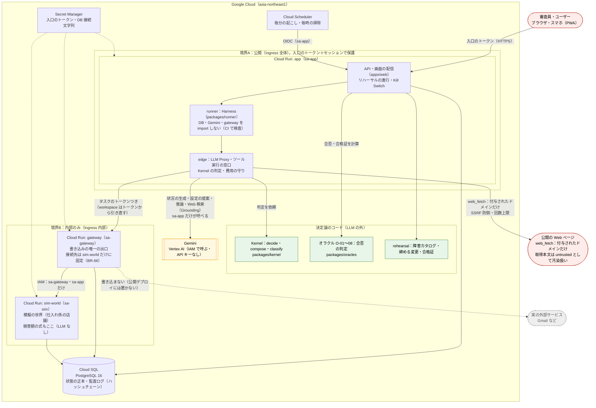
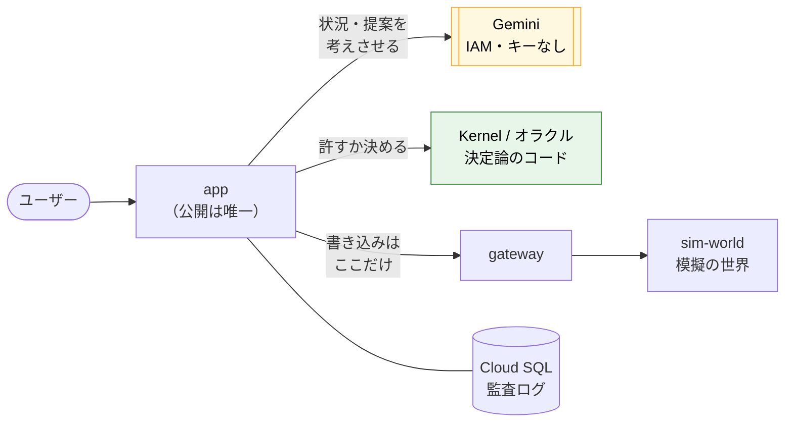

# 構成図（提出用）

- 元の図：`README.md` §構成、`docs/design/15_hackathon.md` §構成（Cloud Run）。
- 提出用に、(1) 信頼の境界、(2) 「Gemini が決めないもの」、(3) 書き込みの経路、を図の上で分かるようにした。
- 事実の出典：`infra/README.md`（サービスアカウント・Ingress・`run.invoker`）、15 §公開時のセキュリティ（BR-66）。

## 1. 構成図（Mermaid）

実線＝呼び出し、点線＝参照。`app` だけが外に開き、書き込みは `gateway` だけが出口。



### 図の読み方（図の下に載せる説明文）

1. **信頼の線は2本**。境界A（公開）に出ているのは `app` だけ。境界B（内部）の `gateway`・`sim-world` は、IAM の呼び出し元（`sa-app`・`sa-gateway`）しか呼べない。
2. **書き込みの出口は `gateway` だけ**。`runner` は DB・Gemini・`gateway` に直接届かず、`edge` の関数を通してしか LLM・ツールに届かない。`gateway` は、リクエストが言う `workspace_id` ではなく、タスクのトークンから引き直す。
3. **実の外部サービスへの書き込みはない**。`gateway` がつなげる先は `sim-world` だけ（`ALLOWED_CONNECTOR_URLS` を設定で固定。BR-66）。外に出るのは調べものの読み取りだけ：`web_fetch` は付与されたドメイン（`allow_domains`）の公開ページだけを取り（SSRF 防御・回数上限つき）、`web_search` は Gemini の Google 検索 Grounding を edge の `callGemini` 経由で使う。どちらも受け取った時点でタスクを汚染し、取得本文は `<untrusted>` に包んでエージェントに渡す。汚染後の書き込みは Kernel の判定を通る（[D-111](../design/decisions.md#d-111)）。
4. **Gemini は API キーを持たない**。`sa-app` の IAM だけで呼ぶ。キーが漏れる経路がない。Gemini を呼べるのは `sa-app` だけ（`gateway`・`sa-sim` には `aiplatform.user` がない）。

## 2. Gemini が決めるもの・決めないもの（図に添える表）

| 区分 | 内容 | 担うもの |
|---|---|---|
| Gemini が担う | エージェントの推論・要約、設定プランナー（編成・担当・仕事の指示）、リハーサルの状況の生成、自分の言葉の悪い日を障害カタログに当てはめる、Web 検索の要約と出典（Google 検索の Grounding。[D-111](../design/decisions.md#d-111)。受け取った内容は untrusted として汚染扱い） | Gemini（Vertex AI） |
| Gemini が決めない | 書き込みを許すか（自動／確認／拒否） | Kernel の `decide()`（決定論） |
| 〃 | 締める提案（ガードの案）を作る | `proposeTighteningForRuns`（`apps/app/src/rehearsal/tighten-apply.ts`。中身は `packages/rehearsal/src/tighten.ts` の純粋関数。LLM なし） |
| 〃 | 提案が「締める」か「広げる」か（広げる提案は出さない） | `classify()` |
| 〃 | リハーサルの合否・誰が止めたか | オラクル O-01〜08と Kernel の判定の記録 |
| 〃 | 損害額・防いだ損害 | `sim-world` の固定の式（BR-79） |
| 〃 | 合格証の発行・失効、合格証がない間のルールの自動の停止 | `packages/rehearsal`・`decide()`（BR-81） |
| 〃 | 費用の上限・Kill Switch・監査ログの記録 | `edge`・DB（ハッシュチェーン） |

## 3. 簡略版（動画・スライド用）

動画の最後の場面（2:38〜）では、下の簡略版を使うと読める。



## 4. 画像化の手順

### 4-1. mmdc（Mermaid CLI）で PNG・SVG にする

Node 22 以上があれば、インストールなしで動く。

```bash
cd docs/submission
# 図1だけを .mmd に切り出す（このファイルの最初の ```mermaid ブロックの中身）
#   例：sed や手で architecture-full.mmd / architecture-simple.mmd として保存する
npx -y @mermaid-js/mermaid-cli -i architecture-full.mmd   -o architecture-full.png   -b white -w 1800 -s 2
npx -y @mermaid-js/mermaid-cli -i architecture-full.mmd   -o architecture-full.svg   -b white
npx -y @mermaid-js/mermaid-cli -i architecture-simple.mmd -o architecture-simple.png -b white -w 1600 -s 2
```

- `-w` は幅（px）、`-s` は縮尺（高解像度化）。`-b white` で背景を白にする（YouTube・スライドで透過が黒くなるのを避ける）。
- Markdown ごと変換するなら：`npx -y @mermaid-js/mermaid-cli -i architecture.md -o architecture-out.md`（各ブロックが画像になり、`architecture-out-1.svg` などが出る）。
- WSL では Chromium（puppeteer）が必要。起動に失敗する場合は、次の設定ファイルを渡す。
  ```json
  { "args": ["--no-sandbox"] }
  ```
  `npx -y @mermaid-js/mermaid-cli -p puppeteer-config.json -i … -o …`
- 日本語が文字化けする場合は、フォントを入れる：`sudo apt-get install -y fonts-noto-cjk`。

### 4-2. mmdc が使えないとき

- **Mermaid Live Editor**（https://mermaid.live）に図のコードを貼り、PNG／SVG を保存する。
- **VS Code**：拡張機能「Markdown Preview Mermaid Support」で表示し、スクリーンショットを撮る。
- **draw.io**：Mermaid を読み込む（「配置 → 挿入 → 高度 → Mermaid」）と図形に変換でき、手で整えられる。

### 4-3. 置き場所とリンク

- 画像は `docs/submission/img/architecture-full.png` のように置く（コミットは別途判断。このタスクでは作らない）。
- README の §構成は mermaid のままで、画像へのリンク（`docs/submission/img/…`）を1行足す。提出フォームの「構成図」欄には PNG をアップロードする。
- 提出前に、図の事実（サービス名・サービスアカウント名・Ingress）が最新のデプロイと合っているか、`gcloud run services describe <サービス> --region=asia-northeast1` で確かめる。

## 5. 図の事実の確かめ

- `gateway`・`sim-world` の Ingress 内部のみ・呼び出し元の制限は `.github/workflows/deploy.yml`（`--ingress=internal`、`run.invoker`）で確認済み。
- Cloud Scheduler（毎分の tick・毎時の掃除）は 2026-10-05 に作成し、手動実行で 200 を確認した（`ot-tick`・`ot-cleanup-guests`、OIDC は `sa-app`）。図1に載せている。
- 図の Mermaid は 2026-10-05 に `mermaid.parse` で構文を検証し、2 図とも通った（描画そのものは未確認。画像化は上の手順）。2026-10-09 に `web_search` / `web_fetch` の経路（`edge` → Gemini の Grounding・`edge` → 公開の Web ページ）を足した（[D-111](../design/decisions.md#d-111)）。2026-10-09 に `render-diagrams.sh` で2図とも描き直し、`img/` の PNG・SVG に反映した（足した経路が図1に出ることを目で確かめた）。
- 2026-10-05 時点で、`app`・`gateway`・`sim-world` の最新リビジョンはいずれも `main`（9514267）と同じコミットで Ready。`gateway`・`sim-world` は Ingress internal で、外から叩くと 404。
